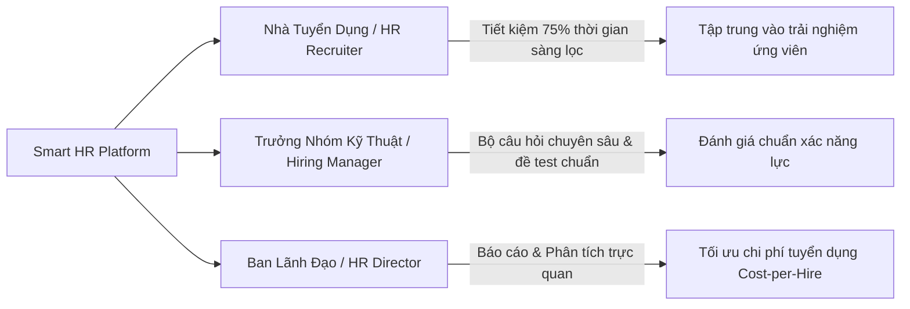

# 🌟 Smart HR & Candidate Screening System - Tổng Quan Dự Án

> **Phiên bản tài liệu**: 1.0.0  
> **Trạng thái**: Hoạt động & Đang phát triển  
> **Tác giả**: Smart HR Engineering & AI Team  

---

## 1. Bối Cảnh & Vấn Đề Thực Tế (Problem Statement)

Quy trình tuyển dụng nhân sự truyền thống, đặc biệt trong ngành công nghệ thông tin (IT) và tri thức, đang đối mặt với những nút thắt nghiêm trọng:
- **Tắc nghẽn đọc duyệt CV thủ công**: Một vị trí tuyển dụng có thể nhận từ 200 - 500 CVs. Nhà tuyển dụng (HR) mất trung bình 3-5 phút cho mỗi CV chỉ để phân loại sơ bộ, dẫn đến quá tải và phản hồi chậm trễ cho ứng viên.
- **Định kiến chủ quan (Unconscious Bias)**: Đánh giá cảm tính dựa trên bố cục CV, tên trường đại học hoặc định kiến cá nhân thay vì năng lực thực tế.
- **Khó khăn trong đánh giá kỹ thuật chuyên sâu**: HR Recruiter không phải chuyên gia kỹ thuật nên khó phân biệt chính xác mức độ phù hợp giữa kỹ năng ứng viên và yêu cầu thực tế trong Mô tả công việc (Job Description - JD).
- **Thiếu câu hỏi phỏng vấn cá nhân hóa**: Đa số người phỏng vấn sử dụng danh sách câu hỏi chung chung, không bám sát điểm mạnh/điểm yếu thực tế của từng ứng viên.

---

## 2. Giải Pháp - Smart HR System

**Smart HR & Candidate Screening System** là nền tảng tự động hóa sàng lọc và đánh giá ứng viên ứng dụng Trí tuệ Nhân tạo thế hệ mới (LLM-based Recruitment Intelligence):
1. **Bóc tách hồ sơ thông minh (Intelligent CV Parsing)**: Tự động trích xuất cấu trúc văn bản từ các định dạng PDF, DOCX, Hình ảnh bằng OCR và LLM (Google Gemini 2.0 Flash / OpenAI GPT-4o-mini).
2. **Khớp nối ngữ nghĩa đa chiều (Semantic Fit Scoring)**: Đánh giá mức độ phù hợp giữa CV và JD trên thang điểm 0–100% dựa trên kỹ năng kỹ thuật, kinh nghiệm chuyên môn, và miền nghiệp vụ (Domain Fit).
3. **Sinh câu hỏi phỏng vấn thích ứng (Adaptive Interview Generation)**: Tự động tạo bộ câu hỏi phỏng vấn kỹ thuật bám sát khoảng cách kỹ năng (skill gaps) của ứng viên, kèm đáp án tham chiếu và thang chấm điểm.
4. **Sinh bài kiểm tra năng lực (Tailored Technical Assessment)**: Tạo thử thách lập trình hoặc câu hỏi tình huống phù hợp với cấp bậc seniority của ứng viên.
5. **Dashboard quản trị tuyển dụng**: Trực quan hóa tiến trình tuyển dụng, tìm kiếm ngữ nghĩa, so sánh ứng viên và quản lý trạng thái hồ sơ.

---

## 3. Đối Tượng Người Dùng & Giá Trị Đem Lại

---

## 4. Cấu Trúc Tài Liệu Kỹ Thuật

Hệ thống tài liệu dự án được tổ chức theo tiêu chuẩn kiến trúc phần mềm chuyên nghiệp:
- [00-overview/](file:///d:/Smart-HR-Candidate-Screening-System/docs/00-overview/): Tổng quan dự án, công nghệ sử dụng, lộ trình phát triển.
- [01-business/](file:///d:/Smart-HR-Candidate-Screening-System/docs/01-business/): Mô hình nghiệp vụ, bài toán kinh tế, thuật ngữ chuyên ngành HR Tech.
- [02-requirements/](file:///d:/Smart-HR-Candidate-Screening-System/docs/02-requirements/): Yêu cầu chức năng, phi chức năng và use cases chi tiết.
- [03-product/](file:///d:/Smart-HR-Candidate-Screening-System/docs/03-product/): Tầm nhìn sản phẩm, chân dung người dùng, hành trình trải nghiệm.
- [04-design/](file:///d:/Smart-HR-Candidate-Screening-System/docs/04-design/): Hướng dẫn thiết kế UI/UX, Design System, Wireframes.
- [05-system-architecture/](file:///d:/Smart-HR-Candidate-Screening-System/docs/05-system-architecture/): Kiến trúc hệ thống NestJS, pipeline AI, thuật toán chấm điểm.
- [06-database/](file:///d:/Smart-HR-Candidate-Screening-System/docs/06-database/): Thiết kế ERD, Schema MongoDB/PostgreSQL, Indexing & Tối ưu.
- [07-api/](file:///d:/Smart-HR-Candidate-Screening-System/docs/07-api/): Đặc tả RESTful API chi tiết cho toàn bộ endpoints.
- [08-security/](file:///d:/Smart-HR-Candidate-Screening-System/docs/08-security/): Kiến trúc bảo mật, an toàn dữ liệu PII và phòng ngừa tấn công LLM.
