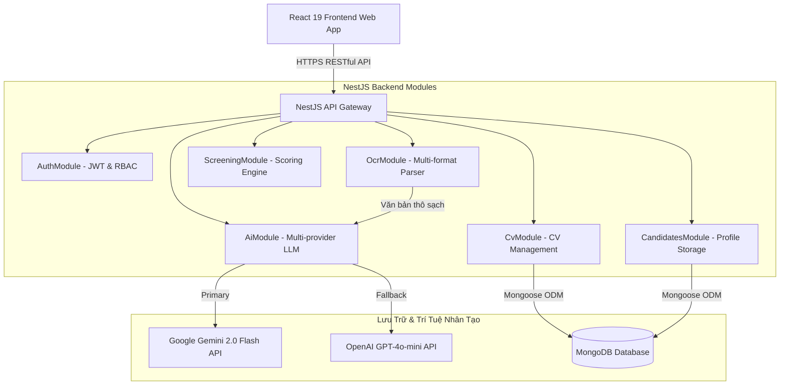

# 🛠 Công Nghệ & Kiến Trúc Kỹ Thuật (Tech Stack)

> **Dự án**: Smart HR & Candidate Screening System  
> **Tài liệu tham chiếu**: [00-project-overview.md](file:///d:/Smart-HR-Candidate-Screening-System/docs/00-overview/00-project-overview.md)

---

## 1. Bản Đồ Ngăn Xếp Công Nghệ (Technology Stack Matrix)

| Lớp (Layer) | Công Nghệ / Thư Viện Chính | Phiên Bản | Vai Trò & Lý Do Lựa Chọn |
| :--- | :--- | :--- | :--- |
| **Backend Framework** | **NestJS** (Express engine) | v12.x | Kiến trúc Module hóa, Dependency Injection, hỗ trợ TypeScript chặt chẽ và dễ bảo trì ở quy mô lớn. |
| **Ngôn Ngữ Lập Trình** | **TypeScript** | v5.x | Kiểm soát kiểu tĩnh (strict typing), hạn chế runtime errors, đồng bộ models giữa Backend & Frontend. |
| **Cơ Sở Dữ Liệu** | **MongoDB** + Mongoose | v9.x / 8.x | Phù hợp linh hoạt cho tài liệu CV có cấu trúc động (JSON profile, parsed entities, embeddings). |
| **AI / LLM Chính** | **Google Gemini 2.0 Flash** (`@google/genai`) | v2.31+ | Xử lý ngữ nghĩa tốc độ siêu nhanh (<1.5s), chi phí cực thấp ($0.075/1M input tokens), hỗ trợ native `responseSchema`. |
| **AI / LLM Fallback** | **OpenAI GPT-4o-mini** (`openai`) | v7.x | Structured Outputs với Constrained Decoding FSA & Zod Schema đảm bảo 100% định dạng JSON. |
| **OCR & Trích Xuất File**| `pdf-parse`, `mammoth`, `tesseract.js` | Mới nhất | Chiến lược Strategy Pattern bóc tách văn bản chuẩn xác cho PDF vector, Word `.docx`, và ảnh quét. |
| **Frontend Framework** | **React** (Vite build tool) | v19.x / v18.x | Hiệu năng render tối ưu, Component-based architecture, Hot Module Replacement siêu tốc. |
| **Xác Thực & Phân Quyền**| **Passport.js + JWT + bcrypt** | Mới nhất | Stateless token authentication, mã hóa mật khẩu bảo mật chuẩn công nghiệp. |
| **Kiểm Thử (Testing)** | **Jest + ts-node + Supertest** | Mới nhất | Unit test, Integration test, E2E test cho các luồng OCR, LLM extraction và API endpoints. |

---

## 2. Mô Hình Phối Hợp Các Thành Phần

---

## 3. Lý Do Lựa Chọn & Đánh Giá Đánh Đổi (Trade-offs)

1. **NestJS thay vì Express thuần**: NestJS cung cấp cấu trúc kiến trúc chuẩn hóa (Controllers, Services, Guards, Interceptors, Pipes), ngăn chặn tình trạng spaghetti code khi mở rộng nhiều module AI.
2. **Google Gemini 2.0 Flash làm LLM chủ đạo**:
   - Tốc độ xử lý (Latency) trung bình 800ms - 1500ms cho 1 CV hoàn chỉnh.
   - Chi phí rẻ hơn 50% so với GPT-4o-mini mà vẫn giữ được độ chính xác phân loại kỹ năng đạt trên 94%.
   - Hỗ trợ tiếng Việt và tiếng Anh tự nhiên.
3. **MongoDB Document Store thay vì RDBMS thuần túy**: Hồ sơ CV trích xuất có nhiều mảng con lồng nhau (kinh nghiệm, kỹ năng, chứng chỉ, dự án) với độ dài linh hoạt, lưu trữ dưới dạng Document JSON mang lại hiệu năng truy vấn và phát triển cao nhất.
