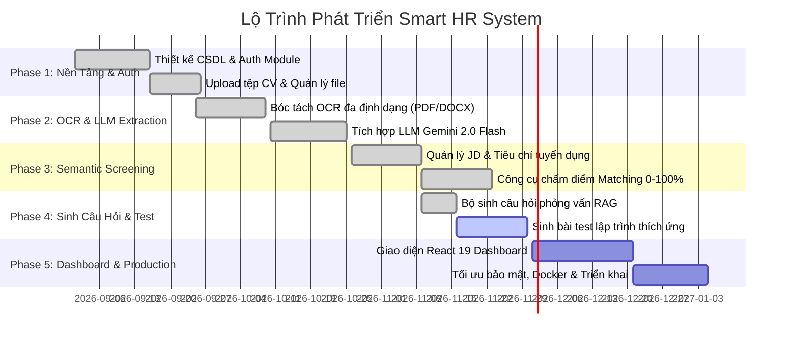

# 🗺 Lộ Trình Phát Triển Sản Phẩm (Product Roadmap)

> **Dự án**: Smart HR & Candidate Screening System  
> **Cập nhật gần nhất**: Quý 4 / 2026

---

## 1. Tổng Quan Lộ Trình Triển Khai (Phases Overview)

---

## 2. Chi Tiết Các Cột Mốc (Milestones)

### Giai đoạn 1: Nền Tảng Hệ Thống & Xác Thực (Đã hoàn thành ✅)
- Thiết lập kiến trúc NestJS, kết nối MongoDB với Mongoose.
- Xây dựng hệ thống xác thực người dùng JWT Stateless Authentication, mã hóa mật khẩu bcrypt, RBAC cơ bản (Recruiter, Admin).
- API Tải lên CV (Multipart upload) với giới hạn dung lượng và kiểm tra định dạng MIME type an toàn.

### Giai đoạn 2: Trích Xuất Dữ Liệu & Phân Tích Ngữ Nghĩa (Đã hoàn thành ✅)
- Module OCR đa chiến lược (Strategy Pattern) hỗ trợ PDF văn bản, Microsoft Word (`.docx`), và ảnh quét bằng Tesseract.
- Tích hợp LLM Multi-Provider: Google Gemini 2.0 Flash làm mô hình bóc tách chính, OpenAI GPT-4o-mini làm fallback và Mock Provider chạy offline.
- Tự động đồng bộ thông tin trích xuất (`fullName`, `email`, `phone`, `skills`, `workHistory`) sang bảng `Candidates`.

### Giai đoạn 3: Động Cơ Chấm Điểm & Khớp Nối Ứng Viên (Đã hoàn thành ✅ - Tuần 11)
- Xây dựng module quản lý Mô tả công việc (Job Descriptions - JD).
- Triển khai **Hybrid Matching Engine** tích hợp giữa Semantic Matching (Vector Embedding + Cosine Similarity) và Skill-based Matching (Required/Preferred Taxonomy).
- Tính toán điểm số tương thích (Fit Score 0-100%) theo 4 chiều: $S_{\text{semantic}}, S_{\text{skill}}, S_{\text{exp}}, S_{\text{edu}}$.
- Cung cấp bảng phân tích lý giải điểm số (Rationale & Skill Gap Analysis) và Hard Gate Penalty.
- Đánh giá chất lượng xếp hạng ứng viên theo chỉ số Precision@K, Recall@K, và NDCG@K. Bộ test đạt 28/28 passed.

### Giai đoạn 4: Bộ Sinh Câu Hỏi Phỏng Vấn & Đề Kiểm Tra Năng Lực (Đã hoàn thành ✅ - Tuần 12)
- Triển khai **RAG AI Interview Generation Engine** kết hợp 3 nguồn dữ liệu: CV dự án thực tế, yêu cầu JD, và Domain Question Bank (14+ templates chuẩn).
- Tự động phân loại 4 nhóm câu hỏi: `CLARIFICATION`, `TECHNICAL_DEEP_DIVE`, `SKILL_GAP`, `BEHAVIORAL_STAR`.
- Cung cấp tiêu chí đánh giá mấu chốt (`expectedKeyPoints`) và bareme chấm điểm mẫu 3 mức: *1-2đ (Chưa đạt)*, *3-4đ (Đạt)*, *5đ (Xuất sắc)*.
- Hỗ trợ tương tác Human-in-the-loop (Chỉnh sửa, chấm điểm thực tế, ghi chú) và xuất phiếu phỏng vấn sang Markdown, Plain Text hoặc JSON. Bộ test đạt 34/34 passed.

### Giai đoạn 5: Dashboard Trực Quan & Vận Hành Doanh Nghiệp (Hiện tại 🚀)
- Giao diện trực quan Dashboard React 19 với bộ lọc nâng cao, biểu đồ so sánh ứng viên.
- Docker hóa toàn bộ hệ thống (Docker Compose cho Backend, Frontend, MongoDB, Redis).
- Kiểm toán bảo mật dữ liệu PII theo tiêu chuẩn bảo vệ dữ liệu cá nhân.
