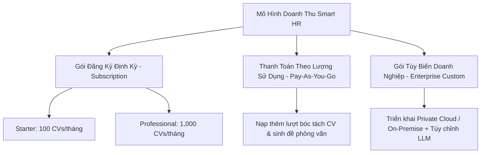

# 💼 Mô Hình Kinh Doanh (Business Model)

> **Dự án**: Smart HR & Candidate Screening System  
> **Lĩnh vực**: HR Tech / Talent Acquisition Automation SaaS  

---

## 1. Khách Hàng Mục Tiêu (Target Customer Segments)

Hệ thống được thiết kế hướng tới mô hình **B2B SaaS (Business-to-Business)**, phục vụ 3 nhóm đối tượng chính:

1. **Doanh Nghiệp Công Nghệ (Tech Companies & Startups)**:
   - Các công ty phát triển phần mềm, startup tăng trưởng nhanh có nhu cầu tuyển dụng nhiều kỹ sư lập trình, DevOps, QA, Data Engineer.
   - Thường xuyên gặp tình trạng quá tải CV và tiêu tốn thời gian phỏng vấn không chất lượng.
2. **Công Ty Dịch Vụ Tuyển Dụng (Headhunting & Staffing Agencies)**:
   - Đơn vị chuyên cung cấp dịch vụ săn đầu người cần tốc độ phân loại ứng viên cực nhanh để gửi hồ sơ cho khách hàng trước đối thủ.
3. **Bộ Phận Nhân Sự Doanh Nghiệp Lớn (Enterprise HR Departments)**:
   - Các tập đoàn với hàng nghìn nhân sự cần giải pháp chuẩn hóa quy trình tuyển dụng, loại bỏ thiên vị và tuân thủ bảo vệ dữ liệu.

---

## 2. Mô Hình Doanh Thu (Revenue Streams)

1. **Gói Starter (Doanh nghiệp nhỏ / Nhóm tuyển dụng đơn lẻ)**:
   - Giới hạn 100 CVs / tháng, phân tích khớp nối cơ bản với JD, 3 tài khoản Recruiter.
2. **Gói Professional (Doanh nghiệp vừa & Công ty Headhunt)**:
   - 1,000 CVs / tháng, bóc tách tốc độ cao với Gemini 2.0 Flash, sinh câu hỏi phỏng vấn tự động không giới hạn, xuất báo cáo PDF.
3. **Gói Enterprise (Tập đoàn lớn)**:
   - Số lượng CV không giới hạn, kết nối API tích hợp trực tiếp vào hệ thống ATS hiện có (Workday, Greenhouse, BambooHR), hỗ trợ Private LLM deployment đảm bảo bí mật dữ liệu.

---

## 3. Cấu Trúc Chi Phí (Cost Structure)

- **Chi phí hạ tầng điện toán đám mây**: Máy chủ NestJS API, cơ sở dữ liệu MongoDB Atlas, MinIO Object Storage lưu trữ file tệp tin.
- **Chi phí Token LLM API**: Google Gemini 2.0 Flash (~$0.075/1M input tokens) và OpenAI GPT-4o-mini dự phòng. Trung bình chi phí AI cho mỗi CV chỉ dao động từ **0.0003 USD - 0.0008 USD**, mang lại biên lợi nhuận gộp > 90%.
- **Chi phí R&D và Vận hành**: Phát triển tính năng mới, kiểm thử an toàn bảo mật, hỗ trợ khách hàng 24/7.
