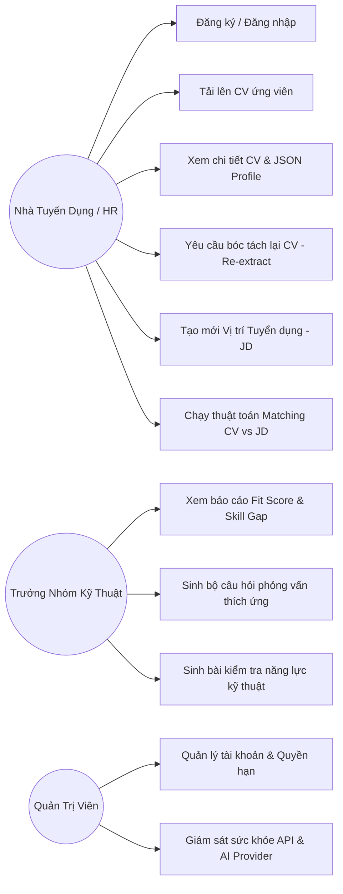

# 🎯 Danh Sách Ca Sử Dụng (Use Cases)

> **Dự án**: Smart HR & Candidate Screening System  

---

## 1. Sơ Đồ Tổng Quan Ca Sử Dụng (Use Case Diagram)

---

## 2. Đặc Tả Chi Tiết Các Ca Sử Dụng Chính

### UC-01: Tải Lên & Bóc Tách CV Tự Động (Upload & Auto-Extract CV)
- **Actor chính**: Nhà tuyển dụng (HR).
- **Tiền điều kiện (Preconditions)**: HR đã đăng nhập thành công vào hệ thống và có JWT hợp lệ.
- **Dữ liệu đầu vào**: Tệp CV (PDF/DOCX/Ảnh) và token xác thực.
- **Luồng sự kiện chính (Main Flow)**:
  1. HR chọn tệp CV từ máy tính và gửi yêu cầu `POST /api/v1/cv/upload`.
  2. Hệ thống kiểm tra dung lượng ($\le 5\text{MB}$) và định dạng MIME Type được phép.
  3. Hệ thống lưu tệp tin an toàn vào thư mục lưu trữ với tên tệp duy nhất (`uniqueSuffix`).
  4. Hệ thống kích hoạt `OcrService` để trích xuất văn bản thô theo đúng định dạng file.
  5. Hệ thống gọi `AiService.extractCvStructuredData()` để bóc tách thông tin cá nhân, kỹ năng, kinh nghiệm.
  6. Hệ thống tự động tạo hoặc liên kết bản ghi trong collection `candidates`.
  7. Hệ thống lưu hồ sơ JSON hoàn chỉnh vào `cvs.parsedData` và trả về kết quả 201 Created.
- **Luồng ngoại lệ (Alternative Flow)**:
  - Nếu tệp không đúng định dạng: Ném mã lỗi 400 Bad Request.
  - Nếu nội dung văn bản quá ngắn (< 30 ký tự): Bỏ qua bước LLM và thông báo cảnh báo file rỗng.

---

### UC-02: Tái Trích Xuất Hồ Sơ Ứng Viên (Re-extract CV Profile)
- **Actor chính**: HR hoặc Hệ thống tự động.
- **Mục đích**: Chạy lại quy trình bóc tách LLM khi cập nhật phiên bản Prompt mới hoặc khi lần tải lên đầu tiên bị gián đoạn mạng.
- **Luồng xử lý**:
  1. HR gửi yêu cầu `POST /api/v1/cv/:id/extract`.
  2. Hệ thống kiểm tra tính hợp lệ của `id` và tìm bản ghi CV trong CSDL.
  3. Hệ thống lấy lại `cleanedText` đã lưu trong `parsedData.ocrMetadata` (nếu không có thì đọc lại tệp gốc trên đĩa cứng).
  4. Hệ thống gửi văn bản tới LLM để phân tích lại cấu trúc JSON.
  5. Cập nhật lại `parsedData.profile` và đồng bộ lại họ tên, tóm tắt sang bảng `candidates`.
  6. Trả về thông tin cập nhật mới nhất kèm mã trạng thái 200 OK.
