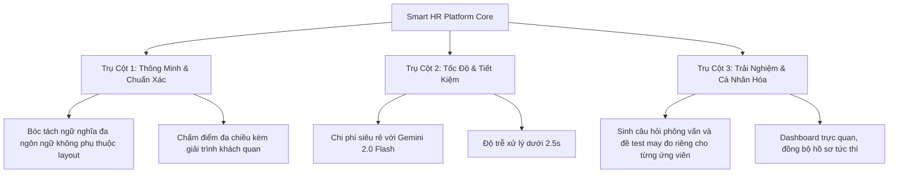

# 🔭 Tầm Nhìn Sản Phẩm (Product Vision)

> **Dự án**: Smart HR & Candidate Screening System  

---

## 1. Tuyên Ngôn Tầm Nhìn (Product Vision Statement)

> **Dành cho** các phòng ban tuyển dụng và các công ty công nghệ đang bị quá tải bởi khối lượng hồ sơ lớn,  
> **Smart HR & Candidate Screening System** là nền tảng tuyển dụng thông minh ứng dụng Trí tuệ Nhân tạo thế hệ mới (Next-Gen AI ATS),  
> **Giúp** tự động hóa quy trình bóc tách CV, chấm điểm tương thích năng lực chuẩn xác và tự động kiến tạo các câu hỏi phỏng vấn kỹ thuật bám sát khoảng cách năng lực của ứng viên.  
> **Không giống như** các hệ thống ATS truyền thống chỉ lọc từ khóa cứng nhắc (Keyword Matching) dễ bỏ sót nhân tài,  
> **Sản phẩm của chúng tôi** sở hữu khả năng đọc hiểu ngữ nghĩa sâu bằng mô hình ngôn ngữ lớn (LLM), đảm bảo tính minh bạch, khách quan và cắt giảm tới **75% thời gian tuyển dụng**.

---

## 2. Các Trụ Cột Chiến Lược (Strategic Pillars)

---

## 3. Các Chỉ Số Thành Công Chính (North Star Metrics & KPIs)

1. **Thời gian sàng lọc hồ sơ (Time-to-Screen)**: Giảm từ mức trung bình 4 ngày xuống còn dưới 30 phút.
2. **Độ chính xác bóc tách (Parsing Accuracy Rate)**: Tỷ lệ trích xuất đúng thực thể kỹ thuật và thông tin cá nhân đạt trên 95%.
3. **Mức độ hài lòng của Hiring Manager (Tech Lead CSAT)**: Đạt trên 4.5/5 đối với chất lượng các câu hỏi phỏng vấn được AI gợi ý.
4. **Tỷ lệ giữ chân người dùng (Retention Rate)**: Trên 85% người tuyển dụng quay lại sử dụng hệ thống hàng tuần.
