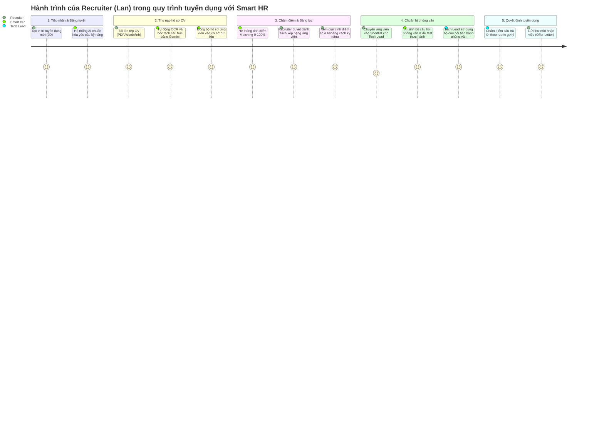

# 🗺 Bản Đồ Hành Trình Người Dùng (User Journey Map)

> **Dự án**: Smart HR & Candidate Screening System  

---

---

## Các Điểm Chạm Chính (Key Touchpoints)

1. **Dashboard Tổng Quan**: Nơi hiển thị các đợt tuyển dụng đang mở, số lượng CV đã nhận, phân bổ điểm số ứng viên.
2. **Khu Vực Tải Lên CV (Drag & Drop Uploader)**: Giao diện kéo thả tệp tin nhanh, hiển thị thanh tiến trình xử lý OCR và LLM Extraction theo thời gian thực.
3. **Màn Hình Chi Tiết Ứng Viên (Candidate Profile View)**:
   - Cột trái: Tệp CV gốc kèm khung xem trực tuyến PDF.
   - Cột phải: Dữ liệu JSON chuẩn hóa (Kinh nghiệm, Kỹ năng, Học vấn, Dự án tiêu biểu).
   - Nút hành động: "Tái bóc tách" (Re-extract), "Đánh giá với JD", "Tạo bộ câu hỏi phỏng vấn".
4. **Bảng Phân Tích Khớp Nối (Match Matrix View)**: So sánh trực quan dạng radar chart giữa yêu cầu của JD và năng lực thực tế của ứng viên.
