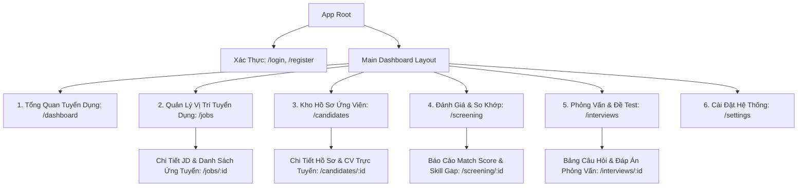

# 📐 Cấu Trúc Thông Tin & Khung Wireframe (Information Architecture & Wireframes)

> **Dự án**: Smart HR & Candidate Screening System  

---

## 1. Sơ Đồ Kiến Trúc Thông Tin (Site Map / Information Architecture)



---

## 2. Mô Tả Bố Cục Khung Dây (Wireframe Layout Specifications)

### A. Màn Hình Dashboard Tuyển Dụng (`/dashboard`)
```text
+-----------------------------------------------------------------------------------+
|  [Logo] Smart HR             [Search Candidate/Job...]          (User Profile) v  |
+-----------------------------------------------------------------------------------+
|  [Sidebar]    |  📊 THỐNG KÊ TUYỂN DỤNG HÔM NAY                                   |
|  - Dashboard  |  +--------------+ +--------------+ +---------------+ +-----------+|
|  - Jobs       |  | 142 CVs Nhận | | 18 CV Khớp Cao| | 5 Phỏng Vấn   | | 89% AI CSAT||
|  - Candidates |  +--------------+ +--------------+ +---------------+ +-----------+|
|  - Screening  |                                                                   |
|  - Interviews |  🚀 TẢI LÊN CV MỚI (Kéo thả PDF / Word vào đây)                    |
|  - Settings   |  +---------------------------------------------------------------+|
|               |  |     [ 📁 Kéo thả file CVs vào đây hoặc Bấm để duyệt file ]    ||
|               |  |     Hỗ trợ định dạng: .pdf, .docx, .png (Tối đa 5MB)          ||
|               |  +---------------------------------------------------------------+|
|               |                                                                   |
|               |  ⭐ TOP ỨNG VIÊN PHÙ HỢP GẦN ĐÂY (SORT BY FIT SCORE)              |
|               |  +---------------------------------------------------------------+|
|               |  | Họ tên          | Vị trí        | Điểm Fit | Kỹ năng chính    ||
|               |  |-----------------+---------------+----------+------------------||
|               |  | Nguyễn Văn An   | Sr Backend    |   94%    | NestJS, MongoDB  ||
|               |  | Sarah Jenkins   | Full Stack    |   88%    | React, TypeScript||
|               |  +---------------------------------------------------------------+|
+-----------------------------------------------------------------------------------+
```

### B. Màn Hình Chi Tiết Hồ Sơ & So Khớp CV (`/candidates/:id`)
```text
+-----------------------------------------------------------------------------------+
|  < Quay lại danh sách       ỨNG VIÊN: NGUYỄN VĂN AN           [Re-extract AI] v   |
+-----------------------------------------------------------------------------------+
|  [BÊN TRÁI: CV GỐC (PDF STREAM)]       |  [BÊN PHẢI: THÔNG TIN BÓC TÁCH LLM]      |
|                                        |                                          |
|  +----------------------------------+  |  👤 THÔNG TIN CÁ NHÂN                    |
|  | NGUYỄN VĂN AN                    |  |  Email: an.nguyen@techcorp.vn            |
|  | Senior Backend Engineer          |  |  SĐT: 0912345678  | Hà Nội, VN           |
|  | Kinh nghiệm:                     |  |                                          |
|  | - FPT Software (2022 - Nay)      |  |  🎯 ĐIỂM MATCH VỚI VỊ TRÍ SENIOR BACKEND |
|  |   Xây dựng microservices NestJS  |  |  [==== 94% ====] Rất phù hợp             |
|  | - VNG (2020 - 2022)              |  |                                          |
|  |                                  |  |  ⚡ KỸ NĂNG NỔI BẬT                      |
|  | Học vấn:                         |  |  [TypeScript] [NestJS] [MongoDB] [Docker]|
|  | - ĐH Bách Khoa Hà Nội (3.5/4)    |  |                                          |
|  |                                  |  |  💼 LỊCH SỬ CÔNG TÁC (2 Công ty)         |
|  |                                  |  |  - FPT Software (24 tháng) - Sr Backend  |
|  |                                  |  |  - VNG Corp (20 tháng) - Jr Developer    |
|  +----------------------------------+  |                                          |
|                                        |  [ Tạo Câu Hỏi Phỏng Vấn ] [ Đề Test ]   |
+-----------------------------------------------------------------------------------+
```
