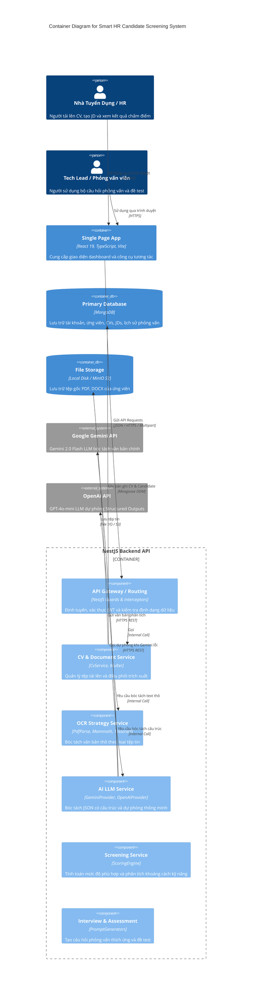

# 🏗 Kiến Trúc Hệ Thống Tổng Thể (High-Level Architecture)

> **Dự án**: Smart HR & Candidate Screening System  
> **Kiểu kiến trúc**: Modular Monolith hướng Service & Clean Architecture (NestJS)

---

## 1. Sơ Đồ Khối C4 - Container Level Diagram

---

## 2. Nguyên Tắc Thiết Kế (Architectural Principles)

1. **Phân Tách Trách Nhiệm (Separation of Concerns)**:
   - Module `OcrModule` chỉ chuyên trách trích xuất văn bản thô và siêu dữ liệu kỹ thuật của tệp.
   - Module `AiModule` chuyên trách giao tiếp với các nhà cung cấp LLM, ép kiểu schema và dự phòng lỗi.
   - Module `CvModule` điều phối quy trình tải lên, liên kết dữ liệu giữa CSDL và tệp tin.
2. **Strategy Pattern trong Xử Lý Tệp**: Tự động áp dụng chiến lược phù hợp (`PdfExtractorStrategy`, `DocxExtractorStrategy`, `ImageOcrStrategy`) dựa vào định dạng MIME type của tệp tin.
3. **Mô Hình Đa Nhà Cung Cấp LLM (Multi-Provider with Graceful Fallback)**:
   - Thứ tự ưu tiên: Google Gemini 2.0 Flash $\rightarrow$ OpenAI GPT-4o-mini $\rightarrow$ Mock Local Provider.
   - Tránh hiện tượng Single Point of Failure (SPOF) khi dịch vụ của một nhà cung cấp gặp trục trặc mạng hoặc vượt hạn ngạch.
