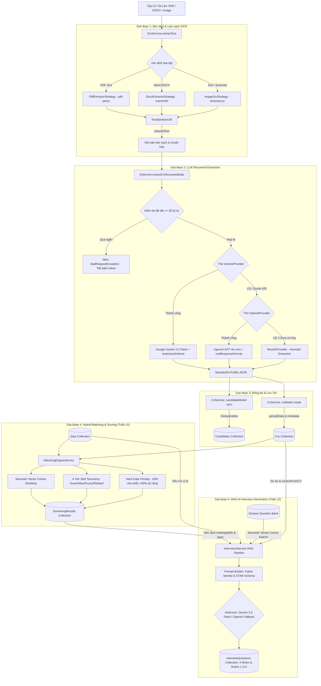

# 🤖 Kiến Trúc Đường Ống Xử Lý AI (AI Pipeline Architecture)

> **Dự án**: Smart HR & Candidate Screening System  
> **Tài liệu chi tiết**: [LLM_CV_EXTRACTION_PLAN.md](file:///d:/Smart-HR-Candidate-Screening-System/docs/LLM_CV_EXTRACTION_PLAN.md)

---

## 1. Luồng Xử Lý Tuần Tự (End-to-End Pipeline)

---

## 2. Cơ Chế Ép Chuẩn Cấu Trúc (Schema Enforcement Mechanism)

Để đảm bảo kết quả trích xuất luôn trả về đúng 100% đối tượng JavaScript hợp lệ và không bị vỡ định dạng:

1. **Google Gemini**:
   - Sử dụng tham số `responseMimeType: 'application/json'`.
   - Cung cấp `responseSchema: CV_EXTRACTION_GEMINI_SCHEMA` trong cấu hình gọi API `@google/genai`. Mô hình được ràng buộc trực tiếp ở mức token sampling để chỉ sinh các token thuộc schema.
2. **OpenAI Structured Outputs**:
   - Sử dụng helper `zodResponseFormat(CandidateProfileZodSchema, 'candidate_cv_profile')`.
   - Kích hoạt chế độ kiểm soát chặt chẽ với cơ chế Finite State Automaton (FSA), triệt tiêu hoàn toàn hallucinated keys.
3. **Mock Heuristic Provider**:
   - Sử dụng Regular Expression thông minh để bóc tách email, số điện thoại Việt Nam (+84, 0x), tên ứng viên và nhận diện các từ khóa kỹ thuật phổ biến (Node.js, NestJS, TypeScript, React, Docker, AWS), trả về đúng cấu trúc `StandardCvProfile` ngay cả khi hoàn toàn mất kết nối internet.
