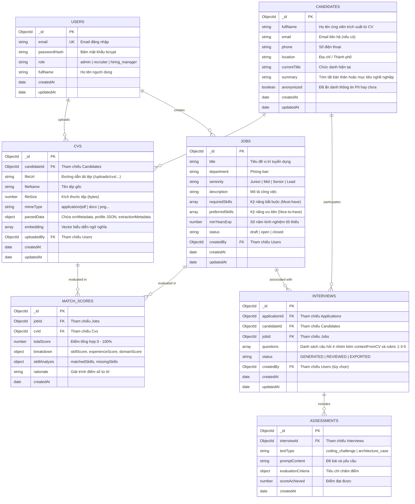

# 🗄 Mô Hình Dữ Liệu & ERD (Data Models & ERD)

> **Dự án**: Smart HR & Candidate Screening System  
> **Cơ sở dữ liệu**: MongoDB (Mongoose ODM)  
> **Tài liệu tham chiếu**: [ERD.md](file:///d:/Smart-HR-Candidate-Screening-System/docs/ERD.md)

---

## 1. Sơ Đồ Quan Hệ Thực Thể (Entity Relationship Diagram - ERD)

