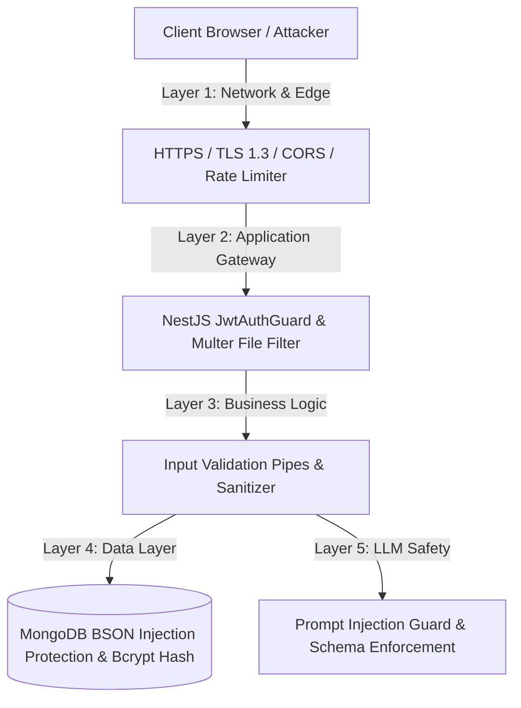

# 🛡 Kiến Trúc Bảo Mật (Security Architecture)

> **Dự án**: Smart HR & Candidate Screening System  
> **Nguyên tắc**: Phòng thủ theo chiều sâu (Defense-in-Depth)

---

## 1. Mô Hình Lớp Bảo Vệ (Multi-Layer Security Model)

---

## 2. Các Cơ Chế Bảo Vệ Trọng Yếu

1. **Kiểm Soát Tệp Tải Lên (Malicious File Upload Prevention)**:
   - Sử dụng Multer `fileFilter` kiểm tra chặt chẽ MIME Type (`application/pdf`, `docx`, `png`, `jpeg`).
   - Đặt giới hạn kích thước tối đa 5MB (`fileSize: 5 * 1024 * 1024`) để chống tấn công từ chối dịch vụ (DoS tốn bộ nhớ).
   - Đổi tên tệp ngẫu nhiên theo timestamp và số ngẫu nhiên cryptographically secure (`${Date.now()}-${Math.round(Math.random() * 1e9)}${ext}`), lưu tệp ngoài thư mục thực thi mã để ngăn chặn mã độc thực thi từ xa (RCE).
2. **Xác Thực & Quản Lý Phiên (Authentication & Session)**:
   - Mã băm mật khẩu `bcrypt` một chiều không thể dịch ngược.
   - Access Token JWT có thời hạn ngắn, ký bằng khóa bí mật `JWT_SECRET` được bảo vệ độc quyền trên server.
3. **Phòng Chống Tấn Công Injection**:
   - Mongoose ODM tự động escape và kiểm tra kiểu ObjectId, triệt tiêu nguy cơ NoSQL Injection.
   - Thư viện `TextSanitizerUtil` lọc bỏ các ký tự điều khiển Unicode ẩn, chống tràn bộ nhớ đệm Buffer.
