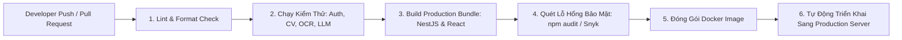

# 🔄 Đường Ống Tích Hợp & Triển Khai Tự Động (CI/CD Pipeline)

> **Dự án**: Smart HR & Candidate Screening System  
> **Nền tảng**: GitHub Actions  

---

## 1. Sơ Đồ Quy Trình Tự Động Hóa (CI/CD Workflow)



---

## 2. Kịch Bản GitHub Actions (`.github/workflows/ci.yml`)

```yaml
name: Smart HR CI/CD Pipeline

on:
  push:
    branches: [main, develop]
  pull_request:
    branches: [main]

jobs:
  backend-test-and-build:
    name: Backend CI (NestJS)
    runs-on: ubuntu-latest

    services:
      mongodb:
        image: mongo:7.0
        ports:
          - 27017:27017

    steps:
      - name: Checkout Mã Nguồn
        uses: actions/checkout@v4

      - name: Cài Đặt Node.js 20
        uses: actions/setup-node@v4
        with:
          node-version: 20
          cache: 'npm'
          cache-dependency-path: backend/package-lock.json

      - name: Cài Đặt Phụ Thuộc
        working-directory: ./backend
        run: npm ci

      - name: Kiểm Tra Cú Pháp & Linter
        working-directory: ./backend
        run: npm run lint

      - name: Chạy Bộ Kiểm Thử Tự Động (Unit & Integration)
        working-directory: ./backend
        run: |
          npm run test:auth
          npm run test:cv
          npm run test:ocr
          npm run test:llm-extract
        env:
          MONGO_URI: mongodb://localhost:27017/SMART-HR-TEST
          JWT_SECRET: test_jwt_secret_key_12345

      - name: Biên Dịch Dự Án (Build Production)
        working-directory: ./backend
        run: npm run build
```
