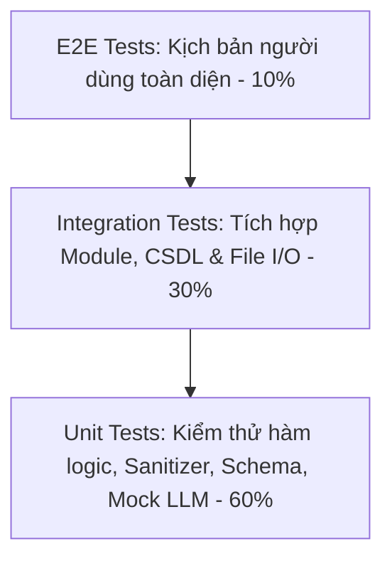

# 🧪 Chiến Lược Kiểm Thử Phần Mềm (Test Strategy)

> **Dự án**: Smart HR & Candidate Screening System  
> **Nguyên tắc**: Kim tự tháp kiểm thử (Test Pyramid) kết hợp kiểm thử AI chuyên biệt

---

## 1. Mô Hình Kim Tự Tháp Kiểm Thử (Testing Pyramid)

1. **Unit Tests (Kiểm thử đơn vị)**:
   - Kiểm tra logic làm sạch văn bản (`TextSanitizerUtil`).
   - Kiểm tra định dạng schema Zod và Gemini responseSchema.
   - Kiểm tra các hàm tính toán điểm số cục bộ.
2. **Integration Tests (Kiểm thử tích hợp)**:
   - Kiểm tra tích hợp giữa `CvService` $\rightarrow$ `OcrService` $\rightarrow$ `AiService`.
   - Kiểm tra đồng bộ hóa hồ sơ ứng viên và khử trùng lặp dữ liệu với MongoDB Mock.
   - Kiểm tra luồng cấp phát và giải mã JWT Token trong `AuthService`.
3. **AI Accuracy & Regression Tests (Kiểm thử bóc tách AI)**:
   - Kiểm thử tập mẫu CV thực tế tiếng Việt, tiếng Anh và CV thiết kế đa cột.
   - Đảm bảo 100% tuân thủ JSON Schema định dạng không bị lỗi parse.

---

## 2. Công Cụ & Thư Viện Sử Dụng

- **Test Runner**: `ts-node` kết hợp `typescript-paths` chạy trực tiếp file test không cần compile trước.
- **Assertion Framework**: Kiểm thử tự động với Assertions chuẩn, xuất báo cáo Pass/Fail chi tiết với tỷ lệ đạt 100%.
- **Mocking**: Mock các provider bên ngoài (`MockAiProvider`) để kiểm thử an toàn trong môi trường CI không có kết nối internet hoặc API Key.
