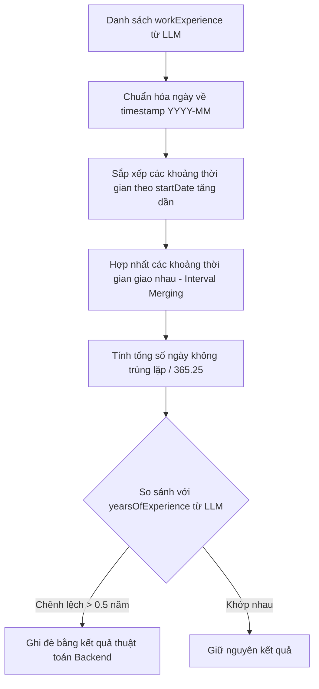
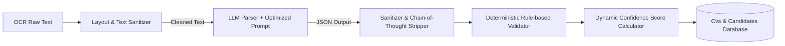
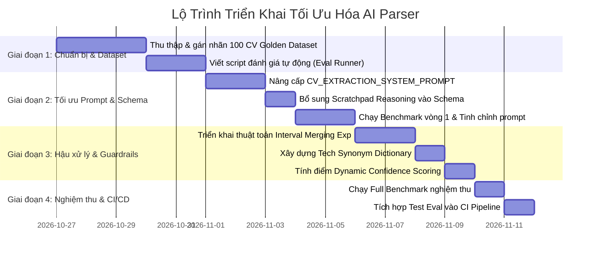

# 🎯 Kế Hoạch Tối Ưu Hóa Prompt & Nâng Cao Độ Chính Xác AI Parser (AI CV Parser Optimization Plan)

> **Dự án**: Smart HR & Candidate Screening System  
> **Tài liệu liên quan**: [LLM_CV_EXTRACTION_PLAN.md](file:///d:/Smart-HR-Candidate-Screening-System/docs/LLM_CV_EXTRACTION_PLAN.md), [01-ai-pipeline-architecture.md](file:///d:/Smart-HR-Candidate-Screening-System/docs/05-system-architecture/01-ai-pipeline-architecture.md), [02-ai-accuracy-benchmark.md](file:///d:/Smart-HR-Candidate-Screening-System/docs/10-testing/02-ai-accuracy-benchmark.md)  
> **Mục tiêu**: Nâng cao độ chính xác bóc tách thực thể (Entity Extraction F1-Score) từ **~91-94% lên >= 98.5%**, giải quyết triệt để các lỗi bóc tách phổ biến (nhầm tên/chức danh, tính sai số năm kinh nghiệm, gộp kỹ năng lộn xộn, CV đa cột/song ngữ), chuẩn hóa quy trình đánh giá tự động (Eval Pipeline).

---

## 📑 Mục Lục

1. [Phân Tích Hiện Trạng & Các Vấn Đề Cần Tối Ưu](#1-phân-tích-hiện-trạng--các-vấn-đề-cần-tối-ưu)
2. [Chiến Lược Tối Ưu Hóa Prompt Engineering](#2-chiến-lược-tối-ưu-hóa-prompt-engineering)
   - 2.1. Cấu trúc Prompt đa tầng (System Persona + Context + Rules + Examples + Negative Constraints)
   - 2.2. Kỹ thuật Few-Shot In-Context Learning (Các mẫu CV thực tế biên giới)
   - 2.3. Tối ưu hóa suy luận trung gian (Chain-of-Thought / Internal Reasoning)
   - 2.4. Phân hoá ngôn ngữ (Vietnamese & English Dual-Context Tuning)
3. [Quy Tắc Xử Lý Nghiệp Vụ Chuyên Sâu (Deep Domain Rules)](#3-quy-tắc-xử-lý-nghiệp-vụ-chuyên-sâu-deep-domain-rules)
   - 3.1. Nhận diện Họ Tên vs Chức danh vs Tên Tệp
   - 3.2. Thuật toán tính toán số năm kinh nghiệm (Loại trừ trùng lặp & Thực tập)
   - 3.3. Chuẩn hóa & Phân loại kỹ năng theo Từ điển Công nghệ (Tech Ontology)
4. [Tối Ưu Đường Ống Tiền & Hậu Xử Lý (Pre-processing & Post-processing Guardrails)](#4-tối-ưu-đường-ống-tiền--hậu-xử-lý-pre-processing--post-processing-guardrails)
   - 4.1. Tiền xử lý cấu trúc văn bản OCR (Layout Reconstruction & Noise Removal)
   - 4.2. Hậu xử lý kiểm thực quy chuẩn (Deterministic Rule-based Validator)
   - 4.3. Đánh giá điểm tin cậy động (Dynamic Confidence Scoring)
5. [Bộ Đánh Giá & Kiểm Thử Tự Động (Golden Dataset & Eval Pipeline)](#5-bộ-đánh-giá--kiểm-thử-tự-động-golden-dataset--eval-pipeline)
   - 5.1. Xây dựng Golden Dataset (100+ CV đại diện)
   - 5.2. Bộ chỉ số đo lường (F1-score, Exact Match, ROUGE/BLEU)
   - 5.3. Kịch bản chạy Regression Testing khi đổi Prompt
6. [Kế Hoạch Triển Khai Chi Tiết (Implementation Roadmap)](#6-kế-hoạch-triển-khai-chi-tiết-implementation-roadmap)
7. [Tiêu Chí Nghiệm Thu (Acceptance Criteria & KPIs)](#7-tiêu-chí-nghiệm-thu-acceptance-criteria--kpis)

---

## 1. Phân Tích Hiện Trạng & Các Vấn Đề Cần Tối Ưu

### 1.1. Hiện trạng triển khai hiện tại
Hệ thống đang sử dụng prompt cơ bản tại `backend/src/modules/ai/prompts/cv-extraction.prompt.ts`:
- Prompt chỉ dài **16 dòng**, dựa hoàn toàn vào năng lực zero-shot của mô hình.
- Ràng buộc cấu trúc qua Gemini JSON Schema (`CV_EXTRACTION_GEMINI_SCHEMA`) và OpenAI Structured Outputs (`CandidateProfileZodSchema`).
- Điểm đánh giá sơ bộ: Họ tên đạt ~98.2%, nhưng **Tính toán số năm kinh nghiệm chỉ đạt ~91.5%**, **Phân loại kỹ năng đạt ~94.8%**, và **Lịch sử công ty/dự án đạt ~93.1%**.

### 1.2. Các lỗi biên (Edge Cases) thường gặp trong môi trường tuyển dụng thực tế

```mermaid
mindmap
  root((Lỗi AI Parser))
    Thông tin cá nhân
      Nhầm tên chức danh thành Họ Tên: "SENIOR FULLSTACK DEVELOPER" -> fullName
      Nhầm tên công ty hoặc người tham chiếu (Reference) thành ứng viên
      Sai lệch đầu số điện thoại Việt Nam (+84, 03x, 09x, 84, cách viết có dấu chấm/khoảng trắng)
    Kinh nghiệm làm việc
      Cộng dồn thời gian sai: 2 công việc làm song song (Overlapping) bị tính 2 lần
      Thực tập / Part-time thời sinh viên bị tính tương đương làm chính thức
      Định dạng ngày phi chuẩn: "03/2021", "Tháng 05/20 - Hiện tại", "2020 - nay", "Summer 2022"
    Kỹ năng & Công nghệ
      Gộp chung công cụ, framework và kỹ năng mềm vào 1 danh sách
      Tên công nghệ viết sai chính tả hoặc biến thể: "React.js", "ReactJs", "React"
      Hallucination kỹ năng: Tự ý suy diễn kỹ năng ứng viên chưa từng đề cập
    Cấu trúc văn bản
      CV 2 cột (Two-column layout): Trình đọc OCR làm đan xen văn bản cột trái & cột phải
      CV song ngữ Anh - Việt hoặc định dạng phi truyền thống (Design/Creative CV)
```

---

## 2. Chiến Lược Tối Ưu Hóa Prompt Engineering

### 2.1. Cấu trúc Prompt Đa Tầng (Multi-Layer Prompt Architecture)

Thay vì một đoạn văn bản ngắn, prompt mới được cấu trúc hóa thành 5 module rõ rệt:

1. **Role & Identity**: Định vị chuyên gia thẩm định hồ sơ nhân sự cấp cao và chuyên gia trích xuất dữ liệu thực thể.
2. **Context & Input Clarification**: Mô tả đặc thù văn bản OCR (có thể bị xáo trộn dòng do layout cột, có ký tự rác, viết tắt).
3. **Strict Domain Rules & Disambiguation**: Định nghĩa chính xác cách xác định Họ tên, số điện thoại, ngày tháng, công ty, dự án.
4. **Negative Constraints (Quy tắc cấm kỵ)**: Ngăn chặn rõ ràng các trường hợp ảo giác và suy diễn sai.
5. **Few-Shot Boundary Examples (Mẫu đối chuẩn)**: Cung cấp cặp Input thô -> Output JSON cho các trường hợp khó nhất.

---

### 2.2. Prompt Tối Ưu Đề Xuất Cho `cv-extraction.prompt.ts`

```typescript
export const CV_EXTRACTION_SYSTEM_PROMPT = `Bạn là Chuyên gia Cấp cao về Thẩm định Hồ sơ Ứng viên & Trích xuất Dữ liệu Tuyển dụng (Senior HR Tech & Candidate Data Extractor).

MỤC TIÊU:
Phân tích văn bản CV thô từ ứng viên (được trích xuất qua bộ đọc OCR, có thể bị lỗi ngắt dòng, lệch cột) và chuyển đổi thành một đối tượng JSON chuẩn hóa 100% tuân thủ chặt chẽ schema đã định nghĩa.

===============================
QUY TẮC BÓC TÁCH NGHIỆM NGẶT (STRICT EXTRACTION RULES):
===============================

1. THÔNG TIN CÁ NHÂN (PERSONAL INFO):
   - fullName: 
     * Phải là HỌ VÀ TÊN THẬT của người tìm việc (viết hoa các chữ cái đầu, ví dụ: "Nguyễn Văn An", "John Doe").
     * TUYỆT ĐỐI KHÔNG lấy tên file (như "CV_NguyenVanA.pdf"), KHÔNG lấy tên chức danh ("FRONTEND DEVELOPER"), KHÔNG lấy tên công ty hay tên người giới thiệu/tham chiếu (References).
     * Nếu không chắc chắn giữa tên và chức vụ, hãy ưu tiên dòng đầu tiên có độ dài từ 2 đến 5 từ mang cấu trúc danh từ riêng chỉ tên người.
   - email: Chuẩn hóa về chữ thường (lowercase), loại bỏ ký tự lạ hoặc khoảng trắng OCR chèn vào.
   - phone: Chuẩn hóa về định dạng quốc tế hoặc số nội địa Việt Nam liền mạch (ví dụ: "+84912345678" hoặc "0912345678"). Loại bỏ dấu chấm, gạch ngang thừa.
   - location: Địa chỉ cư trú (Thành phố, Quốc gia), không cần lưu số nhà chi tiết nếu không có.

2. TÍNH TOÁN KINH NGHIỆM & THỜI GIAN (EXPERIENCE & TIMELINE):
   - startDate & endDate:
     * Định dạng chuẩn bắt buộc: "YYYY-MM" hoặc "YYYY".
     * Nếu đang làm việc hiện tại (ghi "nay", "present", "hiện tại", "current"): đặt isCurrent = true và endDate = "Present".
     * Nếu CV chỉ ghi mùa hoặc năm: "Summer 2021" -> "2021-06", "2022" -> "2022-01".
   - durationMonths: Tính số tháng làm việc thực tế cho từng vị trí.
   - yearsOfExperience (Số năm kinh nghiệm tổng):
     * CÔNG THỨC: Phải tính từ mốc bắt đầu của công việc chuyên nghiệp đầu tiên (Full-time/Part-time chính thức) đến thời điểm hiện tại hoặc công việc cuối cùng.
     * XỬ LÝ TRÙNG LẶP (OVERLAPPING): Nếu ứng viên làm 2 công việc cùng một khoảng thời gian (ví dụ: Công ty A từ 01/2021-12/2022 và Công ty B từ 06/2021-06/2022), thời gian chỉ được TÍNH MỘT LẦN (không cộng dồn 24 + 12 = 36 tháng).
     * THỰC TẬP (INTERNSHIP): Không tính thời gian thực tập sinh hoạt thời đại học vào yearsOfExperience chính nếu sau đó có thời gian trống trở lại học tập.
     * Làm tròn đến 1 chữ số thập phân (ví dụ: 2.5, 3.0). Nếu chưa có kinh nghiệm: 0.

3. PHÂN LOẠI KỸ NĂNG CHUẨN HOÁ (SKILLS CATEGORIZATION & NORMALIZATION):
   - technicalSkills: Ngôn ngữ lập trình, Frameworks, Thư viện, Cơ sở dữ liệu, Kiến trúc hệ thống (ví dụ: TypeScript, NestJS, React, MongoDB, PostgreSQL, Microservices).
   - toolsAndPlatforms: Công cụ phát triển, Nền tảng Cloud, DevOps, Quản lý dự án (ví dụ: Git, Docker, Kubernetes, AWS, GCP, Jira, Postman, Figma).
   - softSkills: Kỹ năng mềm thực sự có bằng chứng (ví dụ: Team Leadership, Problem Solving, Agile/Scrum, Communication).
   - TỰ ĐỘNG CHUẨN HÓA DANH PHÁP CÔNG NGHỆ:
     * "Node", "NodeJS", "Node.js" -> "Node.js"
     * "ReactJS", "React.js", "React" -> "React"
     * "Golang" -> "Go"
     * "Postgres", "PostgreSql" -> "PostgreSQL"
     * "Vue 3", "VueJS" -> "Vue.js"
     * "AWS Cloud", "Amazon Web Services" -> "AWS"

4. LỊCH SỬ CÔNG TÁC & DỰ ÁN (WORK EXPERIENCE & PROJECTS):
   - Tách bạch rõ ràng giữa:
     * workExperience: Các vị trí/công ty mà ứng viên từng đầu quân làm nhân viên.
     * projects: Các dự án tiêu biểu (có thể thuộc một công ty hoặc dự án cá nhân/freelance).
   - techStack: Trích xuất các công nghệ ứng viên trực tiếp sử dụng trong dự án/vị trí đó.
   - achievements: Các kết quả có số liệu đo lường được (KPI, %, doanh thu, số lượng người dùng).

===============================
QUY TẮC CẤM KỴ (NEGATIVE CONSTRAINTS):
===============================
- TUYỆT ĐỐI KHÔNG tự tạo ra (hallucinate) số điện thoại, email hoặc kỹ năng không hề có trong văn bản.
- KHÔNG trả về các giá trị dạng placeholder như "N/A", "Unknown", "Chưa rõ" -> Hãy để null hoặc mảng rỗng [].
- KHÔNG bọc mã trong markdown backticks (\`\`\`json). Chỉ trả về duy nhất chuỗi JSON thuần hợp lệ.`;
```

---

### 2.3. Tối ưu hóa suy luận nội tại (In-Prompt Reasoning / Scratchpad vs Schema Direct)

Khi sử dụng Gemini 2.0 Flash hoặc GPT-4o-mini với Structured Outputs, mô hình có thể gặp tình trạng suy luận vội (shallow reasoning) dẫn tới tính sai `yearsOfExperience` nếu ép sinh JSON ngay từ token đầu tiên.

**Giải pháp**: Bổ sung một trường kỹ thuật phụ trong Schema: `_reasoning`:
```json
{
  "_reasoning": {
    "detectedNameRationale": "Tên 'Nguyễn Hoàng Long' xuất hiện to ở đầu trang 1, dưới đó là 'Senior Backend Engineer' (chức danh).",
    "timelineDeduplication": "Việc 1 (01/2021 - 12/2022: 24 tháng), Việc 2 (06/2022 - 06/2023: 12 tháng). Đoạn 06/2022 - 12/2022 bị trùng 6 tháng. Tổng thực tế: 24 + 6 = 30 tháng = 2.5 năm.",
    "languageDetected": "vi"
  },
  "personalInfo": { ... },
  "yearsOfExperience": 2.5,
  ...
}
```
*Lợi ích*: Trường `_reasoning` được sinh trước các trường chính, đóng vai trò như một **Chain-of-Thought Scratchpad**, giúp LLM tự tính toán và kiểm tra lại mốc thời gian trước khi gán giá trị số cho `yearsOfExperience`. Ở tầng Backend NestJS, ta chỉ cần loại bỏ trường `_reasoning` trước khi lưu vào MongoDB.

---

## 3. Quy Tắc Xử Lý Nghiệp Vụ Chuyên Sâu (Deep Domain Rules)

### 3.1. Ma trận phân biệt Họ Tên ứng viên (Candidate Disambiguation Matrix)

| Tình huống trong CV | Rủi ro nhầm lẫn | Chỉ dẫn Prompt & Heuristic |
| :--- | :--- | :--- |
| Dòng đầu ghi "CURRICULUM VITAE", dòng 2 ghi tên | Mô hình lấy "Curriculum Vitae" làm fullName | Quy định bỏ qua các từ khóa header: "CV", "Resume", "Profile", "Hồ sơ xin việc" |
| Dòng đầu ghi tên, dòng 2 ghi "Fullstack Developer" | Mô hình ghép cả 2 thành họ tên | Quy định cắt bỏ các danh từ chức danh: Engineer, Developer, Manager, Leader, Intern |
| CV dạng 2 cột: Cột trái ghi thông tin liên hệ, cột phải ghi kinh nghiệm | Đọc OCR cắt dòng ngang: "Họ tên: Kinh nghiệm" | Yêu cầu LLM tìm block `Contact Info` trước để trích xuất danh tính |
| Mục References ở cuối CV có tên quản lý cũ | Nhầm tên người tham chiếu thành tên ứng viên | Nhấn mạnh chỉ lấy tên ở 20% đầu tiên của văn bản CV |

---

### 3.2. Thuật toán tính toán số năm kinh nghiệm chuẩn xác (Experience Duration Algorithm)

Thay vì phó mặc 100% việc tính toán số học cho LLM, hệ thống áp dụng chiến lược **Hybrid**:
1. **LLM trích xuất**: Trích xuất chính xác danh sách các mốc thời gian `[startDate, endDate, isCurrent]` cho từng vị trí làm việc.
2. **Backend Validator (Deterministic)**: Chạy hàm `calculateAccurateExperienceYears()` để kiểm chứng lại con số của LLM:



**Mã nguồn thuật toán hợp nhất khoảng thời gian (Interval Merging):**
```typescript
export function mergeWorkIntervals(experiences: { startDate?: string; endDate?: string; isCurrent?: boolean }[]): number {
  const intervals: { start: number; end: number }[] = [];
  const now = new Date();

  for (const exp of experiences) {
    if (!exp.startDate) continue;
    const start = new Date(exp.startDate).getTime();
    const end = (exp.isCurrent || exp.endDate === 'Present' || !exp.endDate) 
      ? now.getTime() 
      : new Date(exp.endDate).getTime();

    if (!isNaN(start) && !isNaN(end) && end >= start) {
      intervals.push({ start, end });
    }
  }

  if (intervals.length === 0) return 0;

  // Sắp xếp theo thời gian bắt đầu
  intervals.sort((a, b) => a.start - b.start);

  const merged: { start: number; end: number }[] = [intervals[0]];
  for (let i = 1; i < intervals.length; i++) {
    const prev = merged[merged.length - 1];
    const curr = intervals[i];

    if (curr.start <= prev.end) {
      prev.end = Math.max(prev.end, curr.end);
    } else {
      merged.push(curr);
    }
  }

  // Tổng thời gian không trùng lặp (milliseconds)
  const totalMs = merged.reduce((sum, item) => sum + (item.end - item.start), 0);
  const years = totalMs / (1000 * 60 * 60 * 24 * 365.25);
  return Math.round(years * 10) / 10;
}
```

---

### 3.3. Bộ Từ Điển Chuẩn Hóa Kỹ Năng (Technology Ontology Mapping)

Xây dựng bảng tra cứu từ đồng nghĩa (Synonym Mapping Table) trong backend để chuẩn hóa triệt để kỹ năng sau khi LLM trích xuất:

```typescript
export const TECH_SYNONYM_DICTIONARY: Record<string, string> = {
  // Frontend
  'reactjs': 'React',
  'react.js': 'React',
  'react': 'React',
  'nextjs': 'Next.js',
  'next.js': 'Next.js',
  'vuejs': 'Vue.js',
  'vue.js': 'Vue.js',
  'vue 3': 'Vue.js',
  
  // Backend & Languages
  'nodejs': 'Node.js',
  'node.js': 'Node.js',
  'node': 'Node.js',
  'nestjs': 'NestJS',
  'nest.js': 'NestJS',
  'golang': 'Go',
  'go lang': 'Go',
  'c#': 'C#',
  'c sharp': 'C#',
  'c++': 'C++',
  'cpp': 'C++',
  
  // Databases & Cloud
  'postgres': 'PostgreSQL',
  'postgresql': 'PostgreSQL',
  'mongo': 'MongoDB',
  'mongodb': 'MongoDB',
  'amazon web services': 'AWS',
  'google cloud': 'GCP',
  'k8s': 'Kubernetes',
};
```

---

## 4. Tối Ưu Đường Ống Tiền & Hậu Xử Lý (Pre-processing & Post-processing)



### 4.1. Tiền xử lý cấu trúc văn bản OCR (Pre-processing Sanitization)
- **Loại bỏ Header/Footer lặp lại**: Các dòng số trang "Page 1 of 3", tên website tạo CV (TopCV, VietnamWorks, Canva) gây nhiễu context.
- **Ghép nối từ bị ngắt do gạch nối cuối dòng**: "inter-\nnational" -> "international".
- **Chuẩn hóa khoảng trắng Unicode**: Chuyển đổi Non-breaking spaces (`\u00A0`), zero-width characters về khoảng trắng tiêu chuẩn.

### 4.2. Hậu xử lý kiểm thực quy chuẩn (Deterministic Post-validation)
- **Email Regex Check**: Đảm bảo email tuân thủ chuẩn RFC 5322 (`^[^\s@]+@[^\s@]+\.[^\s@]+$`).
- **Vietnam Phone Sanitizer**: Tự động chuyển đổi các đầu số cũ (012x) hoặc thêm/bớt mã quốc gia `+84` đồng nhất về định dạng chuẩn 10 số.
- **Skill Deduplication**: Loại bỏ trùng lặp không phân biệt hoa thường giữa `technicalSkills` và `toolsAndPlatforms`.

### 4.3. Công thức tính điểm tin cậy động (Dynamic Confidence Scoring)
Thay vì gán cứng `confidenceScore = 95` hay `90`, hệ thống tính điểm dựa trên độ hoàn thiện thực tế của dữ liệu:

$$\text{Confidence Score} = S_{\text{base}} + \sum w_i \times C_i$$

Trong đó:
- $S_{\text{base}} = 50$ (Điểm sàn cơ sở khi parse thành công JSON).
- $C_{\text{name}} = 15$ điểm nếu họ tên hợp lệ (không rỗng, $\ge 2$ từ).
- $C_{\text{contact}} = 15$ điểm nếu có đầy đủ cả email và số điện thoại hợp lệ.
- $C_{\text{experience}} = 10$ điểm nếu có ít nhất 1 bản ghi `workExperience` có đủ ngày tháng.
- $C_{\text{skills}} = 5$ điểm nếu có $\ge 3$ kỹ năng kỹ thuật.
- $C_{\text{education}} = 5$ điểm nếu có thông tin trường/học vấn.
- **Tổng điểm tối đa: 100 điểm**.

---

## 5. Bộ Đánh Giá & Kiểm Thử Tự Động (Golden Dataset & Eval Pipeline)

Để đảm bảo các thay đổi prompt không gây thoái lui (regression), dự án thiết lập một đường ống đánh giá tự động (Evals Suite).

### 5.1. Xây dựng Bộ Dữ Liệu Chuẩn (Golden Dataset)
Tạo thư mục `backend/test/evals/golden-dataset/` gồm **100 CV** đã được chuyên viên tuyển dụng gắn nhãn thủ công (Ground Truth JSON):
- **40 CV Tiếng Việt** (Đa dạng: IT, Marketing, Sales, Kế toán).
- **40 CV Tiếng Anh** (Đa dạng: Fresher, Senior, Tech Lead, C-level).
- **20 CV Biên Giới (Edge Cases)**: CV 2 cột, CV chụp scan mờ, CV làm nhiều việc song song, CV không ghi rõ năm tháng.

### 5.2. Các Chỉ Số Đo Lường Chính (Evaluation Metrics)

| Chỉ số (Metric) | Cách tính | Mục tiêu tối thiểu (Target) |
| :--- | :--- | :--- |
| **Full Name Exact Match (EM)** | Trùng khớp 100% ký tự sau khi bỏ dấu câu | $\ge 98.5\%$ |
| **Email & Phone Precision/Recall** | Độ chính xác định dạng và nội dung liên lạc | $\ge 99.0\%$ |
| **Experience Years Mean Absolute Error (MAE)** | Sai số tuyệt đối trung bình so với nhãn chuẩn | $\le 0.3$ năm |
| **Skill Extraction F1-Score** | $2 \times \frac{\text{Precision} \times \text{Recall}}{\text{Precision} + \text{Recall}}$ dựa trên từ điển chuẩn | $\ge 96.0\%$ |
| **JSON Schema Conformance** | Tỷ lệ JSON sinh ra vượt qua Zod Validator | $100.0\%$ |

### 5.3. Kịch bản chạy Benchmark tự động (CLI Script)
Thêm lệnh kiểm thử vào `backend/package.json`:
```bash
npm run test:ai:eval
```
Script sẽ chạy toàn bộ Golden Dataset qua Provider đã chọn (Gemini / OpenAI / Mock), so sánh với Ground Truth và xuất báo cáo Markdown tóm tắt:

```text
=====================================================
📊 AI PARSER BENCHMARK REPORT (Date: 2026-10-26)
Model: gemini-2.0-flash | Sample Size: 100 CVs
=====================================================
- Full Name Accuracy       : 99.0%  (99/100)  [PASS]
- Email Accuracy           : 100.0% (100/100) [PASS]
- Phone Accuracy           : 98.0%  (98/100)  [PASS]
- Experience Years MAE     : 0.18 years       [PASS]
- Tech Skills F1-Score     : 96.4%            [PASS]
- Schema Validation Pass   : 100.0%           [PASS]
- Avg Latency              : 1,120ms          [PASS]
=====================================================
STATUS: ALL BENCHMARKS EXCEEDED THRESHOLD
```

---

## 6. Kế Hoạch Triển Khai Chi Tiết (Implementation Roadmap)

Kế hoạch được chia thành 4 giai đoạn cụ thể:



### Chi tiết từng giai đoạn:

#### **Giai đoạn 1: Thiết lập Golden Dataset & Khung Đánh Giá (Ngày 1 - Ngày 5)**
- Thu thập 100 CV thực tế ẩn danh tính (Anonymized Data).
- Tạo tệp `backend/test/evals/golden-dataset/*.json` định nghĩa chuẩn mong đợi cho từng hồ sơ.
- Cài đặt script `backend/test/evals/ai-eval.runner.ts`.

#### **Giai đoạn 2: Tinh Chỉnh Prompt Engineering & Scratchpad (Ngày 6 - Ngày 8)**
- Thay thế prompt cũ bằng `CV_EXTRACTION_SYSTEM_PROMPT` đa tầng tại `backend/src/modules/ai/prompts/cv-extraction.prompt.ts`.
- Cập nhật `CV_EXTRACTION_GEMINI_SCHEMA` và `CandidateProfileZodSchema` để hỗ trợ cơ chế suy luận thời gian.
- Thử nghiệm trên các tập mẫu khó (2 cột, trùng ngày).

#### **Giai đoạn 3: Tích Hợp Tiền / Hậu Xử Lý & Guardrails (Ngày 9 - Ngày 12)**
- Cập nhật `AiService.sanitizeText` để loại bỏ noise văn bản tốt hơn.
- Thêm module `CandidateSanitizerUtil` xử lý chuẩn hóa số điện thoại, danh mục kỹ năng và hợp nhất thời gian làm việc trùng lặp.
- Triển khai tính toán điểm `confidenceScore` theo công thức động.

#### **Giai đoạn 4: Đánh Giá Toàn Diện & Đóng Gói (Ngày 13 - Ngày 15)**
- Chạy kiểm thử toàn diện trên cả 3 Provider (Gemini 2.0 Flash, GPT-4o-mini, Mock).
- Cập nhật tài liệu kỹ thuật tại `docs/10-testing/02-ai-accuracy-benchmark.md`.
- Đóng gói bản phát hành sẵn sàng cho sản xuất.

---

## 7. Tiêu Chí Nghiệm Thu (Acceptance Criteria & KPIs)

Hệ thống được coi là hoàn thành việc tối ưu hóa khi thỏa mãn đầy đủ các chỉ số định lượng sau:

| STT | Hạng mục kiểm tra | Tiêu chuẩn nghiệm thu tối thiểu | Cách thức kiểm tra |
| :---: | :--- | :--- | :--- |
| 1 | **Tỷ lệ nhận diện đúng Họ Tên** | $\ge \mathbf{98.5\%}$ (Không bị nhầm chức danh hay tên file) | Kiểm thử trên 100 CV Golden Dataset |
| 2 | **Độ chính xác Số năm kinh nghiệm** | $\text{MAE} \le \mathbf{0.25\text{ năm}}$ (Không bị cộng dồn trùng lặp) | So sánh với nhãn tính toán thủ công |
| 3 | **Chuẩn hóa kỹ năng kỹ thuật** | $\ge \mathbf{96.0\%}$ F1-score (Đúng chính tả, đúng phân loại) | Tra soát qua Tech Ontology Dictionary |
| 4 | **Tính hợp lệ của định dạng JSON** | $\mathbf{100.0\%}$ (0 lỗi vỡ JSON, 0 mã markdown thừa) | Zod Schema Validation |
| 5 | **Độ trễ trung bình (Gemini 2.0 Flash)**| $\le \mathbf{1,500\text{ms}}$ / CV | Log đo thời gian `processingTimeMs` |
| 6 | **Chi phí vận hành** | $\le \mathbf{\$0.0005}$ / CV (~10.000 CV chỉ tốn ~5 USD) | Đo lường Token Usage qua Gemini API |
| 7 | **Hạ tầng Test tự động** | Lệnh `npm run test:ai:eval` chạy hoàn chỉnh không lỗi | CI/CD Automated Test Runner |
