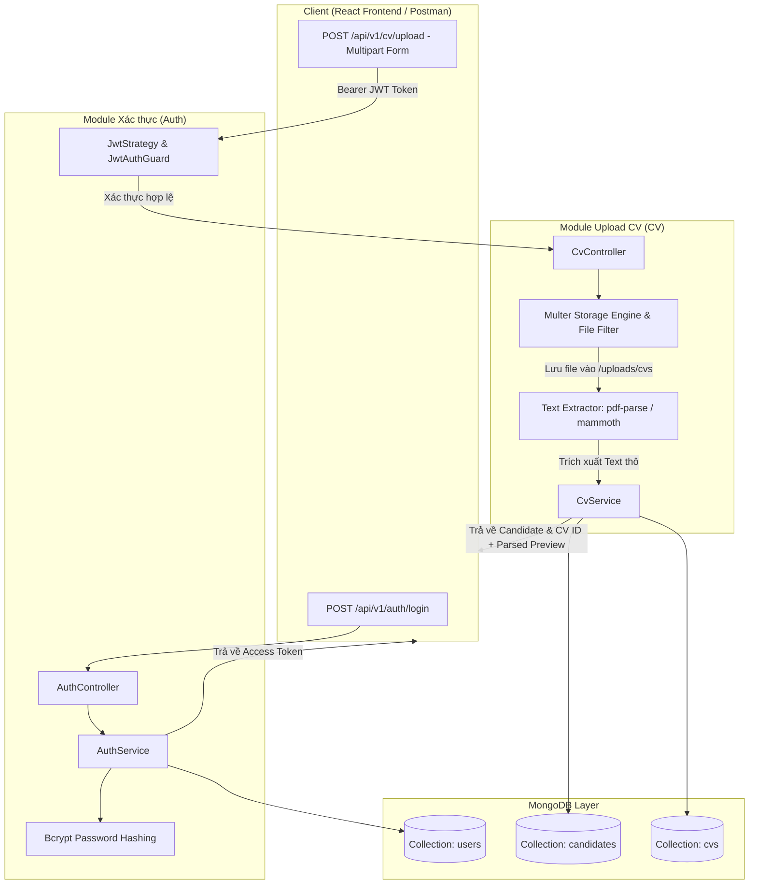
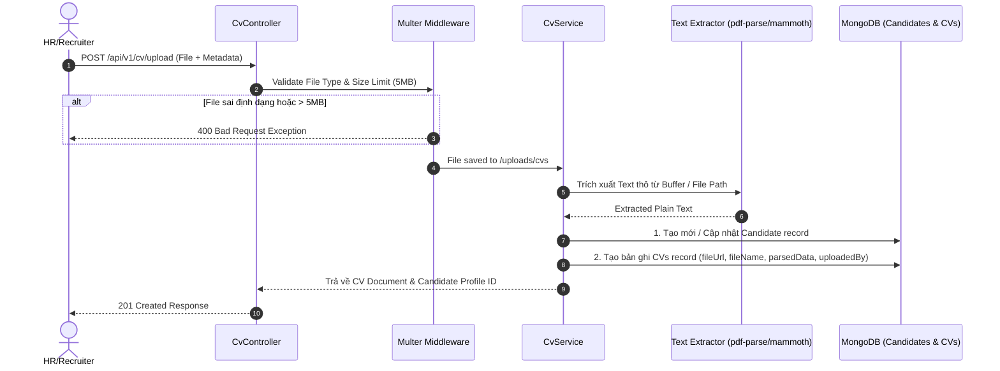

# 📋 Kế Hoạch Phát Triển API Xác Thực (Auth) & Upload CV

> **Dự án**: Smart HR & Candidate Screening System  
> **Tech Stack**: NestJS (v12) + Express + MongoDB (Mongoose ODM) + TypeScript  
> **Mục tiêu**: Xây dựng hệ thống API Xác thực người dùng chuẩn JWT và Module Upload/Xử lý CV tự động.

---

## 🏗 1. Tổng Quan Kiến Trúc & Luồng Dữ Liệu (Architecture & Data Flow)



---

## 🔐 2. Chi Tiết API Xác Thực (Authentication APIs - `AuthModule`)

### 2.1. Danh sách Endpoints
| HTTP Method | Endpoint | Description | Auth Required |
| :--- | :--- | :--- | :---: |
| `POST` | `/api/v1/auth/register` | Đăng ký tài khoản người dùng mới (HR/Recruiter/Admin) | ❌ Không |
| `POST` | `/api/v1/auth/login` | Đăng nhập & Lấy JWT Access Token | ❌ Không |
| `GET` | `/api/v1/auth/me` | Lấy thông tin tài khoản đang đăng nhập | ✅ JWT Bearer |
| `POST` | `/api/v1/auth/logout` | Đăng xuất (Client xóa Token) | ✅ JWT Bearer |

---

### 2.2. DTO & Validation Specs

#### 1. `RegisterDto` (`src/modules/auth/dto/register.dto.ts`)
- `email`: String (IsEmail, Required, Unique)
- `password`: String (MinLength: 6, MaxLength: 32, Required)
- `fullName`: String (IsNotEmpty, Required)
- `role`: Enum (`'ADMIN'`, `'HR_MANAGER'`, `'RECRUITER'`, `'HIRING_MANAGER'`, Default: `'RECRUITER'`)
- `department`: String (IsOptional)

#### 2. `LoginDto` (`src/modules/auth/dto/login.dto.ts`)
- `email`: String (IsEmail, Required)
- `password`: String (IsNotEmpty, Required)

---

### 2.3. Luồng Xử Lý Chi Tiết (Business Logic)
1. **Đăng ký (`register`)**:
   - Kiểm tra xem `email` đã tồn tại trong `users` collection chưa. Nếu có $\rightarrow$ ném ra `ConflictException` (409).
   - Băm mật khẩu sử dụng `bcrypt` với `saltRounds = 10`.
   - Tạo bản ghi mới trong `User` Schema (`passwordHash`).
   - Tạo JWT Access Token chứa payload: `{ sub: userId, email, role }`.
   - Trả về thông tin User (loại bỏ `passwordHash`) + `accessToken`.

2. **Đăng nhập (`login`)**:
   - Tìm người dùng theo `email`. Nếu không tìm thấy $\rightarrow$ ném `UnauthorizedException` (401).
   - So sánh mật khẩu nhập vào với `passwordHash` bằng `bcrypt.compare()`. Nếu sai $\rightarrow$ ném `UnauthorizedException` (401).
   - Kiểm tra `status == 'ACTIVE'`.
   - Tạo JWT Access Token mới và trả về cho Client.

3. **Xác thực JWT Guard (`JwtAuthGuard`)**:
   - Trích xuất Bearer Token từ Header `Authorization: Bearer <token>`.
   - Kiểm tra chữ ký với secret key `JWT_SECRET`.
   - Gắn đối tượng `user` vào `request.user`.

---

## 📄 3. Chi Tiết API Upload & Quản Lý CV (`CvModule`)

### 3.1. Danh sách Endpoints
| HTTP Method | Endpoint | Content-Type | Auth Required | Description |
| :--- | :--- | :--- | :---: | :--- |
| `POST` | `/api/v1/cv/upload` | `multipart/form-data` | ✅ JWT Bearer | Upload file CV (PDF/DOCX), lưu trữ & trích xuất dữ liệu |
| `GET` | `/api/v1/cv/:id` | `application/json` | ✅ JWT Bearer | Lấy chi tiết thông tin CV & kết quả parsing |
| `GET` | `/api/v1/cv/:id/file` | Binary stream | ✅ JWT Bearer | Tải xuống / Xem trực tiếp file CV gốc |

---

### 3.2. Quy Tắc Ràng Buộc & Validation Upload CV (NFR-PERF-01)
- **Dung lượng tối đa**: `5MB` ($5 \times 1024 \times 1024$ bytes).
- **Định dạng cho phép**:
  - `application/pdf` (`.pdf`)
  - `application/vnd.openxmlformats-officedocument.wordprocessingml.document` (`.docx`)
  - `application/msword` (`.doc`)
  - `image/png`, `image/jpeg`
- **Lưu trữ tệp tin**:
  - Thư mục đích: `backend/uploads/cvs/`
  - Tên tệp tin đặt lại: `<timestamp>-<random-hex>-<original-name>` (đảm bảo không trùng tên tệp).

---

### 3.3. Luồng Xử Lý Tải Lên & Trích Xuất Dữ Liệu (`CvService.uploadCv`)



---

## 📦 4. Các Package Cần Cài Đặt (Dependencies)

Cần cài đặt các thư viện NestJS & Utility sau vào thư mục `backend`:

```bash
npm install @nestjs/jwt @nestjs/passport passport passport-jwt bcrypt class-validator class-transformer pdf-parse mammoth
npm install --save-dev @types/passport-jwt @types/bcrypt @types/multer @types/pdf-parse
```

---

## 🗂 5. Danh Sách Các File Cần Tạo & Cập Nhật

```
backend/
├── src/
│   ├── common/
│   │   ├── decorators/
│   │   │   └── get-user.decorator.ts      # Decorator lấy req.user nhanh
│   │   └── guards/
│   │       └── jwt-auth.guard.ts          # Guard bảo vệ các route riêng tư
│   ├── modules/
│   │   ├── auth/
│   │   │   ├── dto/
│   │   │   │   ├── register.dto.ts        # Validation DTO đăng ký
│   │   │   │   └── login.dto.ts           # Validation DTO đăng nhập
│   │   │   ├── strategies/
│   │   │   │   └── jwt.strategy.ts        # Passport Strategy cho JWT
│   │   │   ├── auth.module.ts             # Module Auth đăng ký JwtModule
│   │   │   ├── auth.service.ts            # Logic băm pass & sinh Token
│   │   │   └── auth.controller.ts         # Endpoints Auth
│   │   ├── cv/
│   │   │   ├── cv.module.ts               # Khai báo Mongoose schemas User, Candidate, CV
│   │   │   ├── cv.controller.ts           # Endpoints Upload & Get CV
│   │   │   └── cv.service.ts              # Logic trích xuất text & lưu CSDL
│   ├── app.module.ts                      # Đăng ký AuthModule & Static File Serve
```

---

## 🧪 6. Kế Hoạch Kiếm Thử & Kịch Bản Kiểm Tra (Verification Plan)

1. **Kiểm thử Đăng ký (`POST /auth/register`)**:
   - Đăng ký user hợp lệ $\rightarrow$ Trả về `201 Created` và token.
   - Đăng ký lại cùng email $\rightarrow$ Trả về `409 ConflictException`.
2. **Kiểm thử Đăng nhập (`POST /auth/login`)**:
   - Đăng nhập sai mật khẩu $\rightarrow$ Trả về `401 UnauthorizedException`.
   - Đăng nhập đúng $\rightarrow$ Trả về `accessToken`.
3. **Kiểm thử Route được bảo vệ (`GET /auth/me`)**:
   - Gửi yêu cầu không kèm Header Authorization $\rightarrow$ Trả về `401 Unauthorized`.
   - Gửi token hợp lệ $\rightarrow$ Trả về thông tin User.
4. **Kiểm thử Upload CV (`POST /cv/upload`)**:
   - Upload file PDF chuẩn ($< 5\text{MB}$) $\rightarrow$ Lưu file vào `uploads/cvs/`, trích xuất text và tạo bản ghi Candidate + CV thành công.
   - Upload file `.exe` hoặc file $> 5\text{MB}$ $\rightarrow$ Trả về `400 Bad Request`.

---

## ❓ Câu Hỏi Thắc Mắc & Xác Nhận Yêu Cầu

1. **Phương thức lưu trữ tệp CV**: Trong giai đoạn hiện tại, chúng ta sẽ lưu file trực tiếp trên **Local Disk (`backend/uploads/cvs/`)** hay kết nối Cloud Storage (như AWS S3 / Firebase Storage)? *(Đề xuất: Lưu Local Disk trước để tiện phát triển).*
2. **Luồng trích xuất AI**: Sau khi upload tệp CV và có text thô, chúng ta có gọi trực tiếp `AiService` (dùng Gemini API) để phân tích ra JSON Profile ngay lập tức không?

---
*Vui lòng xác nhận Kế hoạch triển khai trên để bắt đầu tiến hành viết code!*
