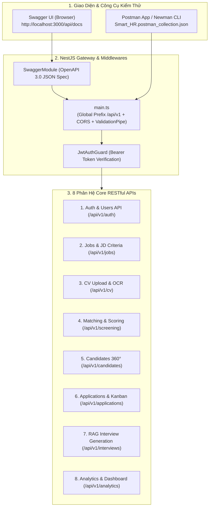

# 🗺️ Kế Hoạch Hoàn Thiện Core RESTful APIs & Kiểm Thử Swagger/Postman Documentation

> **Dự án**: Smart HR & Automated Candidate Screening System  
> **Mục tiêu**: Chuẩn hóa 100% Core RESTful APIs, thiết lập OpenAPI/Swagger UI trực quan tại `/api/docs`, tạo bộ Postman Collection v2.1 sẵn sàng kiểm thử liên thông (End-to-End) có kèm Script tự động lưu JWT Token.  
> **Mã kế hoạch**: `PLAN-CORE-API-SWAGGER-POSTMAN`  
> **Trạng thái**: Sẵn sàng triển khai (Ready for Execution)

---

## 1. Hiện Trạng Hệ Thống & Các Khoảng Trống (Gap Analysis)

| Hạng mục | Hiện trạng | Khoảng trống cần khắc phục |
| :--- | :--- | :--- |
| **Gói Swagger** | Chưa cài đặt trong `backend/package.json` | Cần cài đặt `@nestjs/swagger` và `swagger-ui-express`. |
| **Cấu hình `main.ts`** | Tệp gốc chỉ có 8 dòng, chưa có `ValidationPipe`, CORS, hay Swagger setup | Cần bổ sung `DocumentBuilder`, `SwaggerModule.setup('/api/docs')`, CORS, và Global `ValidationPipe`. |
| **Tiền tố Routing** | Phần lớn dùng `/api/v1/...`, riêng `auth` và `users` đang dùng `/auth` và `/users` | Chuẩn hóa toàn bộ routing thống nhất theo prefix chuẩn `/api/v1/*` (vẫn duy trì alias tương thích ngược). |
| **Swagger Decorators** | Các Controller và DTO chưa gắn các decorator `@ApiTags`, `@ApiOperation`, `@ApiResponse`, `@ApiProperty` | Swagger UI sẽ không hiển thị đầy đủ schema và ví dụ body nếu thiếu decorator. |
| **Postman Artifacts** | Chưa có file Postman Collection v2.1 và Environment chính thức | Cần xuất file JSON Collection có sẵn test scripts (tự động trích xuất Bearer Token sau khi Login). |

---

## 2. Kiến Trúc Luồng Kiểm Thử & Tích Hợp Swagger/Postman



---

## 3. Lộ Trình Triển Khai Chi Tiết (4 Giai Đoạn)

### Giai đoạn 1: Chuẩn Hóa Cấu Hình NestJS & Cài Đặt Swagger Core
1. **Cài đặt thư viện**:
   - Cài đặt `@nestjs/swagger` và `swagger-ui-express` vào `backend`.
2. **Nâng cấp `backend/src/main.ts`**:
   - Cấu hình Global `ValidationPipe({ transform: true, whitelist: true, forbidNonWhitelisted: false })`.
   - Kích hoạt CORS hỗ trợ giao diện Frontend (Next.js/React trên port 3000/3001).
   - Thiết lập `DocumentBuilder`:
     - **Tiêu đề**: *Smart HR & Candidate Screening System API*
     - **Mô tả**: *Nền tảng sàng lọc hồ sơ ứng viên tự động & sinh câu hỏi phỏng vấn thông minh dựa trên AI*
     - **Phiên bản**: `v1.0.0`
     - Bổ sung `addBearerAuth()` cho JWT Authentication (`bearerFormat: 'JWT'`).
     - Mount Swagger UI tại đường dẫn: `GET /api/docs` và raw OpenAPI JSON tại `GET /api/docs-json`.
3. **Chuẩn hóa Route Prefixes**:
   - Cập nhật `AuthController` hỗ trợ cả `@Controller(['api/v1/auth', 'auth'])`.
   - Cập nhật `UsersController` hỗ trợ cả `@Controller(['api/v1/users', 'users'])`.

---

### Giai đoạn 2: Bổ Sung Swagger Decorators Cho Toàn Bộ 8 Phân Hệ Core APIs
Gắn thẻ `@ApiTags`, mô tả nghiệp vụ `@ApiOperation`, mã phản hồi `@ApiResponse` và chi tiết thuộc tính DTO `@ApiProperty` / `@ApiPropertyOptional`:

1. **Auth & Users (`@ApiTags('Authentication')`, `@ApiTags('Users')`)**:
   - `POST /api/v1/auth/register`: Đăng ký tài khoản mới (Recruiter / Candidate).
   - `POST /api/v1/auth/login`: Đăng nhập hệ thống, trả về JWT Access Token.
   - `GET /api/v1/auth/profile`: Lấy thông tin tài khoản đang đăng nhập.
   - `GET /api/v1/users/:email`: Tra cứu thông tin người dùng theo email.
2. **Jobs Module (`@ApiTags('Jobs')`)**:
   - `POST /api/v1/jobs`: Tạo mới tin tuyển dụng (AI bóc tách tiêu chí + vector embedding).
   - `POST /api/v1/jobs/parse-jd`: Xem trước bóc tách tiêu chí JD thô (không lưu DB).
   - `GET /api/v1/jobs`: Danh sách tin tuyển dụng (phân trang, lọc, tìm kiếm).
   - `GET /api/v1/jobs/:id`: Chi tiết tin tuyển dụng kèm thống kê phễu ứng viên.
   - `PUT /api/v1/jobs/:id`: Cập nhật thông tin tin tuyển dụng.
   - `PATCH /api/v1/jobs/:id/status`: Đổi trạng thái tin (`DRAFT` / `PUBLISHED` / `CLOSED`).
   - `DELETE /api/v1/jobs/:id`: Xóa hoặc đóng tin tuyển dụng (bảo toàn dữ liệu nếu đã có ứng viên).
3. **CV & Extraction Module (`@ApiTags('CV & Extraction')`)**:
   - `POST /api/v1/cv/upload`: Tải lên file CV (PDF/DOCX), bóc tách OCR & LLM.
   - `GET /api/v1/cv/:id`: Chi tiết hồ sơ CV đã bóc tách cấu trúc.
   - `GET /api/v1/cv/:id/download`: Tải file CV gốc.
4. **Screening & Matching Engine (`@ApiTags('Candidate Screening & Matching')`)**:
   - `POST /api/v1/screening/match`: Chấm điểm tương thích giữa 1 CV và 1 JD (Hybrid scoring).
   - `POST /api/v1/screening/batch`: Chấm điểm hàng loạt hồ sơ cho 1 vị trí.
   - `GET /api/v1/screening/rank/:jobId`: Bảng xếp hạng Top ứng viên cho tin tuyển dụng.
5. **Candidates Module (`@ApiTags('Candidates')`)**:
   - `GET /api/v1/candidates`: Danh sách ứng viên (bộ lọc skill, score, status, tìm kiếm).
   - `GET /api/v1/candidates/:id`: Hồ sơ 360° ứng viên kèm CV parsed và radar score.
   - `POST /api/v1/candidates`: Tạo mới hoặc khử trùng lặp ứng viên theo email.
   - `PUT /api/v1/candidates/:id`: Cập nhật thông tin ứng viên và cờ ẩn danh (`anonymized`).
   - `PATCH /api/v1/candidates/:id/status`: Chuyển trạng thái tuyển dụng.
   - `DELETE /api/v1/candidates/:id`: Xóa hồ sơ ứng viên & cascade cleanup.
6. **Applications & Kanban Module (`@ApiTags('Applications & Kanban')`)**:
   - `GET /api/v1/applications/kanban`: Dữ liệu phân bổ bảng Kanban 7 cột kèm thẻ điểm AI.
   - `GET /api/v1/applications`: Danh sách đơn ứng tuyển (lọc theo job, trạng thái, điểm số).
   - `GET /api/v1/applications/:id`: Chi tiết đơn ứng tuyển và dòng thời gian quyết định.
   - `POST /api/v1/applications`: Nộp đơn ứng tuyển (khử trùng lặp `candidateId` + `jobId`).
   - `PATCH /api/v1/applications/:id/status`: Kéo thả đổi cột Kanban (lưu audit trail).
   - `DELETE /api/v1/applications/:id`: Xóa đơn ứng tuyển & cascade cleanup.
7. **AI Interview Generation RAG (`@ApiTags('AI Interview Generation')`)**:
   - `POST /api/v1/interviews/generate`: Sinh bộ câu hỏi phỏng vấn RAG đa chiều kèm rubric 3 mức.
   - `GET /api/v1/interviews/:id`: Xem bộ câu hỏi đã lưu.
   - `PUT /api/v1/interviews/:id`: Chỉnh sửa câu hỏi (Human-in-the-loop).
   - `POST /api/v1/interviews/:id/export`: Xuất phiếu phỏng vấn (Markdown/Text/JSON).
8. **Analytics & Dashboard (`@ApiTags('Recruitment Analytics')`)**:
   - `GET /api/v1/analytics/dashboard`: Tổng quan KPIs, phễu 7 vòng, phân bố điểm 3 dải, Top 5 Skill Gaps.

---

### Giai đoạn 3: Xây Dựng Bộ Postman Collection v2.1 & Environment
1. **Tạo Postman Environment**:
   - Đường dẫn lưu trữ: `docs/postman/Smart_HR_Environment.postman_environment.json`.
   - Chứa các biến môi trường cấu hình sẵn:
     - `baseUrl`: `http://localhost:3000`
     - `jwtToken`: Token xác thực
     - `candidateId`, `jobId`, `applicationId`, `cvId`, `interviewId`
2. **Tạo Postman Collection v2.1**:
   - Đường dẫn lưu trữ: `docs/postman/Smart_HR_APIs.postman_collection.json`.
   - Phân chia theo 8 thư mục tương ứng với 8 nhóm API.
   - **Tự động hóa đăng nhập (Test Script)**: Request `POST /api/v1/auth/login` có kèm script tự động trích xuất token:
     ```javascript
     if (pm.response.code === 200 || pm.response.code === 201) {
         var jsonData = pm.response.json();
         var token = jsonData.access_token || (jsonData.data && jsonData.data.access_token);
         if (token) {
             pm.environment.set("jwtToken", token);
             console.log("JWT Token captured successfully!");
         }
     }
     ```
   - Tất cả các endpoint yêu cầu xác thực sẽ kế thừa `Authorization: Bearer {{jwtToken}}`.

---

### Giai đoạn 4: Kiểm Thử Liên Thông (End-to-End) & Cập Nhật Tài Liệu
1. **Kiểm thử biên dịch Swagger**:
   - Đảm bảo Swagger JSON được sinh ra hợp lệ, không có lỗi vòng lặp hoặc lỗi cú pháp schema.
2. **Kiểm thử kịch bản liên thông Postman**:
   - Thực thi chuỗi quy trình tuyển dụng trọn vẹn:
     $$\text{Register/Login} \rightarrow \text{Tạo Job (AI Criteria)} \rightarrow \text{Upload CV} \rightarrow \text{Nộp Application} \rightarrow \text{Screening Matching} \rightarrow \text{Kéo thả Kanban} \rightarrow \text{Sinh Câu Hỏi RAG} \rightarrow \text{Xem Dashboard Thống Kê}$$
3. **Cập nhật tài liệu hướng dẫn**:
   - Tạo file `docs/SWAGGER_AND_POSTMAN_GUIDE.md` hướng dẫn nhập file vào Postman và truy cập Swagger UI.
   - Cập nhật `docs/README.md`.

---

## 4. Danh Mục Các Đầu Ra (Deliverables)

1. **Mã nguồn Backend**:
   - `backend/package.json`: Cài đặt `@nestjs/swagger` & `swagger-ui-express`.
   - `backend/src/main.ts`: Cấu hình Swagger UI tại `/api/docs`, CORS và ValidationPipe.
   - Cập nhật 11 Controllers và các DTOs với đầy đủ Swagger Annotations.
2. **Tài liệu & Artifacts Kiểm Thử**:
   - `docs/postman/Smart_HR_APIs.postman_collection.json`: Bộ Postman Collection đầy đủ 24+ endpoints.
   - `docs/postman/Smart_HR_Environment.postman_environment.json`: File môi trường Postman cấu hình sẵn.
   - `docs/SWAGGER_AND_POSTMAN_GUIDE.md`: Hướng dẫn truy cập Swagger UI và import Postman Collection.
3. **Đảm bảo chất lượng**:
   - Duy trì 100% tỷ lệ vượt qua của toàn bộ 185 test cases hiện tại.
