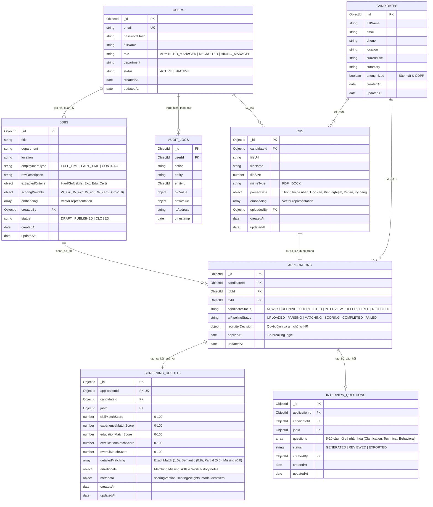

# TÀI LIỆU THIẾT KẾ SƠ ĐỒ THỰC THỂ - LIÊN KẾT (ERD)
## DỰ ÁN: SMART HR & CANDIDATE SCREENING SYSTEM
LINK: https://mermaid.ai/live/edit?utm_medium=share&utm_source=ai_live_editor#pako:eNqtV8tu20YU_ZUBF4UDyI7s-BUDXdAkbbGRJYWi5KAwQIzJsTgxOVSGQ8eKnVUXXRRFEXTVVesE2bQI2qLd1ELRhYL8h_6kd0jqZdFIHFuApBne18x9ncszxY08omwphOsUdzgODxiCT6tpWE10fr64GJ2hr-rbTbSFDhQxvLyInJPBL86zZHj5hjnB4N8DpUBCbemm7VTru7mcP-z_6To-Hfa_ZY7wceSIwYVbKKq1x7beUDDwK5NsGaOm1nRTV21jjjse9n92wMrvyUjpPK_aaFRNTbXNei0TYsP-T13n_asPF1M20steK-EPL98xaehHJ_5wMbbVzkTOz-dFQP0fw_4b14EjvnO8Yf8t6ziCR6wzsTkjlCtqapZh1MzarmMZzVbVno4Ax87x8PI_kYXBUc3RQeYURefIrNmG1TaNfedxy2hODpapOgQfOO7gdSIv9QOdnCkLylm2kZ_64VPiCtNDDvVQ49GEEAtOWQeRENMAteYJXRzHzyPuVXDszxGPkiCo4ZDMEXgUEDilqu-ZNXSOKpazp9bUXcOCjWVoVsu003XFtKSTcuLIEVOKPNLFXISEiTlSLLBIYmlFs822gaSzsuW0Hg8LglxO4M9TxZXnSdebfv5yJo1u4D1BRUBucvYgcrGgESuIQzeIelLG7nWlC3da1apjm3vyfg3VskdrrV6zLbhugc84fq6T2OW0O2siSm-ByKng2IVra5wKwikGKxXMvfvN6Eig-JgGQVxCxmkXfrykhDTCRTxtJtcTu5E0t09oxxcyDvtOKlxC-w6R0vAn5fcdFzSghWYSfrm8VL43rQpzjntw6UPiefLoB0obVEcccdLlJAY3ZG5SCmKRB3W7h3YeXZ8cuqXu2NJ3re2q2awYuvRdtd409FtnyVSTukGuXFszaQnO158fMfLp-eMmnMvkKUzIOAlDzHuT54cR1ClmCLOI9UL6gnjgsW3oShEKoVcK9AXa1RvW7T3V_jQXTWKLmUelLlgXRPeIBqTFg8Lns75lCeQWTwlNuN-cREhDkldaQ9-B3NDr2pOCZIdKjomnYyGrxfYHf6dVz5A7uEDMH7xmJVQZ9r930cnw8i1sHlHmI9ZJQTMsIR0gFA0uJGHY_wex999kCHIXdZBAx8DeXCF8VqBmIOhOIjZmeBodXkdyT4rDPNbZHFVzzdhHU-gq15W6ZUNl22llj-ES1vWdnRHGpDTL-MrQ7Nm6zw1h2qBdElA2sdRqVOuqngpC221mxvZUW6vkdrW6la20-l6jamT2d1SzOmshzx9OXJ7IdqsTl8YQSjDxOOnJOQC9fzXsfwfpAqMZgoxBrj-4RGLY_w1wc670cLcbUBk5mYeULB5ChI-zltCh7hz7dYGeH1BuFO30FFkLSkNXat1RTuT1mgLJHhau3wSUkdVZXlwul6evl3MC0gCGEeaST2P3kuzYn8QtgYse0RtIRCeE448dPat2jwho-MRLebOiN04BmFH6AC1IrCyhJsACE9RFC-WlTdg3YKSgOJDbNdju0TiWsrCdRdY87zC10sPjdB4bmbo_EsvQHtr8fsSPkU9j6Dk9xCJBihA_hBN7WQvMwb9NuEzm0pVhoIRCeDEJTA8aF_gPmG4NIUWD8K1S9m7yNQvls4TEUrFsHGsQbSRncpTO5BOEQP7gL4wWtADzcU6VkE1cn8EOxqZt4uMTGkH-3CvoUeOJZteoGZZq5z1NuiRdGk8a0Alnm89HZqXPg4jJ2-GN_J_EhBe3ecj5wlEYckf0CjRlBNOby88o8No4SMgcgZHnVwi5DdpVPQ8ANr5yeQFjATg87OaXV0pKh1NP2RI8ISUlJByGNdgqqQvkOzKBqUORb2Ye5scyBlKmi9nXURSOxHiUdHxl6wgHMewyB-cv7mMWwjzCtShhQtlafpiqULbOlFNla3F1c2nt4crmZnl9Gb7llbWS0oPHyw_Xl9bKG-XV8spKufxgpbzysqS8SM0uL62srq2tws_mRnljfX3jwcv_ARyKHsw
---

> **Nguồn chiếu**: Tài liệu Báo cáo & Đặc tả Yêu cầu Phần mềm (SRS) - *Tìm hiểu đề tài.pdf*  
> **Kiến trúc CSDL**: MongoDB (Document-Oriented Database) kết hợp NestJS & Mongoose ODM.  
> **Ngôn ngữ**: Tiếng Việt  

---

## 1. TỔNG QUAN KIẾN TRÚC CƠ SỞ DỮ LIỆU

Hệ thống **Smart HR & Candidate Screening System** được thiết kế dựa trên kiến trúc Web Client-Server (React Frontend, NestJS Backend) và hệ quản trị cơ sở dữ liệu **MongoDB**. Cơ sở dữ liệu được tổ chức dưới dạng các **Collections (Tập hợp)** tương ứng với các bảng thực thể trong mô hình quan hệ ERD.

### Các mục tiêu thiết kế cốt lõi:
1. **Quản lý người dùng & Phân quyền (RBAC)**: Phân tách rõ các vai trò Admin, HR Manager, Recruiter, Hiring Manager.
2. **Quản lý Quy trình Tuyển dụng & Pipeline**: Quản lý vị trí tuyển dụng (JD), hồ sơ ứng viên (Candidate/CV), và tiến trình ứng tuyển (Application).
3. **Mô-đun AI Sàng lọc Hồ sơ (AI Candidate Screening Engine)**: Lưu trữ kết quả trích xuất văn bản (CV Parsing), vector biểu diễn (Vector Embeddings), điểm số đa tiêu chí (Multi-Criteria Scores), thứ hạng và bản lý giải AI (AI Rationale).
4. **Bảo mật, Nhật ký & Vấn đề Pháp lý**: Đảm bảo lưu trữ nhật ký thao tác (Audit Logs), ẩn danh hóa dữ liệu (Anonymization - tuân thủ NFR-DATA-03, Nghị định 13/2023/NĐ-CP & GDPR) và đảm bảo tính công bằng (Fairness - NFR-AI-02).

---

## 2. SƠ ĐỒ THỰC THỂ - LIÊN KẾT (MERMAID ERD DIAGRAM)

---

## 3. ĐẶC TẢ CHI TIẾT CÁC BẢNG (COLLECTION SPECIFICATIONS)

### 3.1. Bảng `users` (Quản lý Người dùng & Phân quyền RBAC)
Lưu trữ thông tin tài khoản người dùng hệ thống và vai trò truy cập (Đáp ứng [FR-USER-01], [FR-USER-02]).

| Tên trường (Field) | Kiểu dữ liệu | Khóa / Ràng buộc | Mô tả & Quy tắc nghiệp vụ |
| :--- | :--- | :--- | :--- |
| `_id` | ObjectId | **PK** | Mã định danh duy nhất của người dùng. |
| `email` | String | **UK**, Required, Index | Email đăng nhập hệ thống. |
| `passwordHash` | String | Required | Mật khẩu đã băm (Sử dụng `bcrypt` / `argon2` theo [NFR-SEC-05]). |
| `fullName` | String | Required | Họ và tên người dùng. |
| `role` | String | Enum, Required | Vai trò: `ADMIN`, `HR_MANAGER`, `RECRUITER`, `HIRING_MANAGER`. |
| `department` | String | Nullable | Phòng ban công tác. |
| `status` | String | Enum, Default: `'ACTIVE'` | Trạng thái tài khoản: `'ACTIVE'`, `'INACTIVE'`. |
| `createdAt` | Date | Required | Thời gian tạo tài khoản. |
| `updatedAt` | Date | Required | Thời gian cập nhật gần nhất. |

---

### 3.2. Bảng `jobs` (Quản lý Tin tuyển dụng & Bộ tiêu chí JD)
Lưu trữ thông tin chi tiết về các vị trí tuyển dụng, tiêu chí trích xuất tự động từ AI và cấu hình trọng số (Đáp ứng [FR-JOB-01], [FR-JOB-02], [FR-JOB-03]).

| Tên trường (Field) | Kiểu dữ liệu | Khóa / Ràng buộc | Mô tả & Quy tắc nghiệp vụ |
| :--- | :--- | :--- | :--- |
| `_id` | ObjectId | **PK** | Mã định danh duy nhất của tin tuyển dụng. |
| `title` | String | Required | Tên vị trí tuyển dụng (Ví dụ: Senior React Developer). |
| `department` | String | Required | Bộ phận tuyển dụng. |
| `location` | String | Required | Địa điểm làm việc. |
| `employmentType` | String | Enum | Loại hình: `'FULL_TIME'`, `'PART_TIME'`, `'CONTRACT'`. |
| `rawDescription` | String | Required | Nội dung mô tả công việc (Job Description) văn bản gốc. |
| `extractedCriteria` | Object | Required (AI Output) | Bộ tiêu chí trích xuất từ AI ([FR-JOB-02]): `hardSkills` (mảng), `softSkills` (mảng), `minExperienceYears` (số), `requiredEducation` (chuỗi), `certifications` (mảng). |
| `scoringWeights` | Object | Required ([FR-JOB-03]) | Trọng số do HR Manager điều chỉnh: `skillWeight`, `experienceWeight`, `educationWeight`, `certificationWeight`. **Ràng buộc:** Tổng trọng số $= 1.0$. |
| `embedding` | Array\<Number\> | Vector Index | Vector ngữ nghĩa biểu diễn JD để so khớp AI (Semantic Matching). |
| `createdBy` | ObjectId | **FK** -> `users._id` | Người tạo tin tuyển dụng (HR/Recruiter). |
| `status` | String | Enum, Default: `'DRAFT'` | Trạng thái: `'DRAFT'`, `'PUBLISHED'`, `'CLOSED'`. |
| `createdAt` | Date | Required | Ngày khởi tạo. |
| `updatedAt` | Date | Required | Ngày cập nhật. |

---

### 3.3. Bảng `candidates` (Quản lý Thông tin Ứng viên)
Lưu trữ thông tin định danh và hồ sơ tổng quan của ứng viên (Đáp ứng [FR-CAND-02]).

| Tên trường (Field) | Kiểu dữ liệu | Khóa / Ràng buộc | Mô tả & Quy tắc nghiệp vụ |
| :--- | :--- | :--- | :--- |
| `_id` | ObjectId | **PK** | Mã định danh duy nhất của ứng viên. |
| `fullName` | String | Required | Họ và tên ứng viên. |
| `email` | String | Index | Email liên hệ. |
| `phone` | String | Nullable | Số điện thoại liên lạc. |
| `location` | String | Nullable | Địa chỉ / Thành phố hiện tại. |
| `currentTitle` | String | Nullable | Chức danh hiện tại hoặc gần nhất. |
| `summary` | String | Nullable | Tóm tắt bản thân / Mục tiêu nghề nghiệp. |
| `anonymized` | Boolean | Default: `false` | Cờ ẩn danh hóa dữ liệu theo [NFR-DATA-03] & [NFR-AI-02] (Fairness). |
| `createdAt` | Date | Required | Thời gian tạo hồ sơ. |
| `updatedAt` | Date | Required | Thời gian cập nhật gần nhất. |

---

### 3.4. Bảng `cvs` (Quản lý Tài liệu CV & Dữ liệu Parsing)
Lưu trữ thông tin tệp tin CV (PDF/DOCX) và kết quả bóc tách dữ liệu cấu trúc bằng NLP/LLM (Đáp ứng [FR-CAND-01], [FR-AI-01], [FR-AI-02]).

| Tên trường (Field) | Kiểu dữ liệu | Khóa / Ràng buộc | Mô tả & Quy tắc nghiệp vụ |
| :--- | :--- | :--- | :--- |
| `_id` | ObjectId | **PK** | Mã định danh bản ghi CV. |
| `candidateId` | ObjectId | **FK** -> `candidates._id` | Mã ứng viên sở hữu CV. |
| `fileUrl` | String | Required | Đường dẫn lưu trữ tài liệu tệp tin CV (Private storage / Signed URL). |
| `fileName` | String | Required | Tên tệp tin CV nguyên bản. |
| `fileSize` | Number | Required | Dung lượng tệp tin (Đơn vị: Bytes, Max 5MB theo [NFR-PERF-01]). |
| `mimeType` | String | Required | Định dạng tệp: `'application/pdf'`, `'application/docx'`. |
| `parsedData` | Object | Required ([FR-AI-02]) | Dữ liệu cấu trúc sau CV Parsing: `personalInfo`, `educationHistory`, `workHistory` (bao gồm các khoảng thời gian), `projects`, `skills`, `certifications`. |
| `embedding` | Array\<Number\> | Vector Index | Vector ngữ nghĩa đại diện cho nội dung CV. |
| `uploadedBy` | ObjectId | **FK** -> `users._id` | Người tải lên hồ sơ CV. |
| `createdAt` | Date | Required | Thời gian tải tệp lên. |
| `updatedAt` | Date | Required | Thời gian phân tích CV xong. |

---

### 3.5. Bảng `applications` (Quản lý Đơn ứng tuyển & Tiến trình Pipeline)
Quản lý mối liên kết giữa Ứng viên, Vị trí tuyển dụng, CV và trạng thái xử lý nghiệp vụ/AI (Đáp ứng [FR-CAND-03], [FR-CAND-06], Trạng thái hệ thống).

| Tên trường (Field) | Kiểu dữ liệu | Khóa / Ràng buộc | Mô tả & Quy tắc nghiệp vụ |
| :--- | :--- | :--- | :--- |
| `_id` | ObjectId | **PK** | Mã đơn ứng tuyển. |
| `candidateId` | ObjectId | **FK** -> `candidates._id` | Mã ứng viên nộp đơn. |
| `jobId` | ObjectId | **FK** -> `jobs._id` | Mã vị trí tuyển dụng. |
| `cvId` | ObjectId | **FK** -> `cvs._id` | Mã tệp CV sử dụng cho ứng tuyển. |
| `candidateStatus` | String | Enum, Required | Trạng thái ứng viên: `'NEW'`, `'SCREENING'`, `'SHORTLISTED'`, `'INTERVIEW'`, `'OFFER'`, `'HIRED'`, `'REJECTED'`. |
| `aiPipelineStatus` | String | Enum, Required | Trạng thái luồng xử lý AI: `'UPLOADED'`, `'PARSING'`, `'MATCHING'`, `'SCORING'`, `'COMPLETED'`, `'FAILED'`. |
| `recruiterDecision` | Object | Nullable ([FR-CAND-06]) | Quyết định từ HR/Recruiter: `decisionBy` (User ID), `decisionAt` (Date), `notes` (Ghi chú), `finalStatus`. |
| `appliedAt` | Date | Required, Index | Thời gian nộp hồ sơ. **Ứng dụng:** Dùng làm tiêu chí Tie-breaking khi hai ứng viên bằng điểm (Ứng viên nộp sớm hơn xếp trên). |
| `updatedAt` | Date | Required | Thời gian cập nhật trạng thái gần nhất. |

---

### 3.6. Bảng `screening_results` (Kết quả Sàng lọc & Đánh giá AI)
Lưu trữ toàn bộ kết quả chấm điểm đa tiêu chí, điểm tổng thể, so khớp chi tiết và bản lý giải AI (Đáp ứng [FR-AI-03] đến [FR-AI-10]).

| Tên trường (Field) | Kiểu dữ liệu | Khóa / Ràng buộc | Mô tả & Quy tắc nghiệp vụ |
| :--- | :--- | :--- | :--- |
| `_id` | ObjectId | **PK** | Mã bản ghi kết quả sàng lọc. |
| `applicationId` | ObjectId | **FK**, **UK** -> `applications._id` | Mã đơn ứng tuyển tương ứng (Mỗi đơn chỉ có 1 kết quả active). |
| `candidateId` | ObjectId | **FK** -> `candidates._id` | Mã ứng viên. |
| `jobId` | ObjectId | **FK** -> `jobs._id` | Mã vị trí tuyển dụng. |
| `skillMatchScore` | Number | Required (0 - 100) | Điểm phù hợp Kỹ năng (Skill Score) tính theo công thức trọng số ưu tiên. |
| `experienceMatchScore` | Number | Required (0 - 100) | Điểm Kinh nghiệm làm việc (Hợp nhất các khoảng thời gian trùng lặp). |
| `educationMatchScore` | Number | Required (0 - 100) | Điểm Học vấn (Required: 100, Related: 70, Lower: 50, Not relevant: 0). |
| `certificationMatchScore` | Number | Required (0 - 100) | Điểm Bằng cấp/Chứng chỉ (Matched required: 100, Related: 70, Missing: 0). |
| `overallMatchScore` | Number | Required, Index | Điểm Phù hợp Tổng thể ($OverallScore = \sum Score_i \times W_i$). Làm tròn 2 chữ số thập phân khi hiển thị. |
| `detailedMatching` | Array\<Object\> | Required ([FR-AI-04a]) | Chi tiết so khớp từng tiêu chí: `criterion`, `candidateValue`, `similarity`, `matchLevel` (`'EXACT_MATCH'` (1.0), `'SEMANTIC_MATCH'` (0.8), `'PARTIAL_MATCH'` (0.5), `'MISSING'` (0.0)). |
| `aiRationale` | Object | Required ([FR-AI-07]) | Lý giải đánh giá minh bạch (Explainable AI): `matchingSkills`, `missingSkills`, `workHistoryNotes`. |
| `metadata` | Object | Required ([FR-AI-10]) | Thông tin phiên chấm: `scoringVersion`, `scoringWeights`, `modelIdentifiers`, `processedAt`. |
| `createdAt` | Date | Required | Thời gian chấm điểm hoàn tất. |
| `updatedAt` | Date | Required | Thời gian cập nhật kết quả. |

---

### 3.7. Bảng `interview_questions` (Gợi ý Bộ câu hỏi Phỏng vấn)
Lưu trữ các câu hỏi phỏng vấn được khởi tạo tự động dựa trên kết quả so khớp CV và JD (Đáp ứng tính năng nâng cao [FR-INT-01], [FR-INT-02], [FR-INT-03]).

| Tên trường (Field) | Kiểu dữ liệu | Khóa / Ràng buộc | Mô tả & Quy tắc nghiệp vụ |
| :--- | :--- | :--- | :--- |
| `_id` | ObjectId | **PK** | Mã bộ câu hỏi phỏng vấn. |
| `applicationId` | ObjectId | **FK** -> `applications._id` | Mã đơn ứng tuyển. |
| `candidateId` | ObjectId | **FK** -> `candidates._id` | Mã ứng viên. |
| `jobId` | ObjectId | **FK** -> `jobs._id` | Mã vị trí tuyển dụng. |
| `questions` | Array\<Object\> | Required (5 - 10 câu) | Danh sách câu hỏi: `questionText` (Nội dung), `category` (`'CLARIFICATION'` - làm rõ điểm trống, `'TECHNICAL_DEEP_DIVE'` - chuyên môn, `'BEHAVIORAL'` - tình huống), `targetSkillOrGap`, `difficulty`. |
| `status` | String | Enum, Default: `'GENERATED'` | Trạng thái: `'GENERATED'`, `'REVIEWED'`, `'EXPORTED'`. |
| `createdBy` | ObjectId | **FK** -> `users._id` | Hệ thống AI khởi tạo hoặc Recruiter chỉnh sửa. |
| `createdAt` | Date | Required | Thời gian tạo bộ câu hỏi. |
| `updatedAt` | Date | Required | Thời gian chỉnh sửa gần nhất. |

---

### 3.8. Bảng `audit_logs` (Nhật ký Hoạt động Hệ thống)
Ghi nhận toàn bộ lịch sử thao tác của người dùng trên dữ liệu ứng viên và điều chỉnh cấu hình AI (Đáp ứng [FR-USER-03]).

| Tên trường (Field) | Kiểu dữ liệu | Khóa / Ràng buộc | Mô tả & Quy tắc nghiệp vụ |
| :--- | :--- | :--- | :--- |
| `_id` | ObjectId | **PK** | Mã bản ghi nhật ký. |
| `userId` | ObjectId | **FK** -> `users._id`, Index | Mã người dùng thực hiện thao tác. |
| `action` | String | Required | Hành động thực hiện (Ví dụ: `UPDATE_WEIGHTS`, `REVIEW_DECISION`, `DELETE_CANDIDATE`). |
| `entity` | String | Required | Tên thực thể bị tác động (Ví dụ: `Job`, `Application`, `Candidate`). |
| `entityId` | ObjectId | Required | ID của đối tượng bị tác động. |
| `oldValue` | Object | Nullable | Dữ liệu trước khi thay đổi. |
| `newValue` | Object | Nullable | Dữ liệu sau khi thay đổi. |
| `ipAddress` | String | Nullable | Địa chỉ IP người dùng. |
| `timestamp` | Date | Required, Index | Thời điểm ghi nhận log. |

---

## 4. BẢNG TỔNG HỢP MA TRẬN QUAN HỆ & TÍNH ĐỦ ĐẦY (CARDINALITY MATRIX)

| Thực thể A | Mối quan hệ | Thực thể B | Diễn giải nghiệp vụ |
| :--- | :---: | :--- | :--- |
| **`users`** | **1 : N** | **`jobs`** | Một HR/Recruiter có thể tạo và quản lý nhiều Tin tuyển dụng. |
| **`users`** | **1 : N** | **`audit_logs`** | Một Người dùng có nhiều bản ghi nhật ký thao tác hệ thống. |
| **`users`** | **1 : N** | **`cvs`** | Một Recruiter có thể tải lên nhiều hồ sơ CV. |
| **`candidates`** | **1 : N** | **`cvs`** | Một Ứng viên có thể lưu trữ nhiều phiên bản tệp CV (PDF/DOCX). |
| **`candidates`** | **1 : N** | **`applications`** | Một Ứng viên có thể ứng tuyển vào nhiều vị trí tuyển dụng (Jobs) khác nhau. |
| **`jobs`** | **1 : N** | **`applications`** | Một Vị trí tuyển dụng tiếp nhận nhiều Đơn ứng tuyển từ các ứng viên. |
| **`cvs`** | **1 : 1** | **`applications`** | Mỗi Đơn ứng tuyển cụ thể gắn liền với 1 bản ghi tệp CV duy nhất. |
| **`applications`** | **1 : 1** | **`screening_results`** | Mỗi Đơn ứng tuyển có 1 bản ghi Kết quả Sàng lọc AI chi tiết. |
| **`applications`** | **1 : 0..1** | **`interview_questions`** | Một Đơn ứng tuyển có thể khởi tạo 1 Bộ câu hỏi phỏng vấn tương ứng. |

---

## 5. QUY TẮC RÀNG BUỘC NGHỆP VỤ & THUẬT TOÁN ÁP DỤNG LÊN CSDL

### 5.1. Công thức tính Điểm Tổng thể (Overall Match Score) & Trọng số
Dữ liệu lưu tại `jobs.scoringWeights` và `screening_results`:
$$\text{Overall Score} = (\text{Skill Score} \times W_{\text{skill}}) + (\text{Exp Score} \times W_{\text{exp}}) + (\text{Edu Score} \times W_{\text{edu}}) + (\text{Cert Score} \times W_{\text{cert}})$$
* **Điều kiện ràng buộc:** $W_{\text{skill}} + W_{\text{exp}} + W_{\text{edu}} + W_{\text{cert}} = 1.0$.
* **Độ chính xác:** Mọi tính toán nội bộ duy trì 4 chữ số thập phân, lưu trữ và hiển thị làm tròn đến 2 chữ số thập phân ([FR-AI-05]).

### 5.2. Phân loại Mức độ So khớp Ngữ nghĩa (Semantic Matching Thresholds)
Dữ liệu lưu tại `screening_results.detailedMatching`:
* $\text{Similarity} \ge 0.90 \rightarrow$ **Exact Match** (Trọng số: $1.0$)
* $0.75 \le \text{Similarity} < 0.90 \rightarrow$ **Semantic Match** (Trọng số: $0.8$)
* $0.50 \le \text{Similarity} < 0.75 \rightarrow$ **Partial Match** (Trọng số: $0.5$)
* $\text{Similarity} < 0.50 \rightarrow$ **Missing** (Trọng số: $0.0$)

### 5.3. Thuật toán Xếp hạng & Xử lý Đồng điểm (Tie-Breaking Logic)
Dữ liệu truy vấn từ `screening_results` và `applications`:
* Ưu tiên 1: Điểm Phù hợp Tổng thể (`overallMatchScore` giảm dần).
* Tie-breaker 1: Điểm Kinh nghiệm (`experienceMatchScore` cao hơn xếp trước).
* Tie-breaker 2: Điểm Kỹ năng (`skillMatchScore` cao hơn xếp trước).
* Tie-breaker 3: Thời gian nộp hồ sơ (`applications.appliedAt` nộp sớm hơn xếp trước).

### 5.4. Ràng buộc Bảo mật & Công bằng (Fairness Constraints)
* **Loại bỏ thuộc tính nhạy cảm ([NFR-AI-02]):** CSDL và Scoring Engine không sử dụng các trường giới tính, tuổi, dân tộc, tôn giáo, tình trạng hôn nhân làm tiêu chí tính điểm.
* **Ẩn danh hóa dữ liệu ([NFR-DATA-03]):** Khi ứng viên yêu cầu xóa dữ liệu cá nhân, trường `candidates.anonymized` chuyển thành `true` và các thông tin định danh (`email`, `phone`, `fullName`) sẽ được mã hóa / ẩn danh để bảo lưu dữ liệu phục vụ huấn luyện và đánh giá chất lượng mô hình AI.

---
*Tài liệu này được biên soạn đầy đủ, chính xác và đồng bộ theo đúng các yêu cầu đặc tả trong tài liệu dự án Smart HR.*
