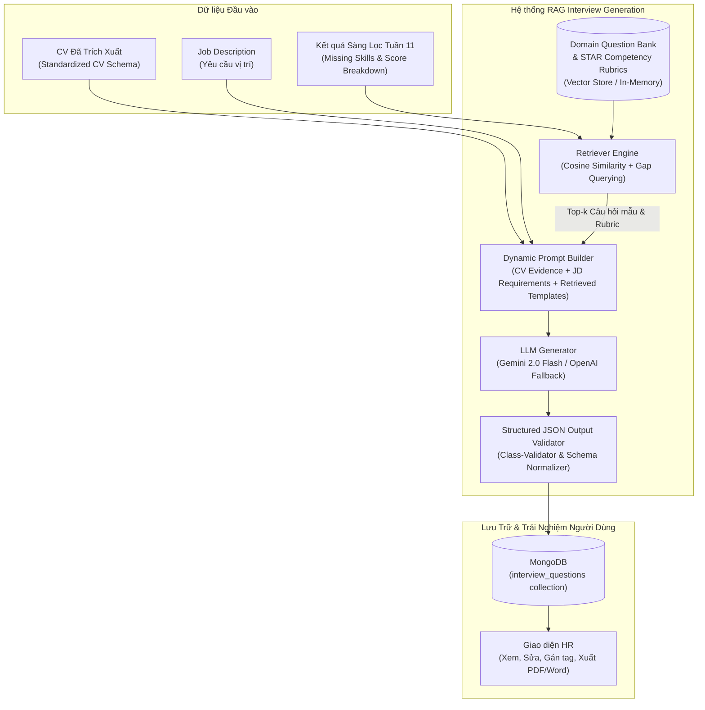

# 🎯 Kế Hoạch Triển Khai Module AI Interview Generation & Kiến Trúc RAG (RAG-based Interview Question Generation Plan)

> **Dự án**: Smart HR & Candidate Screening System  
> **Giai đoạn**: Tuần 12 (09/11/2026 – 15/11/2026)  
> **Tech Stack**: NestJS (v12) + TypeScript + MongoDB (Mongoose) + Vector Embeddings + Google Gemini / OpenAI  
> **Phương pháp luận**: Retrieval-Augmented Generation (RAG) + Competency Rubric Framework (STAR) + Multi-Agent Debate Synthesis.

---

## 📌 1. Đánh Giá Đề Xuất & Phản Biện Đa Chiều (Multi-Agent Debate Synthesis)

Báo cáo nghiên cứu *"Retrieval-Augmented Generation (RAG) và đánh giá khả năng áp dụng cho chức năng AI Interview Generation"* của bạn đặt ra hướng tiếp cận rất đúng đắn. Để đảm bảo giải pháp không rơi vào bẫy "thừa thãi kỹ thuật" (over-engineering) và thực sự mang lại giá trị thực tế cao nhất cho cả luận văn và hệ thống Smart HR, dưới đây là tổng hợp biên bản phản biện từ 3 góc nhìn AI chuyên gia (lấy cảm hứng từ quy trình Multi-Agent review trong `reposupport`):

### 🤖 AI 1: AI / NLP & RAG Systems Architect (Kiến trúc sư Trí tuệ Nhân tạo)
* **Vấn đề chất vấn**: Một CV trung bình chỉ dài 1–3 trang (~1,000–2,000 tokens), JD dài 1 trang (~500 tokens). Các mô hình LLM hiện đại (Gemini 2.0 Flash có context window 1M tokens, GPT-4o-mini có 128k tokens) hoàn toàn có thể đọc trọn vẹn cả CV lẫn JD trong một lần gọi prompt duy nhất (Direct Prompting) mà không bao giờ bị tràn context. Vậy tại sao phải tốn công chia nhỏ (chunking), tạo vector embedding và truy xuất (retrieval)?
* **Kết luận & Đề xuất giải pháp nâng tầm**:
  - Nếu RAG chỉ đơn thuần chunk 1 CV và 1 JD rồi retrieve lại, chi phí tính toán tăng thêm và latency tăng từ ~1s lên ~3s là **lãng phí**.
  - **RAG thực sự phát huy sức mạnh vượt trội khi**:
    1. **Domain Question Bank & Rubric RAG**: Nguồn dữ liệu tri thức của RAG không chỉ có CV/JD, mà quan trọng nhất là **Ngân hàng câu hỏi phỏng vấn chuẩn ngành (Question Bank)** và **Khung tiêu chí đánh giá (Competency Rubrics)** được chuẩn hóa theo từng vị trí (Frontend, Backend, DevOps, Data,...).
    2. **Gap-driven Targeted Retrieval**: Tận dụng trực tiếp kết quả từ `ScreeningModule` (Tuần 11). Những kỹ năng nào ứng viên bị đánh dấu là `missingSkills`, `partiallyMatchedSkills`, hoặc `experienceGaps` sẽ được đưa vào làm query để Retriever bốc chính xác câu hỏi kiểm tra lỗ hổng kiến thức từ Knowledge Base.
    3. **Grounding & Evidence Linking**: Trích xuất chính xác các bullet points dự án trong CV làm `evidence` đính kèm câu hỏi, triệt tiêu 100% hiện tượng ảo giác (hallucination) của LLM.

---

### 👔 AI 2: HR Tech & Senior Recruitment Director (Giám đốc Tuyển dụng & Nghiên cứu Nhân sự)
* **Vấn đề thực tế**: Người phỏng vấn (Interviewer) không phải lúc nào cũng là chuyên gia kỹ thuật sâu sắc, đặc biệt là HR Recruiter hoặc Junior Team Lead. Một câu hỏi như *"Bạn dùng React thế nào?"* là quá chung chung, ứng viên trả lời học vẹt cũng qua được.
* **Đề xuất yêu cầu nghiệp vụ**:
  - Bộ câu hỏi sinh ra **bắt buộc phải chia làm 4 nhóm phân loại rõ ràng (`[FR-INT-02]`)**:
    1. **Clarification / Verification**: Làm rõ những điểm bất thường trong CV (nhảy việc nhanh, khoảng trống thời gian, vai trò thực tế trong một team đông người).
    2. **Technical Deep-Dive**: Đào sâu vào các công nghệ mà ứng viên tự nhận là thành thạo hoặc làm trong các dự án quy mô lớn.
    3. **Skill Gap Probing**: Kiểm tra các kỹ năng bắt buộc trong JD mà CV ứng viên chưa thể hiện rõ hoặc bị thiếu.
    4. **Behavioral & Situational (STAR)**: Tình huống hành vi chuẩn STAR (Situation, Task, Action, Result) về xử lý xung đột, áp lực deadline, sự cố hệ thống.
  - **Evaluation Rubric (Bareme chấm điểm mẫu)**: Mỗi câu hỏi phải gợi ý tiêu chí chấm điểm 3 mức:
    - *Kém (1–2đ)*: Trả lời mơ hồ, không nêu được bản chất.
    - *Đạt (3–4đ)*: Nêu đúng lý thuyết và kinh nghiệm thực tế cơ bản.
    - *Xuất sắc (5đ)*: Phân tích được trade-offs, giải pháp tối ưu, số liệu chứng minh.
  - **Human-in-the-loop (`[FR-INT-03]`)**: Recruiter phải có quyền xem trước, chỉnh sửa câu chữ, đổi độ khó, thêm/xóa câu hỏi trước khi in ra PDF/Word mang vào phòng phỏng vấn.

---

### 💻 AI 3: Software Engineering & NestJS Architect (Kỹ sư Phần mềm Trưởng)
* **Vấn đề triển khai**: Hệ thống hiện dùng NestJS + MongoDB. Nếu tích hợp thêm dịch vụ Vector DB bên ngoài như Pinecone sẽ làm tăng phụ thuộc vào internet, chi phí và phức tạp hạ tầng khi chấm đồ án / demo.
* **Đề xuất kỹ thuật**:
  - **Vector Storage**: Sử dụng **MongoDB Atlas Vector Search** (nếu dùng cloud) HOẶC tận dụng **In-Memory Question Bank Vector Store** sử dụng hàm Cosine Similarity đã viết ở Tuần 11 (`cosine-similarity.util.ts`). Phương án này giúp ứng dụng chạy độc lập 100%, cực kỳ nhanh (<100ms) và không tốn chi phí thuê service ngoài.
  - **Structured JSON Output**: Sử dụng chế độ Structured Outputs của Gemini (`responseMimeType: 'application/json'`) kết hợp DTO validation để đảm bảo frontend luôn nhận đúng cấu trúc dữ liệu.
  - **Caching**: Cache các câu hỏi đã sinh theo `candidateId` và `jobId` trong MongoDB (`interview_questions.schema.ts`), tránh gọi lại LLM tốn token khi người dùng tải lại trang.

---

## 🏗️ 2. Kiến Trúc RAG Đề Xuất Cho AI Interview Generation

### 2.1. Sơ đồ luồng hoạt động tổng thể (Pipeline Workflow)



---

## 📋 3. Thiết Kế Chi Tiết Các Thành Phần RAG

### 3.1. Domain Question Bank (Ngân hàng câu hỏi chuẩn & Bareme)
Xây dựng một bộ câu hỏi nền tảng (Base Knowledge Base) phân loại theo các nhóm công nghệ và năng lực cốt lõi:
- **Kỹ năng chuyên môn (Tech Stacks)**: Frontend (React, Vue, Angular), Backend (Node.js, NestJS, Java, Python, Go), Database (PostgreSQL, MongoDB, Redis), DevOps (Docker, Kubernetes, CI/CD).
- **Khung năng lực hành vi (Behavioral STAR)**: Kỹ năng giải quyết vấn đề (Problem Solving), Làm việc nhóm (Collaboration), Thích ứng (Adaptability), Tinh thần trách nhiệm (Ownership).
- **Mỗi câu hỏi mẫu trong Knowledge Base bao gồm**:
  - `id`: Định danh duy nhất.
  - `category`: `TECHNICAL` | `GAP_ANALYSIS` | `CLARIFICATION` | `BEHAVIORAL`.
  - `skillOrCompetency`: Tên kỹ năng hoặc năng lực mục tiêu (ví dụ: "Docker", "Database Indexing", "Conflict Resolution").
  - `difficulty`: `EASY` | `MEDIUM` | `HARD`.
  - `templateQuestion`: Mẫu câu hỏi khởi điểm.
  - `expectedCriteria`: Các ý quan trọng cần có trong câu trả lời.
  - `rubricLevels`: Thang điểm 1 - 3 - 5.

### 3.2. Chiến lược Chunking & Semantic Querying
1. **Truy vấn lỗ hổng (Gap Query)**:
   - Lấy danh sách `missingSkills` và `partiallyMatchedSkills` từ `ScreeningResult`.
   - Tìm kiếm trong Question Bank các câu hỏi kiểm tra kiến thức nền tảng của các kỹ năng này để kiểm tra xem ứng viên có thể tự học/nắm bắt nhanh hay không.
2. **Truy vấn đào sâu kinh nghiệm (Deep-dive Query)**:
   - Trích xuất các dự án trong CV có thời gian làm việc $\ge 6$ tháng hoặc có chứa các công nghệ cốt lõi của JD.
   - LLM sẽ biến đổi các câu hỏi kỹ thuật chuẩn thành câu hỏi gắn liền với ngữ cảnh thực tế của dự án đó:
     *Ví dụ mẫu*: *"Trong dự án Quản lý kho hàng bạn có nêu việc tối ưu truy vấn MongoDB. Bạn đã đánh index theo chiến lược nào và giảm được bao nhiêu phần trăm latency?"*

### 3.3. Cấu trúc Prompt RAG Chuẩn Hóa
Prompt được thiết kế phân định rõ ràng giữa vai trò, ngữ cảnh đã truy xuất và ràng buộc JSON:

```text
Bạn là Trưởng ban phỏng vấn kỹ thuật (Lead Technical Interviewer) giàu kinh nghiệm.
Nhiệm vụ của bạn là xây dựng bộ câu hỏi phỏng vấn toàn diện, sắc bén và công bằng cho ứng viên dựa trên hồ sơ và yêu cầu công việc.

=== THÔNG TIN VỊ TRÍ TUYỂN DỤNG (JD) ===
- Vị trí: {{jobTitle}}
- Yêu cầu bắt buộc: {{requiredSkills}}
- Kinh nghiệm tối thiểu: {{minExperienceYears}} năm

=== HỒ SƠ ỨNG VIÊN (CV SUMMARY) ===
- Tổng năm kinh nghiệm: {{totalYearsExperience}}
- Kỹ năng ứng viên sở hữu: {{candidateSkills}}
- Dự án tiêu biểu:
{{candidateProjects}}

=== KẾT QUẢ ĐỐI SOÁT & KHOẢNG TRỐNG (SCREENING GAPS) ===
- Kỹ năng còn thiếu hoặc yếu: {{missingSkills}}
- Điểm đánh giá ban đầu: {{matchingScore}} / 100

=== CÂU HỎI MẪU & BAREME TRUY XUẤT TỪ HỆ THỐNG (RETRIEVED CONTEXT) ===
{{retrievedQuestionTemplates}}

=== NGUYÊN TẮC TẠO CÂU HỎI ===
1. PHẢI sinh từ 5 đến 8 câu hỏi, trải đều trên 4 nhóm: CLARIFICATION, TECHNICAL_DEEP_DIVE, SKILL_GAP, BEHAVIORAL_STAR.
2. Tuyệt đối KHÔNG hỏi các câu hỏi lý thuyết chung chung không gắn với kinh nghiệm ứng viên.
3. Mỗi câu hỏi PHẢI có:
   - contextFromCV: Dẫn chứng cụ thể câu chữ hoặc dự án trong CV khiến bạn đặt câu hỏi này.
   - expectedKeyPoints: 2-3 điểm mấu chốt ứng viên cần trả lời được.
   - sampleRubric: Thang điểm gợi ý (1đ - Chưa đạt, 3đ - Đạt yêu cầu, 5đ - Xuất sắc).
4. Định dạng đầu ra: BẮT BUỘC trả về định dạng JSON thuần túy theo Schema quy định.
```

---

## 🗄️ 4. Thiết Kế Schema & Data Contracts (NestJS + MongoDB)

### 4.1. Cấu trúc Question Document (`interview_questions.schema.ts`)
Mỗi câu hỏi được lưu trữ với đầy đủ metadata:

```typescript
export interface InterviewQuestionItem {
  id: string;
  category: 'CLARIFICATION' | 'TECHNICAL_DEEP_DIVE' | 'SKILL_GAP' | 'BEHAVIORAL_STAR';
  question: string;
  purpose: string;
  difficulty: 'EASY' | 'MEDIUM' | 'HARD';
  relatedSkill?: string;
  contextFromCV?: string; // Đoạn trích dẫn thực tế từ CV làm bằng chứng
  expectedKeyPoints: string[];
  sampleRubric: {
    poor: string;       // 1-2 điểm
    acceptable: string; // 3-4 điểm
    excellent: string;  // 5 điểm
  };
  notes?: string;       // Ghi chú của người phỏng vấn khi phỏng vấn thực tế
  scoreGiven?: number;  // Điểm người phỏng vấn chấm thực tế (1 - 5)
}
```

### 4.2. API Endpoints
- `POST /api/v1/interviews/generate`: Tiếp nhận `candidateId`, `jobId`, tự động lấy dữ liệu CV + JD + Screening Result, chạy quy trình RAG và trả về danh sách câu hỏi.
- `GET /api/v1/interviews/application/:applicationId`: Lấy bộ câu hỏi đã sinh của hồ sơ ứng tuyển.
- `PUT /api/v1/interviews/:id/questions`: Cập nhật, thêm, sửa câu hỏi bởi Recruiter (Human-in-the-loop).
- `POST /api/v1/interviews/:id/export`: Xuất phiếu câu hỏi phỏng vấn ra định dạng Word hoặc PDF.

---

## 📊 5. Kế Hoạch Đánh Giá & Thử Nghiệm Đối Chứng (A/B Evaluation)

Đúng như kết luận trong báo cáo nghiên cứu của bạn, hệ thống sẽ thực hiện thử nghiệm so sánh 2 phương pháp:
1. **Vanilla Prompting (Không RAG)**: Ném toàn bộ CV và JD vào một prompt tổng quát.
2. **RAG-based Generation (Có RAG)**: Truy xuất từ Question Bank + Khoanh vùng theo Skill Gap từ Screening Module.

### Các chỉ số đánh giá (Evaluation Metrics):
1. **Groundedness Score (0 - 100%)**: Tỷ lệ câu hỏi có dẫn chứng cụ thể từ dự án/học vấn của CV (không hỏi lan man).
2. **Gap Coverage (0 - 100%)**: Tỷ lệ các kỹ năng bị thiếu (`missingSkills`) được tạo câu hỏi kiểm tra.
3. **Relevance Score (1 - 5)**: Đánh giá của chuyên gia nhân sự về mức độ phù hợp và giá trị của câu hỏi.
4. **Latency (ms)**: Thời gian từ khi bấm nút "Sinh câu hỏi" đến khi kết quả hiển thị trên màn hình.

---

## 🚀 6. Lộ Trình Triển Khai (Roadmap)

| Bước | Nhiệm vụ | Thời gian dự kiến | Đầu ra |
|---|---|---|---|
| **P1** | Xây dựng Module Domain Question Bank & In-memory Vector Index | 1 ngày | `question-bank.service.ts` + 50 câu hỏi mẫu đa ngành |
| **P2** | Xây dựng `RagInterviewService` tích hợp `ScreeningResult` & `AiService` | 2 ngày | Core RAG Engine sinh câu hỏi phân loại 4 nhóm |
| **P3** | Cập nhật Schema & API Controller (`interviews.controller.ts`) | 1 ngày | Hoàn chỉnh CRUD API phỏng vấn + Human-in-the-loop |
| **P4** | Viết Test Suite tự động (`test-interview-generation.ts`) | 1 ngày | 15+ test cases kiểm thử cấu trúc JSON, Rubric, Groundedness |
| **P5** | Tích hợp giao diện Frontend & Xuất phiếu phỏng vấn | 1-2 ngày | Màn hình xem, sửa, in phiếu phỏng vấn cho Recruiter |

