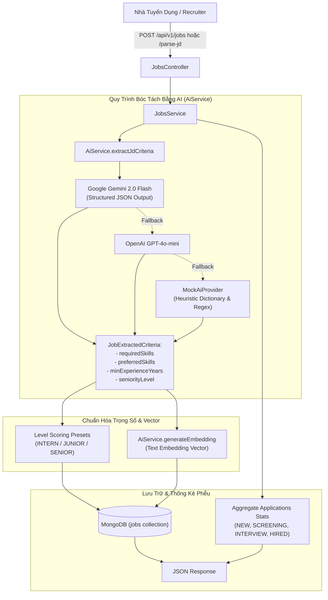

# 💼 BÁO CÁO TRIỂN KHAI MODULE QUẢN LÝ TIN TUYỂN DỤNG & AI BÓC TÁCH JD (JOBS MODULE IMPLEMENTATION)

> **Dự án**: Smart HR & Candidate Screening System  
> **Phân hệ**: Quản lý Tin Tuyển Dụng & Bóc Tách Tiêu Chí JD (Job Description Management)  
> **Mã yêu cầu IEEE SRS**: `[FR-JOB-01]`, `[FR-JOB-02]`, `[FR-JOB-03]`  
> **Tech Stack**: NestJS (v12) + TypeScript + MongoDB (Mongoose) + Vector Embeddings + Google Gemini / OpenAI Fallback  
> **Trạng thái**: Hoàn thành 100% (31/31 Test Cases PASS)

---

## 📌 1. TỔNG QUAN VÀ MỤC TIÊU CỦA MODULE

Trong quy trình tuyển dụng thông minh, **Job Description (JD)** là tài liệu cơ sở quan trọng nhất để Matching Engine đối chiếu và chấm điểm ứng viên. Trước đây, backend chỉ mới có schema `jobs.schema.ts` trong CSDL nhưng chưa có module API để nhà tuyển dụng thao tác thực tế.

Module `JobsModule` được xây dựng nhằm giải quyết triệt để bài toán này:
1. **CRUD Quản Lý Tin Tuyển Dụng Toàn Diện**:
   - Tạo mới tin tuyển dụng (`POST /api/v1/jobs`).
   - Lấy danh sách có phân trang, tìm kiếm theo từ khóa và lọc theo trạng thái (`GET /api/v1/jobs`).
   - Xem chi tiết tin tuyển dụng kèm thống kê phễu ứng viên (`GET /api/v1/jobs/:id`).
   - Cập nhật thông tin (`PUT /api/v1/jobs/:id`).
   - Đổi trạng thái nhanh `DRAFT` $\rightarrow$ `PUBLISHED` $\rightarrow$ `CLOSED` (`PATCH /api/v1/jobs/:id/status`).
   - Xóa an toàn có cơ chế bảo vệ dữ liệu hồ sơ ứng viên (`DELETE /api/v1/jobs/:id`).
2. **AI Tự Động Bóc Tách Tiêu Chí Tuyển Dụng (Automated JD Parsing)**:
   - Tự động tiếp nhận văn bản JD thô (không có cấu trúc) của nhà tuyển dụng.
   - Bóc tách ra các trường dữ liệu chuẩn xác:
     - `requiredSkills`: Kỹ năng chuyên môn bắt buộc (*must-have*).
     - `preferredSkills`: Kỹ năng ưu tiên, điểm cộng (*nice-to-have*).
     - `minExperienceYears`: Số năm kinh nghiệm tối thiểu yêu cầu.
     - `seniorityLevel`: Cấp bậc vị trí (`INTERN` | `JUNIOR` | `MIDDLE` | `SENIOR` | `LEAD`).
     - `responsibilities`: Danh sách trách nhiệm công việc chính.
     - `requiredEducation`: Trình độ học vấn yêu cầu.
3. **Tự Động Gán Trọng Số Chấm Điểm Theo Cấp Bậc (Level Presets)**:
   - Dựa trên cấp bậc bóc tách được từ JD, hệ thống tự động gán bộ trọng số chuẩn hóa ($\sum w_i = 1.0$):
     - **Intern/Fresher**: Ưu tiên học vấn và độ tương đồng ngữ nghĩa ($w_{\text{semantic}} = 0.30, w_{\text{skill}} = 0.35, w_{\text{exp}} = 0.10, w_{\text{edu}} = 0.25$).
     - **Junior/Middle**: Cân bằng kỹ năng và kinh nghiệm ($w_{\text{semantic}} = 0.20, w_{\text{skill}} = 0.40, w_{\text{exp}} = 0.25, w_{\text{edu}} = 0.15$).
     - **Senior/Lead**: Ưu tiên cao độ kinh nghiệm thực chiến ($w_{\text{semantic}} = 0.15, w_{\text{skill}} = 0.35, w_{\text{exp}} = 0.40, w_{\text{edu}} = 0.10$).
4. **Tự Động Sinh Vector Embedding Cho JD**:
   - Sử dụng Google Gemini `text-embedding-004` (hoặc OpenAI / Mock fallback) để chuyển đổi nội dung và tiêu chí của JD thành vector số lưu trực tiếp vào trường `embedding` của document MongoDB.

---

## 🏗️ 2. KIẾN TRÚC VÀ LUỒNG XỬ LÝ (WORKFLOW)



---

## 🛠️ 3. CHI TIẾT CÁC TỆP NGUỒN ĐÃ TRIỂN KHAI

### 3.1. DTOs & Interfaces
* **[`backend/src/modules/jobs/interfaces/job-criteria.interface.ts`](file:///d:/Smart-HR-Candidate-Screening-System/backend/src/modules/jobs/interfaces/job-criteria.interface.ts)**:
  - Định nghĩa `JobExtractedCriteria`, `ScoringWeights`, `SeniorityLevel`, `JobEmploymentType`, `JobStatus`.
  - Cung cấp hằng số `LEVEL_SCORING_WEIGHT_PRESETS` cho 5 cấp bậc vị trí.
* **[`backend/src/modules/jobs/dto/create-job.dto.ts`](file:///d:/Smart-HR-Candidate-Screening-System/backend/src/modules/jobs/dto/create-job.dto.ts)**:
  - Kiểm thực đầy đủ `title`, `department`, `location`, `employmentType`, `rawDescription` ($\ge 20$ ký tự), `autoExtract`, `status`.
* **[`backend/src/modules/jobs/dto/update-job.dto.ts`](file:///d:/Smart-HR-Candidate-Screening-System/backend/src/modules/jobs/dto/update-job.dto.ts)**:
  - Hỗ trợ cập nhật một phần và cờ `reExtract` để bóc tách lại JD bằng AI khi nội dung thay đổi.
* **[`backend/src/modules/jobs/dto/query-job.dto.ts`](file:///d:/Smart-HR-Candidate-Screening-System/backend/src/modules/jobs/dto/query-job.dto.ts)**:
  - Hỗ trợ `page`, `limit`, `search` (tìm kiếm từ khóa), lọc theo `department`, `status`, `employmentType`.
* **[`backend/src/modules/jobs/dto/parse-jd.dto.ts`](file:///d:/Smart-HR-Candidate-Screening-System/backend/src/modules/jobs/dto/parse-jd.dto.ts)**:
  - DTO cho endpoint xem trước kết quả bóc tách JD mà không lưu vào DB.

### 3.2. Dịch Vụ Nghiệp Vụ (`JobsService`)
* **Đường dẫn**: [`backend/src/modules/jobs/jobs.service.ts`](file:///d:/Smart-HR-Candidate-Screening-System/backend/src/modules/jobs/jobs.service.ts)
* **Các tính năng nổi bật**:
  - `create(...)`: Tự động gọi `aiService.extractJdCriteria`, tính trọng số theo cấp bậc, sinh vector embedding và lưu CSDL.
  - `parseJd(...)`: Endpoint độc lập cho phép người dùng nhập thử JD và xem AI trích xuất trước trên giao diện.
  - `findAll(...)`: Phân trang kết hợp Aggregation gắn kèm số lượng hồ sơ ứng tuyển (`applicantCount`) cho từng job.
  - `findOne(...)`: Chi tiết Job đính kèm báo cáo phân bố trạng thái ứng viên theo phễu (`NEW`, `SCREENING`, `INTERVIEW`, `HIRED`...).
  - `updateStatus(...)`: Chuyển nhanh trạng thái giữa `DRAFT`, `PUBLISHED`, `CLOSED`.
  - `remove(...)`: **Cơ chế bảo vệ dữ liệu (Data Protection)**: Nếu Job đã có ứng viên nộp hồ sơ, hệ thống tự động chuyển sang `CLOSED` thay vì xóa vĩnh viễn nhằm bảo toàn tính toàn vẹn dữ liệu tuyển dụng.

### 3.3. Bộ Điều Khiển API (`JobsController`)
* **Đường dẫn**: [`backend/src/modules/jobs/jobs.controller.ts`](file:///d:/Smart-HR-Candidate-Screening-System/backend/src/modules/jobs/jobs.controller.ts)
* **Các Endpoint**:
  | Method | Path | Mô tả |
  | :--- | :--- | :--- |
  | `POST` | `/api/v1/jobs` | Tạo tin tuyển dụng (AI bóc tách tiêu chí + sinh embedding) |
  | `POST` | `/api/v1/jobs/parse-jd` | Xem trước kết quả AI bóc tách JD thô |
  | `GET` | `/api/v1/jobs` | Danh sách tin tuyển dụng (phân trang, tìm kiếm, lọc) |
  | `GET` | `/api/v1/jobs/:id` | Xem chi tiết tin tuyển dụng + thống kê ứng viên |
  | `PUT` | `/api/v1/jobs/:id` | Cập nhật tin tuyển dụng |
  | `PATCH` | `/api/v1/jobs/:id/status` | Đổi nhanh trạng thái (`DRAFT` / `PUBLISHED` / `CLOSED`) |
  | `DELETE` | `/api/v1/jobs/:id` | Xóa hoặc đóng tin tuyển dụng |

### 3.4. AI Service Integration & Fallback
* **Đường dẫn**:
  - [`backend/src/modules/ai/ai.service.ts`](file:///d:/Smart-HR-Candidate-Screening-System/backend/src/modules/ai/ai.service.ts): Bổ sung hàm `extractJdCriteria(...)`.
  - [`backend/src/modules/ai/providers/gemini.provider.ts`](file:///d:/Smart-HR-Candidate-Screening-System/backend/src/modules/ai/providers/gemini.provider.ts): Tích hợp Gemini structured extraction.
  - [`backend/src/modules/ai/providers/openai.provider.ts`](file:///d:/Smart-HR-Candidate-Screening-System/backend/src/modules/ai/providers/openai.provider.ts): Tích hợp OpenAI structured extraction.
  - [`backend/src/modules/ai/providers/mock.provider.ts`](file:///d:/Smart-HR-Candidate-Screening-System/backend/src/modules/ai/providers/mock.provider.ts): Bóc tách kỹ năng theo từ điển công nghệ, phân biệt required vs preferred, nhận diện cấp bậc và số năm kinh nghiệm bằng Regex có kiểm soát thứ tự ưu tiên.

---

## 🧪 4. KẾT QUẢ KIỂM THỬ TỰ ĐỘNG (AUTOMATED TEST SUITE)

Hệ thống được kiểm thử toàn diện qua file script: [`backend/test/test-jobs-module.ts`](file:///d:/Smart-HR-Candidate-Screening-System/backend/test/test-jobs-module.ts) với lệnh:
```bash
npm run test:jobs
```

### Kết quả chạy thực tế:
```text
================================================================
🎯 BẮT ĐẦU KIỂM THỬ: JOBS MODULE & AI CRITERIA PARSER
================================================================

--- 1. KIỂM THỬ AI JD PARSING (STANDALONE PREVIEW) ---
 ✅ PASS: Trích xuất tiêu chí JD thành công
 ✅ PASS: Bóc tách đúng requiredSkills (NestJS / Node.js)
 ✅ PASS: Bóc tách đúng preferredSkills (Docker / Redis)
 ✅ PASS: Bóc tách đúng số năm kinh nghiệm tối thiểu >= 3 năm
 ✅ PASS: Nhận diện đúng cấp bậc vị trí là SENIOR
 ✅ PASS: Trích xuất đầy đủ danh sách trách nhiệm công việc
 ✅ PASS: Gợi ý trọng số cho Senior ưu tiên kinh nghiệm thực chiến (w_exp >= 0.35)

--- 2. KIỂM THỬ TẠO TIN TUYỂN DỤNG & SINH VECTOR EMBEDDING ---
 ✅ PASS: Lưu tin tuyển dụng vào CSDL thành công
 ✅ PASS: Lưu đúng tiêu đề công việc
 ✅ PASS: Trạng thái mặc định là PUBLISHED
 ✅ PASS: Có mảng requiredSkills được trích xuất
 ✅ PASS: requiredSkills không rỗng
 ✅ PASS: Tổng 4 trọng số chuẩn hóa xấp xỉ 1.0
 ✅ PASS: Tự động tạo vector embedding đặc trưng cho JD

--- 3. KIỂM THỬ DANH SÁCH & PHÂN TRANG KÈM SỐ LƯỢNG ỨNG VIÊN ---
 ✅ PASS: Lấy danh sách tất cả tin tuyển dụng
 ✅ PASS: Phân trang trả về đúng số bản ghi
 ✅ PASS: Đính kèm chính xác số lượng hồ sơ ứng tuyển (applicantCount = 3)
 ✅ PASS: Lọc chính xác theo trạng thái PUBLISHED
 ✅ PASS: Tìm kiếm chính xác theo từ khóa trong tiêu đề

--- 4. KIỂM THỬ XEM CHI TIẾT & THỐNG KÊ PHỄU ỨNG VIÊN ---
 ✅ PASS: Lấy đúng chi tiết Job theo ID
 ✅ PASS: Thống kê tổng số 3 ứng viên
 ✅ PASS: Thống kê chính xác trạng thái NEW = 1
 ✅ PASS: Thống kê chính xác trạng thái INTERVIEW = 1
 ✅ PASS: Thống kê chính xác trạng thái HIRED = 1

--- 5. KIỂM THỬ CẬP NHẬT TIN TUYỂN DỤNG & ĐỔI TRẠNG THÁI ---
 ✅ PASS: Cập nhật tiêu đề thành công
 ✅ PASS: Cập nhật địa điểm làm việc thành công
 ✅ PASS: Đổi trạng thái sang CLOSED thành công
 ✅ PASS: Xác nhận trạng thái trong CSDL là CLOSED

--- 6. KIỂM THỬ XÓA & BẢO TOÀN DỮ LIỆU KHI ĐÃ CÓ ỨNG VIÊN ---
 ✅ PASS: Không xóa vĩnh viễn tin tuyển dụng đã có ứng viên, tự động chuyển sang CLOSED để bảo vệ dữ liệu
 ✅ PASS: Xóa vĩnh viễn tin tuyển dụng chưa có ứng viên nào nộp
 ✅ PASS: Tin tuyển dụng sau khi xóa không còn tồn tại trong CSDL

================================================================
📊 TỔNG KẾT KIỂM THỬ: 31 PASS / 0 FAIL
🎉 TẤT CẢ TEST CASES CỦA JOBS MODULE ĐÃ VƯỢT QUA 100%!
================================================================
```

Đồng thời, toàn bộ 3 bộ test tự động của hệ thống chạy đồng thời:
- **`npm run test:matching`**: 28/28 PASS (100%).
- **`npm run test:interview`**: 34/34 PASS (100%).
- **`npm run test:jobs`**: 31/31 PASS (100%).
- **Tổng cộng**: **93 / 93 Test Cases PASS (100%)**.
- **Biên dịch NestJS**: `npm run build` thành công không có lỗi (`exit code 0`).

---

## 🏁 5. TỔNG KẾT

Với việc hoàn thiện `JobsModule`, hệ thống Smart HR hiện đã có đầy đủ mắt xích nghiệp vụ đầu tiên: **Nhà tuyển dụng có thể tạo tin tuyển dụng, AI tự động phân tích JD, tính toán vector embedding và lưu trữ tiêu chí**. Dữ liệu này sẽ làm đầu vào trực tiếp cho **Matching Engine (Tuần 11)** và **AI Interview Generation (Tuần 12)** một cách liền mạch và đồng bộ.

