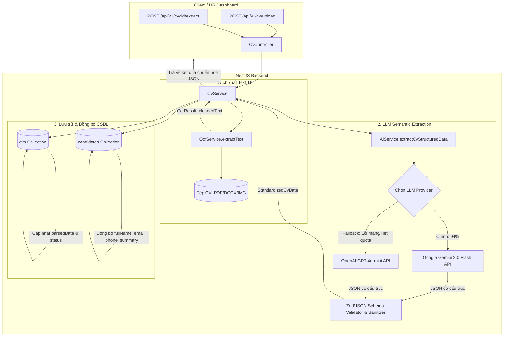
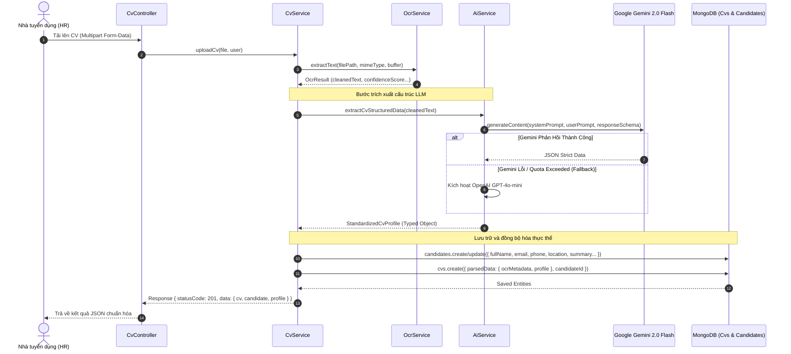
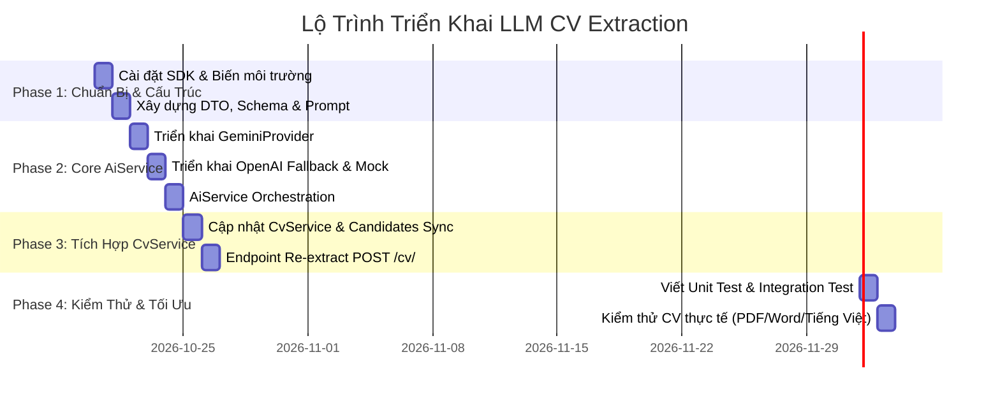

# 🤖 Kế Hoạch Triển Khai Tích Hợp LLM Extraction Để Phân Tích Văn Bản CV Thành Định Dạng JSON Chuẩn

> **Dự án**: Smart HR & Candidate Screening System  
> **Tài liệu tham chiếu**: [ERD.md](file:///d:/Smart-HR-Candidate-Screening-System/docs/ERD.md), [OCR_LLM_SELECTION.md](file:///d:/Smart-HR-Candidate-Screening-System/docs/OCR_LLM_SELECTION.md), [OCR_MODULE_PLAN.md](file:///d:/Smart-HR-Candidate-Screening-System/docs/OCR_MODULE_PLAN.md)  
> **Tech Stack**: NestJS (v12) + Express + MongoDB (Mongoose) + TypeScript  
> **Công nghệ LLM**: Google Gemini 2.0 Flash (`@google/genai`) + OpenAI GPT-4o-mini Fallback + Zod / JSON Schema Strict Structured Outputs  
> **Mục tiêu**: Nâng cấp module `AiService` và `CvService`, biến văn bản thô từ module OCR thành dữ liệu ứng viên có cấu trúc (Standardized JSON Profile), tự động đồng bộ sang thực thể `Candidate` và lưu trữ đầy đủ vào `Cvs.parsedData`.

---

## 📑 Mục Lục
1. [Bối Cảnh & Vấn Đề Hiện Tại](#1-bối-cảnh--vấn-đề-hiện-tại)
2. [Kiến Trúc Tổng Thể & Luồng Xử Lý (Architecture & Pipeline)](#2-kiến-trúc-tổng-thể--luồng-xử-lý-architecture--pipeline)
3. [Định Dạng JSON Chuẩn Hóa (Standardized Candidate JSON Schema)](#3-định-dạng-json-chuẩn-hóa-standardized-candidate-json-schema)
4. [Thiết Kế Prompt Engineering & Schema Enforcement](#4-thiết-kế-prompt-engineering--schema-enforcement)
5. [Thiết Kế Chi Tiết Các Thành Phần Trong Backend NestJS](#5-thiết-kế-chi-tiết-các-thành-phần-trong-backend-nestjs)
   - 5.1. Nâng cấp `AiModule` & `AiService` (Multi-Provider: Gemini + OpenAI)
   - 5.2. Cập nhật `CvService` (Tích hợp luồng bóc tách & Sync với Candidate)
   - 5.3. Bổ sung API Endpoint Re-extract CV (`POST /api/v1/cv/:id/extract`)
   - 5.4. Chiến lược xử lý lỗi, Fallback & Rate Limiting
6. [Kế Hoạch Triển Khai Chi Tiết Theo Giai Đoạn (Implementation Roadmap)](#6-kế-hoạch-triển-khai-chi-tiết-theo-giai-đoạn-implementation-roadmap)
7. [Kế Hoạch Kiểm Thử & Tiêu Chí Nghiệm Thu (Testing & Acceptance Criteria)](#7-kế-hoạch-kiểm-thử--tiêu-chí-nghiệm-thu-testing--acceptance-criteria)

---

## 1. Bối Cảnh & Vấn Đề Hiện Tại

### 1.1. Hiện trạng hệ thống
- **Module OCR (`OcrService`)**: Đã hoàn thành xử lý đa định dạng (PDF text, Word `.docx`, Ảnh/Scanned PDF) và làm sạch văn bản (`cleanedText`, `rawText`), tính toán `confidenceScore`, `wordCount`.
- **Hạn chế tại `CvService.uploadCv`**:
  - Dữ liệu `Candidate` hiện chỉ lấy `fullName` từ tên file tệp tin (`path.basename(file.originalname)`).
  - Tóm tắt `summary` chỉ cắt 500 ký tự đầu tiên của văn bản thô (`extractedText.slice(0, 500)`).
  - `parsedData` trong bảng `CVS` chỉ lưu metadata kỹ thuật của OCR (số từ, số ký tự, extractor used), hoàn toàn **chưa có cấu trúc nghiệp vụ HR** (kinh nghiệm, kỹ năng, học vấn, dự án).
- **Module AI (`AiService`)**: Hiện tại chỉ là hàm stub giả lập trả về mock response:
  ```typescript
  async generateCompletion(prompt: string, schema?: object): Promise<any> {
    return { status: 'stub', promptReceived: prompt };
  }
  ```

### 1.2. Mục tiêu đạt được sau tích hợp
1. **Trích xuất thông minh (Smart Extraction)**: Sử dụng LLM để hiểu ngữ cảnh ngữ nghĩa tiếng Việt & tiếng Anh, phân loại thông tin chuẩn xác bất chấp cấu trúc CV đa cột hay định dạng tự do.
2. **Tuân thủ chuẩn dữ liệu (Strict Schema)**: Đảm bảo 100% kết quả trả về là JSON hợp lệ, tuân thủ TypeScript Interface và Mongoose Schema mà không bị vỡ định dạng (markdown blocks, hallucinated keys).
3. **Đồng bộ tự động (Auto-sync Profile)**: Cập nhật thông tin thực tế của ứng viên (`fullName`, `email`, `phone`, `currentTitle`, `skills`, `workHistory`, v.v.) vào Database.
4. **Hiệu năng & Chi phí**: Tận dụng tối đa **Google Gemini 2.0 Flash** với chi phí siêu rẻ (~$0.075/1M tokens) và độ trễ phản hồi < 1.5 giây.

---

## 2. Kiến Trúc Tổng Thể & Luồng Xử Lý (Architecture & Pipeline)

### 2.1. Sơ đồ luồng dữ liệu (Data Flow Diagram)



### 2.2. Sequence Diagram (Tuần tự xử lý chi tiết)



---

## 3. Định Dạng JSON Chuẩn Hóa (Standardized Candidate JSON Schema)

Định dạng JSON chuẩn hóa phải bao quát toàn diện thông tin một ứng viên, hỗ trợ tìm kiếm ngữ nghĩa (vector embeddings) và chấm điểm với Mô tả công việc (JD).

### 3.1. TypeScript Interface (`standard-cv.interface.ts`)

```typescript
export interface StandardPersonalInfo {
  fullName: string;
  email: string | null;
  phone: string | null;
  location: string | null;
  linkedin: string | null;
  github: string | null;
  portfolioUrl: string | null;
  currentTitle: string | null;
}

export interface StandardWorkExperience {
  company: string;
  role: string;
  location?: string | null;
  startDate: string | null; // Định dạng "YYYY-MM" hoặc "YYYY"
  endDate: string | null;   // Định dạng "YYYY-MM", "YYYY", hoặc "Present"
  isCurrent: boolean;
  durationMonths?: number | null;
  description: string;
  responsibilities: string[];
  achievements: string[];
  techStack: string[];
}

export interface StandardEducation {
  institution: string;
  degree: string;           // Ví dụ: "Bachelor", "Master", "Cử nhân", "Kỹ sư"
  fieldOfStudy: string;     // Ví dụ: "Computer Science", "Information Technology"
  startDate?: string | null;
  endDate?: string | null;
  graduationYear?: string | null;
  gpa?: string | null;
}

export interface StandardLanguage {
  language: string;         // Ví dụ: "English", "Vietnamese"
  proficiency: string;      // Ví dụ: "Native", "Fluent", "IELTS 7.5", "B2"
}

export interface StandardProject {
  projectName: string;
  role?: string | null;
  description: string;
  startDate?: string | null;
  endDate?: string | null;
  techStack: string[];
  projectUrl?: string | null;
}

export interface StandardCertification {
  name: string;
  issuer?: string | null;
  issueDate?: string | null;
  expiryDate?: string | null;
  credentialUrl?: string | null;
}

export interface StandardSkills {
  technicalSkills: string[];    // Ngôn ngữ lập trình, framework, DB
  softSkills: string[];         // Kỹ năng mềm: giao tiếp, làm việc nhóm, giải quyết vấn đề
  toolsAndPlatforms: string[];  // Docker, Git, AWS, Jira, Figma
}

export interface StandardCvProfile {
  personalInfo: StandardPersonalInfo;
  summary: string;
  yearsOfExperience: number;
  skills: StandardSkills;
  workExperience: StandardWorkExperience[];
  education: StandardEducation[];
  certifications: StandardCertification[];
  languages: StandardLanguage[];
  projects: StandardProject[];
}

export interface ExtractionMetadata {
  extractorModel: string;       // "gemini-2.0-flash" | "gpt-4o-mini"
  confidenceScore: number;      // 0 - 100
  processingTimeMs: number;
  tokensUsed?: {
    promptTokens: number;
    completionTokens: number;
    totalTokens: number;
  };
  extractedAt: Date;
}

export interface FullParsedCvData {
  profile: StandardCvProfile;
  ocrMetadata: {
    rawLength: number;
    cleanedLength: number;
    characterCount: number;
    wordCount: number;
    extractorUsed: string;
    isScanned: boolean;
  };
  extractionMetadata: ExtractionMetadata;
}
```

### 3.2. JSON Schema cho LLM Gemini (`responseSchema`)

Google Gemini hỗ trợ ép kiểu trực tiếp cấu trúc JSON thông qua tham số `generationConfig.responseSchema`:

```typescript
export const CV_EXTRACTION_GEMINI_SCHEMA = {
  type: 'OBJECT',
  properties: {
    personalInfo: {
      type: 'OBJECT',
      properties: {
        fullName: { type: 'STRING' },
        email: { type: 'STRING', nullable: true },
        phone: { type: 'STRING', nullable: true },
        location: { type: 'STRING', nullable: true },
        linkedin: { type: 'STRING', nullable: true },
        github: { type: 'STRING', nullable: true },
        portfolioUrl: { type: 'STRING', nullable: true },
        currentTitle: { type: 'STRING', nullable: true },
      },
      required: ['fullName'],
    },
    summary: { type: 'STRING' },
    yearsOfExperience: { type: 'NUMBER' },
    skills: {
      type: 'OBJECT',
      properties: {
        technicalSkills: { type: 'ARRAY', items: { type: 'STRING' } },
        softSkills: { type: 'ARRAY', items: { type: 'STRING' } },
        toolsAndPlatforms: { type: 'ARRAY', items: { type: 'STRING' } },
      },
      required: ['technicalSkills', 'softSkills'],
    },
    workExperience: {
      type: 'ARRAY',
      items: {
        type: 'OBJECT',
        properties: {
          company: { type: 'STRING' },
          role: { type: 'STRING' },
          location: { type: 'STRING', nullable: true },
          startDate: { type: 'STRING', nullable: true },
          endDate: { type: 'STRING', nullable: true },
          isCurrent: { type: 'BOOLEAN' },
          description: { type: 'STRING' },
          responsibilities: { type: 'ARRAY', items: { type: 'STRING' } },
          achievements: { type: 'ARRAY', items: { type: 'STRING' } },
          techStack: { type: 'ARRAY', items: { type: 'STRING' } },
        },
        required: ['company', 'role', 'isCurrent'],
      },
    },
    education: {
      type: 'ARRAY',
      items: {
        type: 'OBJECT',
        properties: {
          institution: { type: 'STRING' },
          degree: { type: 'STRING' },
          fieldOfStudy: { type: 'STRING' },
          startDate: { type: 'STRING', nullable: true },
          endDate: { type: 'STRING', nullable: true },
          graduationYear: { type: 'STRING', nullable: true },
          gpa: { type: 'STRING', nullable: true },
        },
        required: ['institution', 'degree'],
      },
    },
    certifications: {
      type: 'ARRAY',
      items: {
        type: 'OBJECT',
        properties: {
          name: { type: 'STRING' },
          issuer: { type: 'STRING', nullable: true },
          issueDate: { type: 'STRING', nullable: true },
          expiryDate: { type: 'STRING', nullable: true },
          credentialUrl: { type: 'STRING', nullable: true },
        },
        required: ['name'],
      },
    },
    languages: {
      type: 'ARRAY',
      items: {
        type: 'OBJECT',
        properties: {
          language: { type: 'STRING' },
          proficiency: { type: 'STRING' },
        },
        required: ['language', 'proficiency'],
      },
    },
    projects: {
      type: 'ARRAY',
      items: {
        type: 'OBJECT',
        properties: {
          projectName: { type: 'STRING' },
          role: { type: 'STRING', nullable: true },
          description: { type: 'STRING' },
          startDate: { type: 'STRING', nullable: true },
          endDate: { type: 'STRING', nullable: true },
          techStack: { type: 'ARRAY', items: { type: 'STRING' } },
          projectUrl: { type: 'STRING', nullable: true },
        },
        required: ['projectName', 'description'],
      },
    },
  },
  required: ['personalInfo', 'summary', 'skills', 'workExperience', 'education'],
};
```

---

### 3.3. Tích Hợp OpenAI Structured Outputs (Theo Tài Liệu Chính Thức)

Theo [OpenAI Structured Outputs Guide](https://platform.openai.com/docs/guides/structured-outputs), OpenAI cung cấp cơ chế **Constrained Decoding** (FSA - Finite State Automaton sampling) đảm bảo mô hình tuân thủ 100% JSON Schema định nghĩa, triệt tiêu hoàn toàn các lỗi:
- JSON không đóng ngoặc hoặc syntax error.
- Tự ý sinh ra các key không có trong định nghĩa (`hallucinated keys`).
- Bỏ sót các trường dữ liệu bắt buộc.

#### A. 3 Nguyên Tắc Bắt Buộc Của OpenAI Structured Outputs:
1. **`strict: true`**: Bắt buộc kích hoạt chế độ kiểm soát chặt chẽ.
2. **`additionalProperties: false`**: Mọi Object trong schema đều phải có `additionalProperties: false`.
3. **Mọi field đều phải nằm trong `required`**: Nếu một trường là không bắt buộc (optional), trong schema phải định nghĩa dạng Union với `null` (`z.string().nullable()`), tuyệt đối không dùng `.optional()`.

#### B. Thiết Kế Zod Schema - "Single Source of Truth" (`candidate-profile.zod.ts`)
Sử dụng **Zod** làm nguồn định nghĩa duy nhất cho toàn bộ hệ thống: sinh TypeScript Type, phục vụ OpenAI `zodResponseFormat`, và validate runtime cho Gemini.

```typescript
import { z } from 'zod';

export const PersonalInfoZodSchema = z.object({
  fullName: z.string().describe('Họ và tên đầy đủ của ứng viên'),
  email: z.string().nullable().describe('Địa chỉ email hợp lệ hoặc null'),
  phone: z.string().nullable().describe('Số điện thoại liên hệ hoặc null'),
  location: z.string().nullable().describe('Thành phố/Địa chỉ hiện tại hoặc null'),
  linkedin: z.string().nullable().describe('Đường dẫn LinkedIn hoặc null'),
  github: z.string().nullable().describe('Đường dẫn GitHub hoặc null'),
  portfolioUrl: z.string().nullable().describe('Trang web cá nhân hoặc null'),
  currentTitle: z.string().nullable().describe('Vị trí công việc hiện tại hoặc gần nhất'),
});

export const WorkExperienceZodSchema = z.object({
  company: z.string().describe('Tên công ty / tổ chức'),
  role: z.string().describe('Vị trí / chức danh làm việc'),
  location: z.string().nullable().describe('Địa điểm công ty hoặc Onsite/Remote'),
  startDate: z.string().nullable().describe('Thời gian bắt đầu: YYYY-MM hoặc YYYY'),
  endDate: z.string().nullable().describe('Thời gian kết thúc: YYYY-MM, YYYY, hoặc Present'),
  isCurrent: z.boolean().describe('true nếu hiện tại vẫn đang làm việc tại đây'),
  durationMonths: z.number().nullable().describe('Số tháng làm việc ước tính'),
  description: z.string().describe('Tóm tắt tổng quan về công việc'),
  responsibilities: z.array(z.string()).describe('Các đầu việc chính đã thực hiện'),
  achievements: z.array(z.string()).describe('Các thành tựu, giải thưởng hoặc con số nổi bật'),
  techStack: z.array(z.string()).describe('Các công nghệ, ngôn ngữ, công cụ đã dùng'),
});

export const EducationZodSchema = z.object({
  institution: z.string().describe('Tên trường Đại học / Cao đẳng / Học viện'),
  degree: z.string().describe('Bằng cấp: Cử nhân, Thạc sĩ, Kỹ sư, Trung cấp...'),
  fieldOfStudy: z.string().describe('Chuyên ngành: Khoa học máy tính, CNTT, Kinh tế...'),
  startDate: z.string().nullable().describe('Năm bắt đầu'),
  endDate: z.string().nullable().describe('Năm kết thúc'),
  graduationYear: z.string().nullable().describe('Năm tốt nghiệp'),
  gpa: z.string().nullable().describe('Điểm GPA hoặc xếp loại tốt nghiệp'),
});

export const CertificationZodSchema = z.object({
  name: z.string().describe('Tên chứng chỉ: AWS SAA, IELTS, PMP, JLPT...'),
  issuer: z.string().nullable().describe('Tổ chức cấp chứng chỉ'),
  issueDate: z.string().nullable().describe('Ngày cấp'),
  expiryDate: z.string().nullable().describe('Ngày hết hạn'),
  credentialUrl: z.string().nullable().describe('Link tra cứu chứng chỉ'),
});

export const ProjectZodSchema = z.object({
  projectName: z.string().describe('Tên dự án tiêu biểu'),
  role: z.string().nullable().describe('Vai trò trong dự án'),
  description: z.string().describe('Mô tả mục tiêu dự án và quy mô'),
  startDate: z.string().nullable().describe('Ngày bắt đầu'),
  endDate: z.string().nullable().describe('Ngày hoàn thành'),
  techStack: z.array(z.string()).describe('Các công nghệ sử dụng trong dự án'),
  projectUrl: z.string().nullable().describe('Link GitHub hoặc Live Demo'),
});

export const CandidateProfileZodSchema = z.object({
  personalInfo: PersonalInfoZodSchema,
  summary: z.string().describe('Đoạn tóm tắt bản thân hoặc mục tiêu nghề nghiệp'),
  yearsOfExperience: z.number().describe('Tổng số năm kinh nghiệm làm việc thực tế'),
  skills: z.object({
    technicalSkills: z.array(z.string()).describe('Kỹ năng kỹ thuật, ngôn ngữ lập trình, framework, DB'),
    softSkills: z.array(z.string()).describe('Kỹ năng mềm'),
    toolsAndPlatforms: z.array(z.string()).describe('Công cụ và nền tảng: Git, Docker, AWS, Figma, Jira'),
  }),
  workExperience: z.array(WorkExperienceZodSchema),
  education: z.array(EducationZodSchema),
  certifications: z.array(CertificationZodSchema),
  languages: z.array(
    z.object({
      language: z.string().describe('Tên ngôn ngữ'),
      proficiency: z.string().describe('Mức độ thành thạo: Native, Professional, Intermediate, B2...'),
    }),
  ),
  projects: z.array(ProjectZodSchema),
});

// Tự động sinh TypeScript Interface từ Zod Schema
export type CandidateProfileType = z.infer<typeof CandidateProfileZodSchema>;
```

#### C. Bảng So Sánh Cơ Chế Ép Chuẩn Dữ Liệu: OpenAI vs Google Gemini

| Tiêu chí | OpenAI Structured Outputs | Google Gemini Structured Outputs |
| :--- | :--- | :--- |
| **Cơ chế thực thi** | Constrained Decoding với Grammar/Automaton | Constrained Sampling với `responseSchema` |
| **Độ tin cậy định dạng** | 100% khớp Schema (Không bao giờ vỡ cấu trúc) | Rất cao (>99.5%) |
| **Cú pháp gọi SDK** | `client.beta.chat.completions.parse({ response_format: zodResponseFormat(...) })` | `ai.models.generateContent({ config: { responseMimeType: 'application/json', responseSchema } })` |
| **Hỗ trợ Zod** | Có sẵn helper chính thức `zodResponseFormat` | Chuyển đổi qua schema object hoặc dùng Zod validate output |
| **Xử lý từ chối (Refusal)** | Trả về trường `refusal` riêng biệt, không vỡ JSON | Ném exception hoặc cờ `finishReason: SAFETY` |
| **Chi phí (Input / Output)**| $\$0.15$ / $\$0.60$ trên 1M tokens (GPT-4o-mini) | **$\$0.075$ / $\$0.30$** trên 1M tokens (Gemini 2.0 Flash) |


---

## 4. Thiết Kế Prompt Engineering & Schema Enforcement

### 4.1. System Prompt Tối Ưu Cho Tuyển Dụng
Prompt được thiết kế tối ưu cho CV cả Tiếng Việt và Tiếng Anh, giải quyết các vấn đề đặc thù như CV chia 2 cột, ngày tháng không thống nhất, và kỹ năng bị liệt kê rải rác:

```text
Bạn là một Chuyên Gia Tuyển Dụng Nhân Sự Cấp Cao (Senior HR Tech & Data Extractor).
Nhiệm vụ của bạn là đọc toàn bộ văn bản CV thô dưới đây (có thể trích xuất từ PDF/Word/Ảnh, có thể bị xáo trộn thứ tự do layout đa cột) và trích xuất thành định dạng JSON chuẩn hóa cấu trúc 100%.

QUY TẮC TRÍCH XUẤT NGHIÊM NGẶT:
1. Độ chính xác tuyệt đối:
   - KHÔNG ĐƯỢC bịa đặt (hallucinate) thông tin. Nếu trường nào không có trong CV, hãy gán giá trị null hoặc mảng rỗng [].
   - Họ và tên (fullName): Cần tìm tên người ứng viên thực tế ở đầu CV (viết hoa, nổi bật), KHÔNG lấy tên file hay tên chức danh.
   - Email & Số điện thoại: Chuẩn hóa định dạng chuẩn (ví dụ phone loại bỏ khoảng cách thừa, bắt đầu bằng +84 hoặc 0...).
2. Phân tách kỹ năng thông minh (Skill Categorization):
   - Phân loại rõ: technicalSkills (ngôn ngữ, framework, DB), softSkills (giao tiếp, lãnh đạo), và toolsAndPlatforms (Docker, Git, AWS, Figma).
   - Tự động chuẩn hóa tên công nghệ (ví dụ: "React.js" -> "React", "Node" -> "Node.js").
3. Thời gian kinh nghiệm & Tính toán số năm:
   - startDate / endDate: Trả về chuẩn dạng "YYYY-MM" hoặc "YYYY". Nếu đang làm việc hiện tại, ghi "Present" và đánh dấu isCurrent: true.
   - yearsOfExperience: Tính tổng số năm kinh nghiệm làm việc thực tế (tính từ mốc bắt đầu công việc đầu tiên đến nay, loại trừ thời gian thực tập nếu có chồng lấn). Làm tròn đến 1 chữ số thập phân.
4. Trả về đúng 1 đối tượng JSON duy nhất theo schema quy định, không kèm bất kỳ lời giải thích hay markdown backticks (```json).
```

### 4.2. Khử Nhiễu Văn Bản Trước Khi Gửi Sang LLM (Pre-sanitizing)
- Cắt bỏ các ký tự xuống dòng thừa (`\n\n\n+` $\rightarrow$ `\n`).
- Loại bỏ các chuỗi mã base64 rác hoặc ký tự lạ sinh ra do OCR bị lỗi.
- Kiểm tra độ dài văn bản: Nếu văn bản quá ngắn (< 30 từ), kích hoạt cảnh báo file rỗng hoặc không thể đọc.

---

## 5. Thiết Kế Chi Tiết Các Thành Phần Trong Backend NestJS

### 5.1. Nâng cấp `AiModule` & `AiService`

#### A. Cài đặt SDK chính thức
```bash
npm install @google/genai
```
*(Tùy chọn: cài đặt thêm `openai` làm fallback provider).*

#### B. Cấu trúc thư mục mới của `AiModule`
```
backend/src/modules/ai/
├── ai.controller.ts            # Endpoint kiểm tra sức khỏe AI & test prompt
├── ai.module.ts                # Khai báo Provider & Exports
├── ai.service.ts               # Orchestrator & Multi-provider fallback
├── interfaces/
│   ├── standard-cv.interface.ts # Interface dữ liệu chuẩn
│   └── ai-provider.interface.ts # Interface trừu tượng cho LLM Provider
├── providers/
│   ├── gemini.provider.ts      # Triển khai Google Gemini 2.0 Flash
│   └── openai.provider.ts      # Triển khai OpenAI GPT-4o-mini (Fallback)
├── schemas/
│   └── cv-extraction.schema.ts # JSON Schema ép kiểu cho LLM
└── prompts/
    └── cv-extraction.prompt.ts # System prompt & User prompt templates
```

#### C. Triển khai `GeminiProvider` (`gemini.provider.ts`)
```typescript
import { Injectable, Logger } from '@nestjs/common';
import { ConfigService } from '@nestjs/config';
import { GoogleGenAI } from '@google/genai';
import { CV_EXTRACTION_GEMINI_SCHEMA } from '../schemas/cv-extraction.schema';
import { CV_SYSTEM_PROMPT } from '../prompts/cv-extraction.prompt';
import { StandardCvProfile } from '../interfaces/standard-cv.interface';

@Injectable()
export class GeminiProvider {
  private readonly logger = new Logger(GeminiProvider.name);
  private readonly client: GoogleGenAI;
  private readonly modelName = 'gemini-2.0-flash';

  constructor(private readonly configService: ConfigService) {
    const apiKey = this.configService.get<string>('GEMINI_API_KEY') || process.env.GEMINI_API_KEY;
    if (!apiKey) {
      this.logger.warn('GEMINI_API_KEY is not defined. GeminiProvider will run in mock mode.');
    }
    this.client = new GoogleGenAI({ apiKey: apiKey || 'dummy-key' });
  }

  async extractCv(cleanedText: string): Promise<{ profile: StandardCvProfile; tokensUsed?: any }> {
    const prompt = `${CV_SYSTEM_PROMPT}\n\n--- DƯỚI ĐÂY LÀ VĂN BẢN CV CẦN PHÂN TÍCH ---\n${cleanedText}`;

    const response = await this.client.models.generateContent({
      model: this.modelName,
      contents: prompt,
      config: {
        responseMimeType: 'application/json',
        responseSchema: CV_EXTRACTION_GEMINI_SCHEMA,
        temperature: 0.1, // Nhiệt độ thấp để đảm bảo dữ liệu trung thực, không sáng tạo tùy tiện
      },
    });

    const parsedJson = JSON.parse(response.text.trim());
    return {
      profile: parsedJson as StandardCvProfile,
      tokensUsed: response.usageMetadata,
    };
  }
}
```

#### D. Triển khai `OpenAiProvider` Với OpenAI Structured Outputs (`openai.provider.ts`)
Áp dụng đúng chuẩn tài liệu hướng dẫn của OpenAI sử dụng `zodResponseFormat` và phương thức `.parse()`:

```typescript
import { Injectable, Logger } from '@nestjs/common';
import { ConfigService } from '@nestjs/config';
import OpenAI from 'openai';
import { zodResponseFormat } from 'openai/helpers/zod';
import { CandidateProfileZodSchema, CandidateProfileType } from '../schemas/candidate-profile.zod';
import { CV_SYSTEM_PROMPT } from '../prompts/cv-extraction.prompt';

@Injectable()
export class OpenAiProvider {
  private readonly logger = new Logger(OpenAiProvider.name);
  private readonly client: OpenAI;
  private readonly modelName = 'gpt-4o-mini';

  constructor(private readonly configService: ConfigService) {
    const apiKey = this.configService.get<string>('OPENAI_API_KEY') || process.env.OPENAI_API_KEY;
    this.client = new OpenAI({ apiKey: apiKey || 'dummy-key' });
  }

  async extractCv(cleanedText: string): Promise<{ profile: CandidateProfileType; tokensUsed?: any }> {
    const completion = await this.client.beta.chat.completions.parse({
      model: this.modelName,
      messages: [
        { role: 'system', content: CV_SYSTEM_PROMPT },
        { role: 'user', content: `--- DƯỚI ĐÂY LÀ VĂN BẢN CV CẦN PHÂN TÍCH ---\n${cleanedText}` },
      ],
      // Ép chuẩn 100% JSON Schema qua Zod Response Format của OpenAI
      response_format: zodResponseFormat(CandidateProfileZodSchema, 'candidate_cv_profile'),
      temperature: 0.1,
    });

    const message = completion.choices[0]?.message;

    // Kiểm tra trường hợp an toàn (Refusal) theo OpenAI Guide
    if (message?.refusal) {
      throw new Error(`OpenAI Model Refused to extract CV: ${message.refusal}`);
    }

    if (!message?.parsed) {
      throw new Error('OpenAI Structured Output parsing returned null');
    }

    return {
      profile: message.parsed,
      tokensUsed: completion.usage,
    };
  }
}
```

#### E. Triển khai Fallback Orchestration trong `AiService`
```typescript
@Injectable()
export class AiService {
  constructor(
    private readonly geminiProvider: GeminiProvider,
    private readonly openaiProvider: OpenAiProvider,
  ) {}

  async extractCvStructuredData(cleanedText: string): Promise<FullParsedCvData> {
    const startTime = Date.now();
    try {
      // 1. Thử nghiệm với Google Gemini 2.0 Flash
      const { profile, tokensUsed } = await this.geminiProvider.extractCv(cleanedText);
      return {
        profile,
        extractionMetadata: {
          extractorModel: 'gemini-2.0-flash',
          confidenceScore: 95,
          processingTimeMs: Date.now() - startTime,
          tokensUsed,
          extractedAt: new Date(),
        },
        ocrMetadata: {} as any, // Gắn từ OcrService
      };
    } catch (err) {
      this.logger.error('Gemini extraction failed, attempting fallback to OpenAI...', err);
      // 2. Tự động fallback sang OpenAI nếu Gemini gặp sự cố
      const { profile, tokensUsed } = await this.openaiProvider.extractCv(cleanedText);
      return {
        profile,
        extractionMetadata: {
          extractorModel: 'gpt-4o-mini (fallback)',
          confidenceScore: 90,
          processingTimeMs: Date.now() - startTime,
          tokensUsed,
          extractedAt: new Date(),
        },
        ocrMetadata: {} as any,
      };
    }
  }
}
```

---

### 5.2. Cập nhật `CvService` (Tích hợp luồng bóc tách & Sync với Candidate)

Trong `backend/src/modules/cv/cv.service.ts`:
1. Tiêm `AiService` vào `constructor`:
   ```typescript
   constructor(
     @InjectModel(Cvs.name) private readonly cvModel: Model<CvsDocument>,
     @InjectModel(Candidates.name) private readonly candidateModel: Model<CandidatesDocument>,
     private readonly ocrService: OcrService,
     private readonly aiService: AiService,
   ) {}
   ```
2. Cải tiến hàm `uploadCv`:
   - Bước 1: Trích xuất Text bằng `ocrService.extractText()`.
   - Bước 2: Gọi `aiService.extractCvStructuredData(ocr.cleanedText)`.
   - Bước 3: Cập nhật hoặc tạo mới bản ghi `Candidate` với thông tin thực tế từ `profile`:
     ```typescript
     const candidate = await this.candidateModel.create({
       fullName: profile.personalInfo.fullName || defaultName,
       email: profile.personalInfo.email,
       phone: profile.personalInfo.phone,
       location: profile.personalInfo.location,
       currentTitle: profile.personalInfo.currentTitle,
       summary: profile.summary,
     });
     ```
   - Bước 4: Lưu `parsedData` đầy đủ vào bản ghi `Cvs`:
     ```typescript
     parsedData: {
       profile,
       ocrMetadata: {
         rawText: ocr.rawText,
         cleanedText: ocr.cleanedText,
         characterCount: ocr.characterCount,
         wordCount: ocr.wordCount,
         extractorUsed: ocr.extractorUsed,
         isScanned: ocr.isScanned,
         confidenceScore: ocr.confidenceScore,
       },
       extractionMetadata: extractionResult.extractionMetadata,
     }
     ```

---

### 5.3. Bổ sung API Endpoint Re-extract CV (`POST /api/v1/cv/:id/extract`)

Cho phép HR hoặc hệ thống kích hoạt lại việc trích xuất LLM (ví dụ: khi cập nhật prompt mới, đổi mô hình LLM, hoặc khi lần upload đầu bị gián đoạn mạng):

- **Route**: `POST /api/v1/cv/:id/extract`
- **Controller**: `CvController.reExtractCv(@Param('id') id: string)`
- **Luồng xử lý**:
  1. Kiểm tra tồn tại của CV qua ID.
  2. Lấy `cleanedText` đã lưu trong `parsedData.ocrMetadata.cleanedText` (nếu chưa có thì đọc lại tệp file).
  3. Gửi văn bản sang `AiService.extractCvStructuredData()`.
  4. Cập nhật lại `Cvs.parsedData.profile` và đồng bộ lại `Candidates`.
  5. Trả về thông tin cập nhật mới nhất cho Client.

---

### 5.4. Chiến Lược Xử Lý Lỗi, Fallback & Rate Limiting

| Tình huống rủi ro | Cơ chế giải quyết | Hành vi hệ thống |
| :--- | :--- | :--- |
| **CV văn bản quá ngắn (< 30 chữ) hoặc ảnh rỗng** | Validation Guard | Bỏ qua LLM call, trả về thông báo lỗi "CV không chứa đủ nội dung văn bản để phân tích", tiết kiệm token. |
| **Gemini API Rate Limit (429 Too Many Requests)** | Retry with Exponential Backoff (3 lần) | Chờ $1\text{s} \rightarrow 2\text{s} \rightarrow 4\text{s}$. Nếu vẫn lỗi, chuyển sang Fallback Provider (OpenAI). |
| **Mất kết nối mạng / Timeout (> 15 giây)** | Axios/Fetch AbortController Timeout (15s) | Tự động hủy request treo và chuyển sang Mock hoặc Fallback. |
| **Chưa cấu hình API Key (`GEMINI_API_KEY`)** | Mock Service Fallback | Không làm sập ứng dụng (Graceful Degradation); trả về mock structured data mẫu để nhà phát triển kiểm thử UI. |
| **Ứng viên trùng email** | Deduplication check | Kiểm tra `candidateModel.findOne({ email })`. Nếu đã tồn tại, liên kết CV mới với ứng viên hiện có thay vì tạo bản sao rác. |

---

## 6. Kế Hoạch Triển Khai Chi Tiết Theo Giai Đoạn (Implementation Roadmap)



### Chi tiết các công việc cụ thể:

#### Phase 1: Chuẩn bị Thư viện & Thiết kế Cấu trúc Dữ liệu
- [ ] Bổ sung biến môi trường vào `.env` và `configuration.ts`: `GEMINI_API_KEY`, `OPENAI_API_KEY`, `LLM_EXTRACTION_MODEL`.
- [ ] Cài đặt gói `@google/genai` vào `backend/package.json`.
- [ ] Tạo file Interface `backend/src/modules/ai/interfaces/standard-cv.interface.ts`.
- [ ] Tạo file Schema `backend/src/modules/ai/schemas/cv-extraction.schema.ts`.
- [ ] Tạo file Prompt template `backend/src/modules/ai/prompts/cv-extraction.prompt.ts`.

#### Phase 2: Xây dựng & Nâng cấp `AiModule`
- [ ] Xây dựng `GeminiProvider`: Kết nối Gemini API, cấu hình `responseSchema` dạng Strict Object.
- [ ] Xây dựng Mock Provider (phục vụ test local khi không có API Key).
- [ ] Nâng cấp `AiService`: Thêm hàm `extractCvStructuredData(cleanedText: string)`.
- [ ] Đăng ký Provider và Export `AiService` trong `ai.module.ts`.

#### Phase 3: Tích hợp vào `CvModule` & Đồng bộ `Candidate`
- [ ] Import `AiModule` vào `cv.module.ts`.
- [ ] Cập nhật hàm `CvService.uploadCv`:
  - Lấy kết quả từ `AiService`.
  - Đồng bộ các trường `fullName`, `email`, `phone`, `currentTitle`, `summary` vào collection `candidates`.
  - Lưu `profile` và `extractionMetadata` vào `cvs.parsedData`.
- [ ] Thêm method `CvService.reExtractCv(id: string)` và route `POST /api/v1/cv/:id/extract` trong `cv.controller.ts`.

#### Phase 4: Kiểm thử, Tối ưu & Viết Kịch Bản Test
- [ ] Tạo script test độc lập: `backend/test/test-llm-extraction.ts`.
- [ ] Test với 3 bộ dữ liệu CV mẫu:
  1. CV Tiếng Việt IT chuẩn (1 cột).
  2. CV Tiếng Anh đa cột thiết kế (Canva/TopCV).
  3. CV bị khuyết thông tin (không có số điện thoại hoặc không có kinh nghiệm).
- [ ] Đánh giá thời gian phản hồi (Latency) và chi phí token.

---

## 7. Kế Hoạch Kiểm Thử & Tiêu Chí Nghiệm Thu (Testing & Acceptance Criteria)

### 7.1. Danh mục ca kiểm thử (Test Cases)

| Test Case ID | Mục tiêu kiểm thử | Dữ liệu đầu vào | Kết quả mong đợi (Expected Result) |
| :--- | :--- | :--- | :--- |
| **TC-LLM-01** | Bóc tách CV tiếng Việt 1 cột chuẩn | Text CV Lập trình viên tiếng Việt | Trích xuất đúng `fullName`, `email`, `skills.technicalSkills`, `workExperience` chuẩn ngày tháng. |
| **TC-LLM-02** | Bóc tách CV tiếng Anh 2 cột | Text CV từ Canva bị đảo dòng | Nhận diện đúng các khối thông tin, không bị trộn lẫn giữa kỹ năng và công ty. |
| **TC-LLM-03** | Khuyết thông tin liên hệ | CV không ghi SĐT và LinkedIn | `phone: null`, `linkedin: null`, không gây crash hệ thống. |
| **TC-LLM-04** | Đồng bộ sang bảng Candidate | Tải lên file CV mới qua API Upload | Bảng `candidates` có bản ghi mới chứa họ tên thực tế của ứng viên thay vì tên file. |
| **TC-LLM-05** | API Re-extract hoạt động | `POST /api/v1/cv/:id/extract` | Trích xuất lại thành công, cập nhật `parsedData.profile` và trả về HTTP 200. |
| **TC-LLM-06** | Xử lý khi API Key chưa cấu hình | Không truyền `GEMINI_API_KEY` | Hệ thống chuyển sang Mock Provider mượt mà, không trả về HTTP 500. |

### 7.2. Tiêu chí nghiệm thu (Acceptance Criteria - Definition of Done)
1. **Chuẩn hóa dữ liệu**: Mọi CV khi tải lên thành công đều có `parsedData.profile` tuân thủ đúng TypeScript Interface `StandardCvProfile`.
2. **Đồng bộ hóa thực thể**: 100% họ tên của ứng viên trong bảng `candidates` được cập nhật từ nội dung thực của CV (không còn phụ thuộc vào tên file).
3. **Độ ổn định & Tin cậy**: Xử lý 10/10 CV mẫu mà không bị vỡ định dạng JSON (Zero JSON parsing errors).
4. **Thời gian đáp ứng**: Thời gian bóc tách trung bình bằng Gemini 2.0 Flash không vượt quá 2.5 giây / CV.
5. **Tài liệu & Kịch bản test**: Có file test `npm run test:llm-extract` để kiểm thử tự động toàn bộ luồng.

---
*Kế hoạch được lập cho dự án Smart HR Candidate Screening System.*
