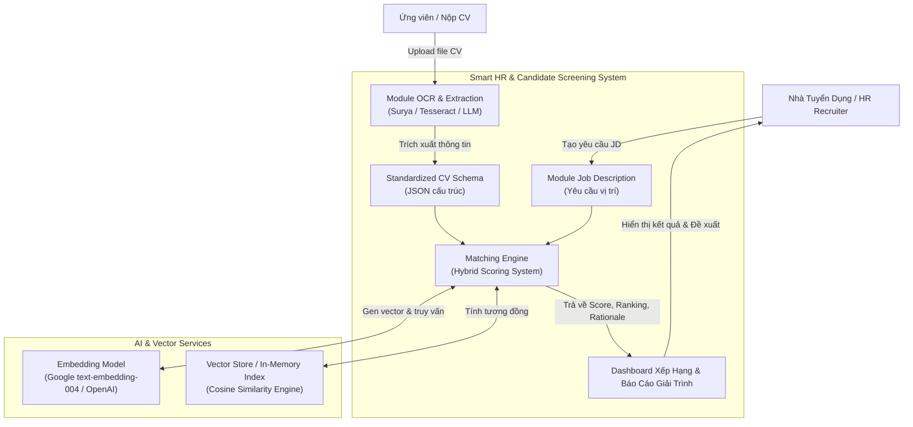
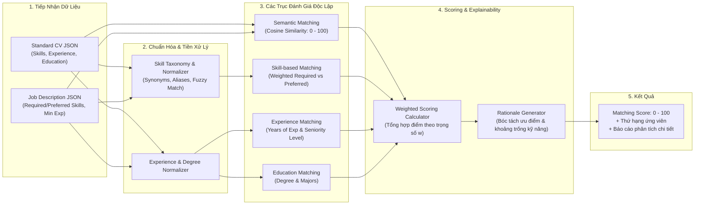

# 🎯 Kế Hoạch Triển Khai Module Matching Engine & Thuật Toán So Khớp Điểm CV - JD (Matching Engine & Scoring System Plan)

> **Dự án**: Smart HR & Candidate Screening System  
> **Giai đoạn**: Tuần 11 (02/11/2026 – 08/11/2026)  
> **Tech Stack**: NestJS (v12) + TypeScript + MongoDB (Mongoose) + Vector Embeddings  
> **Chuẩn tài liệu**: Thiết kế theo chuẩn **Design Document & PRD Pattern** (tổng hợp từ bộ mẫu kỹ sư cao cấp `fabric/create_design_document` & `fabric/create_prd`).

---

## 📌 1. Tổng Quan & Bối Cảnh Nghiên Cứu (Business Posture & Objectives)

### 1.1. Vấn đề thực tế (Problem Statement)
* **Quy trình truyền thống**: So khớp CV và JD thủ công tốn nhiều giờ làm việc của HR, dễ mang tính chủ quan và khó đáp ứng khi có hàng trăm ứng viên ứng tuyển cùng lúc.
* **Hạn chế của Keyword-Matching**: Chỉ so từ khóa chính xác sẽ bỏ sót các ứng viên tiềm năng do cách diễn đạt khác biệt (ví dụ: *"React"* vs *"ReactJS"*, *"Golang"* vs *"Go"*).
* **Mục tiêu hệ thống**: Xây dựng **Matching Engine đa chiều (Hybrid Matching Engine)** kết hợp giữa **So khớp ngữ nghĩa (Semantic Matching - Vector Embedding)** và **So khớp kỹ năng định lượng (Skill-based Matching)**, đi kèm cơ chế giải thích minh bạch (Explainable AI - XAI).

### 1.2. Mục tiêu kỹ thuật Tuần 11 (2/11/2026 - 8/11/2026)
1. Xây dựng dịch vụ **MatchingEngineService** trong `ScreeningModule`.
2. Hiện thực hóa thuật toán chấm điểm trọng số:
   $$\text{Matching Score} = w_1 S_{\text{semantic}} + w_2 S_{\text{skill}} + w_3 S_{\text{experience}} + w_4 S_{\text{education}}$$
3. Xây dựng cơ chế chuẩn hóa từ điển kỹ năng (**Skill Normalization Dictionary & Taxonomy**).
4. Thiết lập bộ đánh giá chất lượng thuật toán theo các chỉ số: **Precision@K**, **Recall@K**, và **NDCG@K**.

---

## 🏗 2. Kiến Trúc Hệ Thống (C4 Architecture Model)

### 2.1. C4 Context Diagram
Sơ đồ định vị vị trí của Matching Engine trong hệ thống Smart HR:



### 2.2. C4 Container Diagram (Chi Tiết Luồng Xử Lý Matching Engine)



---

## 🧮 3. Chi Tiết Thuật Toán & Công Thức Tính Điểm (Mathematical Formulation)

### 3.1. Điểm Tương Đồng Ngữ Nghĩa ($S_{\text{semantic}}$)
Sử dụng **Cosine Similarity** đo góc giữa vector embedding của CV ($\vec{A}$) và JD ($\vec{B}$):

$$\text{Cosine Similarity}(\vec{A}, \vec{B}) = \frac{\vec{A} \cdot \vec{B}}{\|\vec{A}\| \times \|\vec{B}\|} = \frac{\sum_{k=1}^d A_k B_k}{\sqrt{\sum_{k=1}^d A_k^2} \sqrt{\sum_{k=1}^d B_k^2}}$$

* Khoảng giá trị: $[-1, 1]$, sau đó được chuẩn hóa về thang $[0, 100]$:
  $$S_{\text{semantic}} = \max\left(0, \frac{\text{Cosine Similarity} + 1}{2}\right) \times 100$$
* **Lưu ý**: $S_{\text{semantic}}$ phản ánh độ tương quan chủ đề và ngữ cảnh tổng thể, tránh việc đánh đồng 0.8 Cosine là đáp ứng 80% kỹ năng.

---

### 3.2. Điểm Kỹ Năng Phân Bổ Trọng Số ($S_{\text{skill}}$)
Kỹ năng trong JD được phân loại thành 2 nhóm:
1. **Required Skills ($R$)**: Trọng số cơ sở $a_r = 3.0$ (kỹ năng cốt lõi).
2. **Preferred / Nice-to-have Skills ($P$)**: Trọng số cơ sở $a_p = 1.0$ (điểm cộng).

Mức độ đáp ứng $m_i$ của ứng viên với kỹ năng thứ $i$:
* $m_i = 1.0$: Đáp ứng hoàn toàn (Exact match hoặc Alias match trong từ điển kỹ năng).
* $m_i = 0.5$: Đáp ứng một phần (Có kỹ năng tương đương hoặc công nghệ họ hàng, ví dụ: JD cần *PostgreSQL*, CV có *MySQL*).
* $m_i = 0.0$: Chưa tìm thấy bằng chứng trong hồ sơ.

**Công thức**:
$$S_{\text{skill}} = \left( \frac{\sum_{i=1}^n a_i \times m_i}{\sum_{i=1}^n a_i} \right) \times 100$$

> **Quy tắc an toàn (Hard Gate Constraint)**: Nếu ứng viên thiếu quá 50% số lượng Required Skills, điểm kỹ năng $S_{\text{skill}}$ sẽ bị phạt giảm 20% tổng điểm kỹ năng để đảm bảo tính phù hợp tối thiểu.

---

### 3.3. Điểm Kinh Nghiệm ($S_{\text{experience}}$)
So khớp giữa số năm kinh nghiệm thực tế của ứng viên ($Y_{\text{cand}}$) và số năm yêu cầu trong JD ($Y_{\text{req}}$):

$$S_{\text{experience}} = \begin{cases} 
100 & \text{nếu } Y_{\text{cand}} \ge Y_{\text{req}} \\
\left( \frac{Y_{\text{cand}}}{Y_{\text{req}}} \right) \times 100 & \text{nếu } 0.5 Y_{\text{req}} \le Y_{\text{cand}} < Y_{\text{req}} \\
\max\left(20, \left( \frac{Y_{\text{cand}}}{Y_{\text{req}}} \right) \times 70\right) & \text{nếu } Y_{\text{cand}} < 0.5 Y_{\text{req}}
\end{cases}$$

---

### 3.4. Điểm Học Vấn & Bằng Cấp ($S_{\text{education}}$)
Được chấm điểm dựa trên ma trận bậc học:
* Đáp ứng đúng hoặc vượt bậc học yêu cầu (VD: JD cần Cử nhân, CV có Thạc sĩ/Tiến sĩ): **100 điểm**.
* Thấp hơn 1 bậc nhưng đúng chuyên ngành liên quan (CNTT/Khoa học máy tính): **70 điểm**.
* Khác chuyên ngành hoàn toàn: **40 - 50 điểm**.

---

### 3.5. Tổng Hợp Điểm (Weighted Matching Score)

$$\text{Matching Score} = w_1 S_{\text{semantic}} + w_2 S_{\text{skill}} + w_3 S_{\text{experience}} + w_4 S_{\text{education}}$$

Với điều kiện ràng buộc: $\sum_{j=1}^4 w_j = 1$.

**Cấu hình trọng số mẫu theo cấp bậc (Preset Weights):**

| Cấp bậc vị trí | $w_1$ (Semantic) | $w_2$ (Skill) | $w_3$ (Experience) | $w_4$ (Education) | Ghi chú |
| :--- | :---: | :---: | :---: | :---: | :--- |
| **Intern / Fresher** | 0.25 | **0.45** | 0.05 | **0.25** | Chú trọng tiềm năng, kiến thức nền & bằng cấp |
| **Junior / Middle** | 0.25 | **0.45** | 0.25 | 0.05 | Ưu tiên kỹ năng thực hành và công nghệ |
| **Senior / Lead** | 0.20 | 0.35 | **0.40** | 0.05 | Kinh nghiệm và thời gian chiến đấu là yếu tố quyết định |

---

## 📚 4. Cơ Chế Chuẩn Hóa Kỹ Năng (Skill Taxonomy & Normalization)

Để giải quyết vấn đề *"sự khác biệt trong cách diễn đạt kỹ năng"* (Mục 5.1):

```typescript
// Cấu trúc từ điển kỹ năng chuẩn hóa (Skill Taxonomy Structure)
export interface SkillTaxonomyEntry {
  standardName: string;            // Tên chuẩn (vd: 'React')
  category: 'frontend' | 'backend' | 'devops' | 'database' | 'ai_ml' | 'soft_skill';
  aliases: string[];               // Các từ đồng nghĩa: ['reactjs', 'react.js', 'react js']
  relatedSkills: string[];         // Kỹ năng liên đới (được tính 0.5 điểm nếu có): ['Next.js', 'Redux', 'Vue.js']
}
```

* **Thuật toán so khớp 3 lớp:**
  1. **Lớp 1 (Exact / Alias Match)**: Chuyển về lowercase, xóa ký tự đặc biệt, đối chiếu bảng `aliases` $\rightarrow m_i = 1.0$.
  2. **Lớp 2 (Fuzzy / Levenshtein Distance)**: Bắt lỗi chính tả gõ sai (vd: *"Dockr"* $\rightarrow$ *"Docker"*, similarity > 0.88) $\rightarrow m_i = 1.0$.
  3. **Lớp 3 (Taxonomy Related Match)**: Đối chiếu danh sách `relatedSkills` $\rightarrow m_i = 0.5$.

---

## 📊 5. Khung Đánh Giá Hiệu Năng & Độ Chính Xác (Evaluation Framework)

Để kiểm chứng tính khoa học của thuật toán (Mục 6), hệ thống xây dựng bộ benchmark với tập dữ liệu **Ground Truth** gồm 50 CV và 5 JD đã được các Tech Lead & HR chấm điểm thủ công:

### 5.1. Precision@K
Tỷ lệ ứng viên thực sự phù hợp trong top $K$ hồ sơ đầu bảng:
$$\text{Precision@}K = \frac{|\text{Top } K \text{ ứng viên máy chọn} \cap \text{Ứng viên phù hợp thực tế}|}{K}$$

### 5.2. Recall@K
Tỷ lệ gom đủ ứng viên phù hợp so với toàn bộ tập mẫu:
$$\text{Recall@}K = \frac{|\text{Top } K \text{ ứng viên máy chọn} \cap \text{Ứng viên phù hợp thực tế}|}{|\text{Tổng số ứng viên phù hợp thực tế}|}$$

### 5.3. NDCG@K (Normalized Discounted Cumulative Gain)
Đánh giá độ chính xác của **thứ tự xếp hạng**:
$$\text{DCG@}K = \sum_{i=1}^K \frac{2^{\text{rel}_i} - 1}{\log_2(i + 1)}, \quad \text{NDCG@}K = \frac{\text{DCG@}K}{\text{IDCG@}K}$$
*(Trong đó $\text{rel}_i$ là mức độ phù hợp thực tế của ứng viên ở vị trí thứ $i$)*.

---

## 🛠 6. Kế Hoạch Triển Khai Chi Tiết Tuần 11 (Implementation Roadmap)

| Ngày | Nhiệm vụ kỹ thuật | Output bàn giao | Trách nhiệm |
| :--- | :--- | :--- | :--- |
| **02/11/2026** | • Hoàn thiện tài liệu kiến trúc & công thức toán.<br>• Xây dựng bộ Schema DTO `MatchScreeningDto` & `MatchingResultDto`. | File `MATCHING_ENGINE_PLAN.md` & DTO types trong `src/modules/screening/dto/`. | Tech Lead / Architecture |
| **03/11/2026** | • Xây dựng module `SkillTaxonomyService` (từ điển chuẩn hóa từ đồng nghĩa).<br>• Viết hàm tính khoảng cách xấp xỉ (Fuzzy matching). | `skill-taxonomy.service.ts` + 500+ từ khóa công nghệ phổ biến. | Backend Engineer |
| **04/11/2026** | • Triển khai dịch vụ Vector Embedding trong `AiModule`.<br>• Viết tiện ích `CosineSimilarityUtil` tính toán vector cosine. | `cosine-similarity.util.ts` & integration test với Gemini embedding. | AI Engineer |
| **05/11/2026** | • Hiện thực hóa thuật toán chấm điểm `WeightedScoringEngine`.<br>• Triển khai bộ phân tích giải thích kết quả (**Rationale & Gap Analysis**). | `screening.service.ts` hoàn thiện logic tính 4 cột điểm. | Backend Engineer |
| **06/11/2026** | • Viết API Controller `POST /api/v1/screening/match`.<br>• Tích hợp xếp hạng danh sách ứng viên (Candidate Ranking & Sorting). | Endpoint hoạt động đầy đủ, trả về điểm & thứ hạng. | Backend Engineer |
| **07/11/2026** | • Chạy bộ test dữ liệu thực tế (50 CV + 5 JD).<br>• Đo lường Precision@5, Recall@5 và NDCG@5. | File báo cáo kết quả benchmark `MATCHING_EVALUATION_REPORT.md`. | QA / Data Specialist |
| **08/11/2026** | • Review toàn diện code, tối ưu tốc độ tính toán in-memory.<br>• Chốt báo cáo nghiên cứu Tuần 11 cho hội đồng/mentor. | PR hoàn chỉnh vào nhánh `main`/`develop`. | Toàn đội |

---

## 🔒 7. Quản Trị Rủi Ro & Giải Pháp Dự Phòng (Risk Assessment)

1. **Rủi ro 1: Chi phí & Quota API Embedding**
   * *Giải pháp*: Cache vector embedding của JD và CV trong MongoDB (field `cvEmbedding` và `jdEmbedding`). Không bao giờ gọi embedding lại nếu nội dung không đổi.
2. **Rủi ro 2: "Ảo tưởng" về điểm số (Overfitting Scoring)**
   * *Giải pháp*: Cung cấp phân rã điểm chi tiết (Breakdown: Skill / Semantic / Experience / Education) thay vì chỉ đưa ra 1 con số duy nhất. Đính kèm danh sách "Kỹ năng thiếu" để HR tự thẩm định.
3. **Rủi ro 3: CV bị OCR lỗi làm mất kỹ năng**
   * *Giải pháp*: Tích hợp cảnh báo chất lượng OCR (`ocrConfidence < 0.7`) ngay trên giao diện kết quả so khớp.

