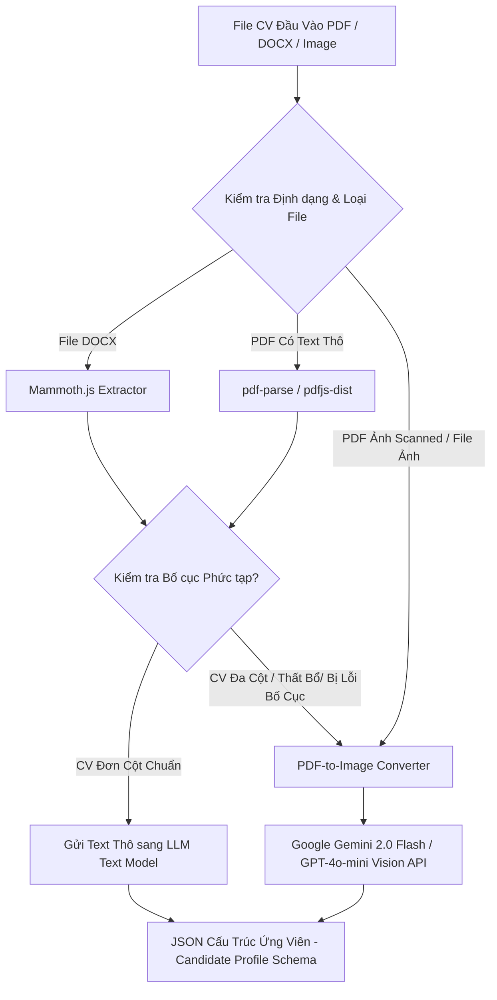

# 📄 Báo Cáo Lựa Chọn Thư Viện OCR & Mô Hình LLM Cho Dự Án Smart HR Candidate Screening System

---

## 🌟 1. Tổng Quan & Mục Tiêu (Executive Summary)

Dự án **Smart HR & Candidate Screening System** đòi hỏi khả năng xử lý hồ sơ ứng viên (CV/Resume) tự động, phân tích thông tin cấu trúc, chấm điểm mức độ phù hợp với Mô tả công việc (Job Description - JD), và tự động tạo câu hỏi phỏng vấn/bài test kỹ thuật.

Báo cáo này đưa ra phân tích chi tiết và đề xuất giải pháp kỹ thuật tối ưu nhất cho **thư viện OCR/Document Parser** và **Mô hình AI (LLM)** dựa trên stack **NestJS + React + TypeScript** của hệ thống.

---

## 🔍 2. Phân Tích Độc Thù Dữ Liệu Đầu Vào & Yêu Cầu Kỹ Thuật

### 2.1. Độc thù CV trong tuyển dụng HR
1. **Đa dạng định dạng**: PDF kỹ thuật số (text-based), PDF dạng ảnh quét (scanned PDF), Microsoft Word (`.docx`), và các định dạng ảnh (`.png`, `.jpg`).
2. **Bố cục phức tạp (Complex Multi-column Layouts)**: Các CV thiết kế (ví dụ từ Canva, TopCV) thường chia 2–3 cột. Thư viện đọc văn bản truyền thống (naive text extractors) thường đọc theo thứ tự ngang từ trái sang phải, làm xáo trộn hoàn toàn ngữ cảnh dòng văn bản (ví dụ: trộn tên kỹ năng ở cột trái vào mô tả dự án ở cột phải).
3. **Đa ngôn ngữ & Thuật ngữ kết hợp**: CV tại Việt Nam sử dụng kết hợp Tiếng Việt + Tiếng Anh chuyên ngành IT/Tech (ví dụ: *"Kinh nghiệm 3 năm làm việc với ReactJS, NestJS microservices"*).
4. **Cấu trúc dữ liệu đầu ra**: Cần trích xuất dữ liệu thô thành **JSON có cấu trúc chặt chẽ** (Thông tin liên hệ, Học vấn, Kỹ năng, Lịch sử làm việc, Dự án tiêu biểu).

---

## 🛠 3. Đánh Giá & Lựa Chọn Thư Viện OCR / Document Parser

### 3.1. Bảng So Sánh Các Giải Pháp OCR & Trích Xuất Văn Bản

| Giải pháp | Cơ chế | Độ chính xác Layout (Canva/Multi-column) | Hỗ trợ Tiếng Việt | Chi phí | Tốc độ | Tích hợp vào NestJS |
| :--- | :--- | :---: | :---: | :---: | :---: | :---: |
| **`pdf-parse` / `mammoth`** | Native Text Extractor (Node.js) | ❌ Kém (Bị trộn cột) | ✅ Tốt (Text thô) | Miễn phí | $< 50\text{ms}$ | Rất dễ (`npm install`) |
| **`Tesseract.js`** | Open-source OCR (WASMER/Node) | ⚠️ Trung bình (Cần Pre-processing) | ⚠️ Khá (`vie` traineddata) | Miễn phí | $1\text{s} - 3\text{s}$ / trang | Dễ |
| **`PaddleOCR` / `EasyOCR`** | Deep Learning OCR (Python Service) | ✅ Tốt (Bảng & Cột) | ✅ Tốt | Miễn phí (Cần server GPU/CPU) | $500\text{ms} - 1.5\text{s}$ | Cần microservice Python riêng |
| **`Google Cloud Document AI`** | Enterprise Resume Parser API | 🚀 Rất cao | 🚀 Rất tốt | $\$0.015$ / trang | $500\text{ms}$ | Cần API Cloud & Credit |
| **`LLM Vision Direct Parsing`** *(Gemini 2.0 Flash / GPT-4o-mini)* | Chuyển PDF thành ảnh $\rightarrow$ LLM Multimodal vừa OCR vừa parse JSON | 🚀 Tối ưu nhất (Hiểu bố cục thị giác) | 🚀 Tốt nhất | $\$0.0001 - \$0.0005$ / trang | $1\text{s} - 2\text{s}$ | Rất dễ (Qua LLM API) |

---

### 3.2. Đề Xuất Chiến Lược Pipeline Xử Lý CV Kết Hợp (Hybrid Pipeline)

Để vừa **tối ưu chi phí**, vừa **đảm bảo độ chính xác 100% với cả CV bị quét ảnh lẫn CV multi-column**, chúng ta áp dụng **Kiến trúc Pipeline Hybrid 2 Tầng**:



#### Chi tiết công cụ lựa chọn:
1. **Văn bản chuẩn (DOCX / Native Text PDF)**: Sử dụng **`pdf-parse`** và **`mammoth`** trên Node.js để trích xuất cực nhanh ($< 50\text{ms}$) không tốn chi phí.
2. **CV Dạng Ảnh Scanned & Multi-column Phức Tạp**: Chuyển đổi trang PDF thành ảnh (dùng `pdf-img-convert` hoặc `pdf2pic`) và gửi trực tiếp qua **Gemini 2.0 Flash Vision API**. Gemini sẽ vừa làm nhiệm vụ OCR nhận diện chữ, vừa hiểu không gian thị giác (nhận biết vị trí các cột, mục kỹ năng) để xuất thẳng ra JSON cấu trúc.

---

## 🤖 4. Đánh Giá & Lựa Chọn Mô Hình LLM (LLM Model Selection)

Hệ thống yêu cầu LLM thực hiện 3 tác vụ chính:
1. **CV Structuring**: Chuyển text/ảnh CV thành JSON theo Schema chuẩn.
2. **Semantic JD Match Scoring**: Chấm điểm phù hợp 0-100%, phân tích điểm mạnh, khoảng trống kỹ năng (skill gaps).
3. **Adaptive Question & Assessment Generation**: Đề xuất câu hỏi phỏng vấn kỹ thuật & bài test tailored cho ứng viên.

### 4.1. Bảng So Sánh Các Mô Hình LLM Hàng Đầu

| Mô hình LLM | Structured Output (JSON Schema) | Trí Tuệ Reasoning (Scoring & Test Gen) | Tiếng Việt & Thuật Ngữ Tech | Chi Phí Input (trên 1M tokens) | Chi Phí Output (trên 1M tokens) | Đánh giá Tổng Thể |
| :--- | :---: | :---: | :---: | :---: | :---: | :---: |
| **Google Gemini 2.0 Flash** *(Khuyên dùng chính)* | 🚀 Cực tốt (`responseSchema`) | 🚀 Xuất sắc | 🚀 Tốt nhất | **$\$0.075$** | **$\$0.30$** | 🏆 **Lựa chọn số 1 (Ngon - Bổ - Rẻ - Nhanh)** |
| **OpenAI GPT-4o-mini** *(Khuyên dùng dự phòng)* | 🚀 Cực tốt (`json_schema`) | ✅ Khá / Tốt | ✅ Rất tốt | $\$0.15$ | $\$0.60$ | 🥈 **Lựa chọn dự phòng xuất sắc** |
| **OpenAI GPT-4o** | 🚀 Cực tốt | 🚀 Xuất sắc | 🚀 Xuất sắc | $\$2.50$ | $\$10.00$ | 💰 Tốt nhưng chi phí cao |
| **DeepSeek V3 / R1** | ⚠️ Trung bình (Cần prompt kỹ) | 🚀 Cực cao về Coding & Logic | ✅ Tốt | $\$0.14 - \$0.55$ | $\$0.28 - \$2.19$ | 💡 Thích hợp cho bài test Coding phức tạp |
| **Claude 3.5 Sonnet** | ✅ Tốt | 🚀 Xuất sắc | 🚀 Xuất sắc | $\$3.00$ | $\$15.00$ | 💰 Chi phí cao |

---

### 4.2. Lý Do Chọn Google Gemini 2.0 Flash Làm Mô Hình Chính (Primary Model)

1. **Chi phí tối ưu vượt trội**: Chi phí chỉ $\$0.075$ / 1 triệu input tokens (rẻ hơn GPT-4o gấp **33 lần** và rẻ hơn GPT-4o-mini gấp **2 lần**).
2. **Hỗ trợ Native Context Window lên tới 1M - 2M tokens**: Có thể nạp hàng chục trang CV, tài liệu JD dài và tiêu chí tuyển dụng cùng lúc mà không lo hết bộ nhớ ngữ cảnh.
3. **Khả năng Vision Multimodal Natively**: Đọc trực tiếp các tệp PDF/Image CV thiết kế phức tạp mà không cần qua thư viện OCR trung gian.
4. **Hỗ trợ Ép Chuẩn Dữ Liệu Dạng JSON (Strict Structured Outputs)**: Tương thích hoàn toàn với OpenAPI / TypeScript DTOs trong NestJS qua thuộc tính `responseSchema`.
5. **Tốc độ xử lý (Latency)**: Thời gian phản hồi trung bình chỉ từ $0.6\text{s} - 1.2\text{s}$, đảm bảo trải nghiệm tức thì trên giao diện Dashboard HR.

---

## 🏗 5. Kiến Trúc Tích Hợp Kỹ Thuật Vào Backend NestJS

### 5.1. Các Thư Viện Cần Nạp Vào Backend (`backend/package.json`)

```json
{
  "dependencies": {
    "@google/genai": "^0.1.1",
    "@langchain/community": "^0.3.0",
    "pdf-parse": "^1.1.1",
    "mammoth": "^1.8.0",
    "pdf2pic": "^3.1.1"
  }
}
```

### 5.2. Chuẩn Dữ Liệu JSON Schema Trích Xuất CV (`CandidateProfile`)

```typescript
export const candidateProfileSchema = {
  type: 'OBJECT',
  properties: {
    fullName: { type: 'STRING' },
    email: { type: 'STRING' },
    phone: { type: 'STRING' },
    summary: { type: 'STRING' },
    yearsOfExperience: { type: 'NUMBER' },
    skills: {
      type: 'ARRAY',
      items: { type: 'STRING' }
    },
    workExperience: {
      type: 'ARRAY',
      items: {
        type: 'OBJECT',
        properties: {
          company: { type: 'STRING' },
          role: { type: 'STRING' },
          duration: { type: 'STRING' },
          description: { type: 'STRING' },
          techStack: { type: 'ARRAY', items: { type: 'STRING' } }
        }
      }
    },
    education: {
      type: 'ARRAY',
      items: {
        type: 'OBJECT',
        properties: {
          institution: { type: 'STRING' },
          degree: { type: 'STRING' },
          fieldOfStudy: { type: 'STRING' },
          graduationYear: { type: 'STRING' }
        }
      }
    }
  },
  required: ['fullName', 'skills', 'workExperience']
};
```

---

## 💰 6. Bảng Ước Tính Chi Phí Vận Hành (Cost Estimation)

Dưới đây là bảng tính toán chi phí trung bình khi xử lý **1,000 CV** và **10,000 CV** hàng tháng sử dụng **Gemini 2.0 Flash**:

*Giả định:*
- *1 CV trung bình = 2 trang = 1,500 tokens input.*
- *Dữ liệu JSON xuất ra = 500 tokens output.*
- *1 lượt Semantic Match JD + Generate Questions = 2,000 tokens input + 800 tokens output.*

| Quy mô xử lý | Số lượt CV & Matching | Dung lượng Tokens Input | Dung lượng Tokens Output | Chi phí Gemini 2.0 Flash (USD) | Chi phí Quy Đổi (VND) |
| :--- | :--- | :--- | :--- | :--- | :--- |
| **Quy mô Nhỏ** | 1,000 CVs / tháng | ~ 3,500,000 tokens | ~ 1,300,000 tokens | **~ $\$0.65$** | **~ 16,500 VNĐ** |
| **Quy mô Doanh Nghiệp** | 10,000 CVs / tháng | ~ 35,000,000 tokens | ~ 13,000,000 tokens | **~ $\$6.52$** | **~ 165,000 VNĐ** |

> 💡 **Nhận xét**: Chi phí vận hành AI gần như cực thấp ($\approx 165,000\text{ VNĐ}$ cho 10,000 CV), hoàn toàn đáp ứng tốt cho cả dự án cá nhân, Startup lẫn ứng dụng Doanh nghiệp tuyển dụng lớn.

---

## 🎯 7. Khuyến Nghị Lộ Trình Triển Khai (Implementation Roadmap)

1. **Giai đoạn 1 (Hiện tại)**: 
   - Cài đặt `pdf-parse` & `mammoth` để đọc nhanh CV định dạng văn bản chuẩn.
   - Tích hợp `@google/genai` với mô hình **Gemini 2.0 Flash** cho module `AiService` trong NestJS.
2. **Giai đoạn 2**: 
   - Triển khai `pdf2pic` để xử lý các CV định dạng ảnh / scanned PDF / Canva CV bị lệch dòng qua Gemini Vision Prompt.
3. **Giai đoạn 3 (Dự phòng)**:
   - Tích hợp thêm Provider `OpenAI GPT-4o-mini` làm mô hình fallback tự động nếu API Gemini gặp sự cố gián đoạn dịch vụ.

---
*Tài liệu được biên soạn cho dự án Smart HR Candidate Screening System.*
