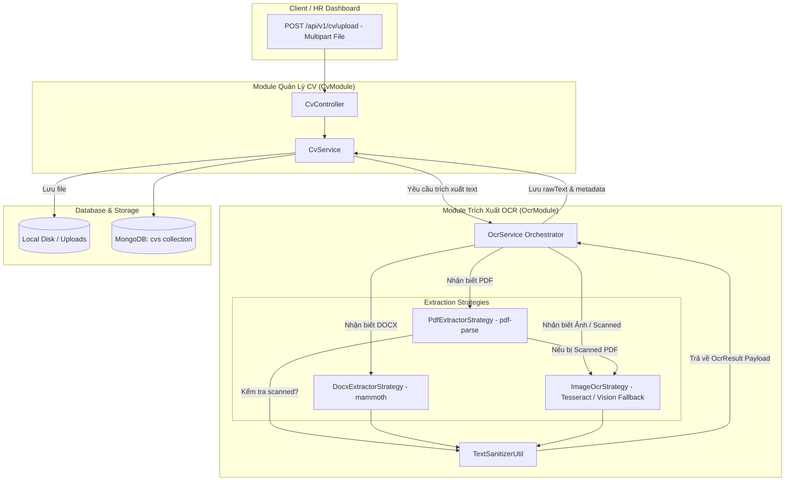
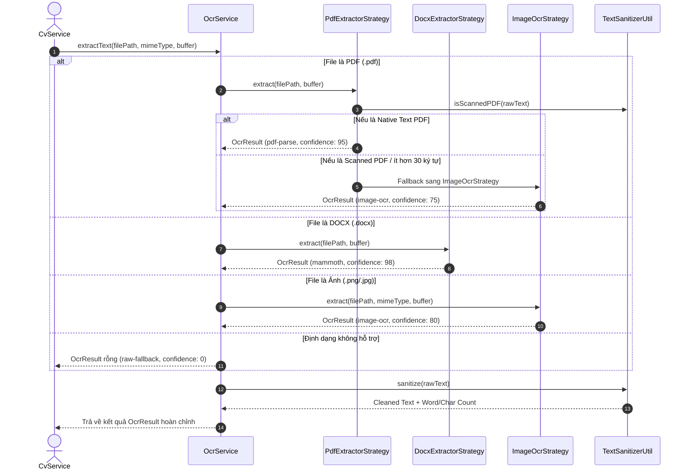

# 📄 Kế Hoạch Triển Khai Module OCR Trích Xuất Văn Bản Thô Từ File CV (OCR & Text Extraction Module Plan)

> **Dự án**: Smart HR & Candidate Screening System  
> **Tech Stack**: NestJS (v12) + Express + MongoDB + TypeScript  
> **Thư viện chính**: `pdf-parse`, `mammoth`, `tesseract.js` / Gemini Vision Fallback  
> **Mục tiêu**: Xây dựng module trích xuất văn bản thô (Raw Text Extraction) chất lượng cao từ mọi tệp CV nộp vào (PDF, DOCX, PNG, JPEG, Scanned PDF).

---

## 🏗 1. Tổng Quan Kiến Trúc & Luồng Dữ Liệu (Architecture & Data Flow)

Module OCR (`OcrModule`) đóng vai trò là một **Dedicated Subsystem** chịu trách nhiệm xử lý toàn bộ tác vụ trích xuất, đọc chữ và chuẩn hóa dữ liệu văn bản thô từ tệp CV trước khi nạp vào **AI Screening Module (LLM)**.



---

## ⚙️ 2. Phân Tích Kỹ Thuật & Các Định Dạng CV Đầu Vào

Hệ thống hỗ trợ 4 nhóm định dạng file CV chính với các giải pháp trích xuất tương ứng:

| Định dạng File | Cơ chế xử lý chính | Thư viện / Strategy | Tốc độ trích xuất | Trường hợp đặc biệt / Fallback |
| :--- | :--- | :--- | :---: | :--- |
| **PDF kỹ thuật số** *(Text-based PDF)* | Đọc Native Text Stream | `PdfExtractorStrategy` (`pdf-parse`) | $< 50\text{ms}$ | Nếu bị mã hóa font hoặc ít hơn 30 ký tự $\rightarrow$ Chuyển sang Scanned PDF Fallback |
| **Word Document** (`.docx`, `.doc`) | XML Parsing & Extract Raw Text | `DocxExtractorStrategy` (`mammoth`) | $< 30\text{ms}$ | Giữ nguyên cấu trúc đoạn văn, bỏ qua định dạng style/color |
| **Tệp Hình Ảnh** (`.png`, `.jpg`, `.jpeg`) | Optical Character Recognition | `ImageOcrStrategy` (`tesseract.js` / Vision) | $500\text{ms} - 1.5\text{s}$ | Nhận diện vùng chữ Tiếng Việt + Tiếng Anh chuyên ngành |
| **PDF dạng ảnh quét** *(Scanned PDF)* | Auto-detect & Fallback OCR | `PdfExtractorStrategy` $\rightarrow$ `ImageOcrStrategy` | $1\text{s} - 2\text{s}$ | Phát hiện qua độ dài chữ $< 50$ ký tự hoặc tỷ lệ Alphanumeric $< 35\%$ |

---

## 🛠 3. Thiết Kế Chi Tiết Module Trong NestJS

Vị trí kiến trúc trong dự án: `backend/src/modules/ocr/`

```
backend/src/modules/ocr/
├── ocr.module.ts                   # NestJS Module export OcrService
├── ocr.service.ts                  # Service điều phối chính (Orchestrator)
├── interfaces/
│   └── ocr-result.interface.ts     # Interface định nghĩa cấu trúc dữ liệu OcrResult
├── strategies/
│   ├── pdf-extractor.strategy.ts   # Strategy trích xuất PDF qua pdf-parse
│   ├── docx-extractor.strategy.ts  # Strategy trích xuất DOCX qua mammoth
│   └── image-ocr.strategy.ts      # Strategy trích xuất PNG/JPEG/Scanned PDF
└── utils/
    └── text-sanitizer.util.ts      # Utility làm sạch ký tự rác & phân tích chất lượng text
```

---

## 📝 4. Chuẩn Định Dạng Dữ Liệu Đầu Ra (`OcrResult`)

```typescript
export interface OcrResult {
  /** Văn bản thô chưa qua xử lý */
  rawText: string;

  /** Văn bản đã qua bộ lọc làm sạch & chuẩn hóa */
  cleanedText: string;

  /** Tổng số ký tự trong văn bản đã làm sạch */
  characterCount: number;

  /** Tổng số từ (word count) tính theo regex Tiếng Việt & Anh */
  wordCount: number;

  /** Phương thức/Strategy đã dùng để trích xuất */
  extractorUsed: 'pdf-parse' | 'mammoth' | 'image-ocr' | 'raw-fallback';

  /** Cờ đánh dấu file CV dạng ảnh quét */
  isScanned: boolean;

  /** Điểm độ tin cậy trích xuất (Thang điểm 0 - 100) */
  confidenceScore: number;
}
```

---

## 🔄 5. Luồng Xử Lý Chi Tiết Của `OcrService` (Sequence Diagram)



---

## 🧹 6. Thuật Toán Làm Sạch Văn Bản (`TextSanitizerUtil`)

Văn bản trích xuất từ các file CV thường chứa nhiều ký tự lỗi, mã BOM hoặc khoảng trắng thừa gây nhiễu cho mô hình AI. `TextSanitizerUtil` áp dụng các bước chuẩn hóa sau:

1. **Loại bỏ ký tự ẩn & Ký tự điều khiển**:
   - Xóa Unicode Byte Order Mark (`\uFEFF`), Zero-width spaces (`\u200B`, `\u200C`, `\u200D`), Null bytes (`\0`).
   - Xóa Control Characters trong dải ASCII (`\x00-\x08`, `\x0B`, `\x0C`, `\x0E-\x1F`).
2. **Chuẩn hóa khoảng trắng & Đổi dòng**:
   - Chuyển đổi Non-breaking space (`\u00A0`), IDEOGRAPHIC SPACE (`\u3000`) thành khoảng trắng đơn (` `).
   - Đội hệ điều hành (`\r\n` $\rightarrow$ `\n`).
3. **Cắt khoảng trắng thừa theo từng dòng**:
   - Loại bỏ khoảng trắng ở cuối mỗi dòng chữ (Trailing whitespaces).
   - Thu gọn các đoạn xuống dòng liên tiếp quá 2 dòng (`\n{3,}` $\rightarrow$ `\n\n`).
4. **Phát hiện Scanned PDF**:
   - Đếm số ký tự chữ cái/chữ số tiếng Việt & Anh (`[a-zA-Z0-9À-ỹđĐ]`).
   - Nếu tổng số ký tự $< 50$ hoặc tỷ lệ alphanumeric $< 35\% \rightarrow$ Xác định là Scanned PDF.

---

## 🧪 7. Kế Hoạch Kiểm Thử (Verification & Testing Plan)

Tạo file kiểm thử tự động `backend/test/test-ocr.ts` với các kịch bản:

1. **Test Case 1: Làm sạch văn bản (`TextSanitizerUtil`)**:
   - Kiểm tra khả năng lọc ký tự rác `\uFEFF`, chuẩn hóa khoảng trắng và đếm đúng số từ.
2. **Test Case 2: Trích xuất PDF kỹ thuật số**:
   - Nạp file PDF mẫu $\rightarrow$ Đảm bảo `extractorUsed == 'pdf-parse'` và `characterCount > 0`.
3. **Test Case 3: Trích xuất file Word DOCX**:
   - Nạp file `.docx` mẫu $\rightarrow$ Đảm bảo `extractorUsed == 'mammoth'`.
4. **Test Case 4: Xử lý file ảnh & Scanned PDF Fallback**:
   - Nạp file ảnh `.png` $\rightarrow$ Đảm bảo `isScanned == true` và `extractorUsed == 'image-ocr'`.
5. **Test Case 5: Xử lý ngoại lệ (Error Handling)**:
   - Nạp đường dẫn file không tồn tại hoặc format `.xyz` $\rightarrow$ Đảm bảo trả về `raw-fallback` không bị rò rỉ ngoại lệ (crash app).

---

## 📅 8. Danh Sách Tệp Cần Tạo & Tích Hợp

```
backend/
├── src/
│   ├── modules/
│   │   ├── ocr/
│   │   │   ├── interfaces/
│   │   │   │   └── ocr-result.interface.ts
│   │   │   ├── utils/
│   │   │   │   └── text-sanitizer.util.ts
│   │   │   ├── strategies/
│   │   │   │   ├── pdf-extractor.strategy.ts
│   │   │   │   ├── docx-extractor.strategy.ts
│   │   │   │   └── image-ocr.strategy.ts
│   │   │   ├── ocr.service.ts
│   │   │   └── ocr.module.ts
│   │   ├── cv/
│   │   │   ├── cv.module.ts        # Import OcrModule
│   │   │   └── cv.service.ts       # Inject OcrService
│   ├── app.module.ts               # Import OcrModule
├── test/
│   └── test-ocr.ts                 # Automated Test Suite cho OCR
```

---
*Tài liệu kế hoạch module OCR trích xuất văn bản thô cho dự án Smart HR Candidate Screening System.*
