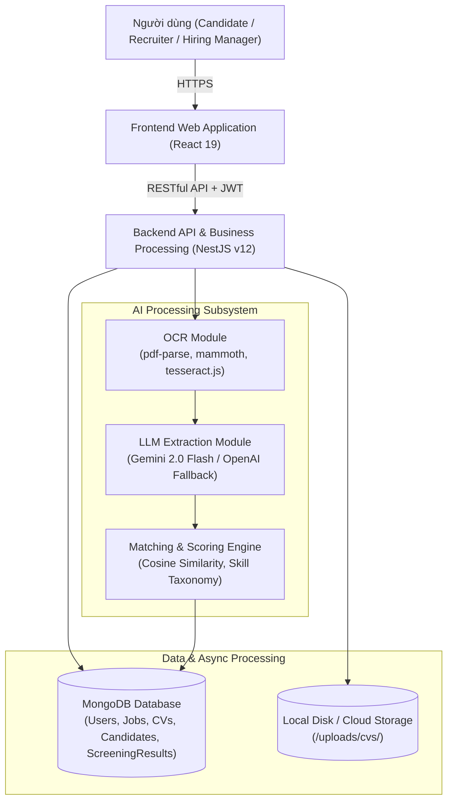

# 📘 Báo Cáo Tổng Hợp Cơ Sở Lý Thuyết & Quá Trình Nghiên Cứu Đề Tài Smart HR (Tuần 1 - Tuần 11)

> **Tên đề tài**: Smart HR & Candidate Screening System  
> **Nguồn tài liệu gốc**: Tài liệu báo cáo nghiên cứu đồ án tốt nghiệp `Tìm hiểu đề tài.pdf` (85 trang)  
> **Thời gian thực hiện**: 24/08/2026 – 08/11/2026 (Tuần 1 đến Tuần 11)  
> **Chuẩn đặc tả**: IEEE Std 830-1998 / ISO/IEC/IEEE 29148 & AWS Intelligent Document Processing (IDP) Architecture

---

## 🧭 Mục Lục Tổng Hợp Các Tuần Nghiên Cứu

* [Tuần 1: Tổng Quan Quy Trình Tuyển Dụng & Chuyển Dịch Tự Động Hóa](#tuần-1-24082026---30082026)
* [Tuần 2: Khảo Sát Hệ Thống Tuyển Dụng & Xây Dựng Đặc Tả Yêu Cầu SRS Chuẩn IEEE](#tuần-2-31082026---06092026)
* [Đặc Tả Chi Tiết SRS: Hệ Thống Mã Yêu Cầu [FR] và [NFR] Chuẩn Hóa](#đặc-tả-yêu-cầu-phần-mềm-srs-chuẩn-hóa)
* [Tuần 3: Thiết Kế Kiến Trúc Tổng Quan (C4 Model & AWS IDP)](#tuần-3-07092026---13092026)
* [Tuần 5: Lựa Chọn Tech Stack & So Sánh Công Nghệ Chi Tiết (OCR, LLM, Embedding)](#tuần-5-21092026---27092026)
* [Tuần 7: Thiết Kế Module Xác Thực (Auth) & Upload / Quản Lý CV](#tuần-7-05102026---11102026)
* [Tuần 8: Nghiên Cứu & Thiết Kế Module OCR Đa Chiến Lược (Multi-Strategy OCR)](#tuần-8-12102026---18102026)
* [Tuần 9: Bóc Tách Dữ Liệu Bằng LLM & OpenAI Structured Outputs / JSON Schema](#tuần-9-19102026---25102026)
* [Tuần 10: Tối Ưu Hóa AI Parser & Quy Trình Tinh Chỉnh Prompt Có Hệ Thống](#tuần-10-26102026---01112026)
* [Tuần 11: Matching Engine, Vector Database, Cosine Similarity & Đánh Giá Đa Tiêu Chí](#tuần-11-02112026---08112026)

---

## 📅 TUẦN 1 (24/08/2026 - 30/08/2026)
### Tổng Quan Quy Trình Tuyển Dụng & Sự Chuyển Dịch Sang Tự Động Hóa

### 1. Bối cảnh & Định nghĩa
* **Quy trình tuyển dụng hiện đại**: Chuỗi kế thừa liên tục: Xác định nhu cầu $\rightarrow$ Sourcing $\rightarrow$ Sàng lọc (Screening) $\rightarrow$ Phỏng vấn & Đánh giá $\rightarrow$ Onboarding.
* **Applicant Tracking System (ATS)**: Hệ thống hỗ trợ quản lý dữ liệu và pipeline ứng viên, tự động hóa tiếp nhận hồ sơ, theo dõi trạng thái.
* **Candidate Screening**: Quá trình đánh giá kỹ năng, kinh nghiệm và độ phù hợp so với Mô tả công việc (Job Description - JD) để thiết lập danh sách tiềm năng (shortlist).

### 2. Ba Hạn chế Cốt lõi của Sàng lọc Thủ công
1. **Thiếu hụt thời gian (Time Constraint)**: Nghiên cứu eye-tracking của tổ chức *TheLadders* chứng minh recruiter thường chỉ dành trung bình **6-7 giây** cho lần xem CV ban đầu, dễ dẫn đến áp lực lớn và bỏ sót dữ liệu quan trọng khi số lượng CV tăng cao.
2. **Thiên kiến nhận thức (Cognitive Bias)**: Đánh giá thủ công dễ bị chi phối bởi yếu tố chủ quan, thiên kiến vô thức về trường lớp, tuổi tác, giới tính hoặc xuất thân.
3. **Thiếu tính nhất quán (Inconsistency)**: Bị ảnh hưởng bởi tâm lý mệt mỏi theo thời gian trong ngày làm việc của chuyên viên tuyển dụng.

### 3. Đối tượng sử dụng hệ thống (User Persona)
* **HR / Recruiters (Người dùng chính)**: Vận hành quy trình tuyển dụng hàng ngày, đăng JD, tải CV, cấu hình bộ lọc AI và theo dõi hiệu suất tuyển dụng.
* **Hiring Managers (Người dùng gián tiếp)**: Xem danh sách rút gọn (shortlist), duyệt câu hỏi phỏng vấn và nhận xét chuyên môn. Phạm vi đề tài tập trung sâu vào tối ưu hóa hiệu suất cho đội ngũ tuyển dụng (Recruiters).

---

## 📅 TUẦN 2 (31/08/2026 - 06/09/2026)
### Khảo Sát Hệ Thống Tuyển Dụng & Xây Dựng SRS

### 1. Khảo sát các nền tảng ATS thương mại
* Khảo sát các báo cáo từ **Capterra ATS Benchmark**, **G2 Grid for ATS**, và nền tảng **Base E-Hiring**.
* **Các nhóm tính năng phổ biến**: Quản lý người dùng, quản lý tin tuyển dụng, quản lý ứng viên/CV, quản lý pipeline ứng tuyển, theo dõi trạng thái.

### 2. Điểm khác biệt đột phá của Đề tài Smart HR
Thay vì chỉ dừng lại ở mức quản lý dữ liệu quy trình như ATS truyền thống, Smart HR tập trung vào **AI-assisted Candidate Screening**:
* Tự động đọc và bóc tách nội dung CV đa định dạng.
* Phân tích yêu cầu có cấu trúc từ JD.
* So khớp ngữ nghĩa và tính điểm định lượng xác định (Deterministic Scoring Engine).
* Cung cấp bản giải trình minh bạch lý do chấm điểm (Explainable AI - XAI).
* Tự động khởi tạo câu hỏi phỏng vấn thích ứng cá nhân hóa cho từng ứng viên.

### 3. Chuẩn hóa đặc tả yêu cầu SRS
Áp dụng tiêu chuẩn cấu trúc **IEEE Std 830-1998 / ISO/IEC/IEEE 29148**.
* Thuật ngữ ràng buộc: **PHẢI** (MUST/SHALL) cho tính năng bắt buộc, **NÊN** (SHOULD) cho khuyến nghị, **CÓ THỂ** (MAY) cho tính năng mở rộng.
* Định dạng mã truy vết: `[FR-nhóm-stt]` cho chức năng và `[NFR-nhóm-stt]` cho phi chức năng.

---

## 📋 ĐẶC TẢ YÊU CẦU PHẦN MỀM (SRS) CHUẨN HÓA

### 1. Yêu Cầu Chức Năng (Functional Requirements)

#### Nhóm Quản lý Người dùng & Hệ thống (User Management)
* **[FR-USER-01] [MUST]**: Đăng nhập & Xác thực qua Email/Password an toàn.
* **[FR-USER-02] [MUST]**: Phân quyền vai trò (RBAC) với các nhóm: Admin, HR Manager, Recruiter, Hiring Manager.
* **[FR-USER-03] [MUST]**: Quản lý nhật ký hoạt động (Audit Trail) lưu vết `userId`, `timestamp`, `action`, `entity`, `entityId`, `oldValue`, `newValue`.

#### Nhóm Quản lý Tin tuyển dụng & JD (Job Management)
* **[FR-JOB-01] [MUST]**: Quản lý Mô tả Công việc (tạo mới, chỉnh sửa, lưu trữ, xuất bản JD).
* **[FR-JOB-02] [MUST]**: Trích xuất tiêu chí JD tự động bằng AI (Hard skills, Soft skills, Số năm kinh nghiệm tối thiểu, Bằng cấp/Chứng chỉ).
* **[FR-JOB-03] [MUST]**: Tùy chỉnh trọng số đánh giá thập phân từ $0.0$ đến $1.0$ cho từng vị trí, với ràng buộc $\sum \text{Weights} = 1.0$.

#### Nhóm Quản lý Ứng viên & Hồ sơ (Candidate Management)
* **[FR-CAND-01] [MUST]**: Cho phép Recruiter tải lên CV đơn lẻ (PDF/DOCX).
* **[FR-CAND-02] [MUST]**: Quản lý hồ sơ ứng viên (xem, cập nhật thông tin).
* **[FR-CAND-03] [MUST]**: Quản lý trạng thái ứng viên trong pipeline (`NEW`, `SCREENING`, `SHORTLISTED`, `INTERVIEW`, `OFFER`, `HIRED`, `REJECTED`).
* **[FR-CAND-04] [MUST]**: Cho phép truy cập, xem inline và tải CV gốc.
* **[FR-CAND-05] [MAY] [ADVANCED]**: Hỗ trợ tải lên và xử lý hàng loạt hồ sơ CV (Batch Upload).
* **[FR-CAND-06] [MUST]**: Recruiter Review & Decision (HR xem kết quả phân tích AI, ghi chú và ra quyết định Shortlist/Reject).

#### Nhóm AI Sàng Lọc Hồ Sơ (AI-Assisted Candidate Screening)
* **[FR-AI-01] [MUST]**: Tiếp nhận và trích xuất văn bản từ tài liệu CV (PDF/DOCX).
* **[FR-AI-02] [MUST]**: Sử dụng NLP/LLM phân tích CV thành JSON có cấu trúc (Thông tin cá nhân, Học vấn, Lịch sử làm việc, Dự án, Kỹ năng, Chứng chỉ).
* **[FR-AI-03] [MUST]**: Semantic Matching biểu diễn yêu cầu JD và CV dưới dạng vector embedding, đo độ tương đồng ngữ nghĩa.
* **[FR-AI-04] [MUST]**: Thuật toán so khớp ngữ nghĩa nhận diện kỹ năng tương đương (ví dụ: `React.js` $\leftrightarrow$ `ReactJS`, `REST API` $\leftrightarrow$ `RESTful API`).
* **[FR-AI-04a] [MUST]**: Phân loại mức độ so khớp theo ngưỡng (Similarity Thresholds):
  * $\text{Similarity} \ge 0.90$: **Exact Match** (Hệ số: $1.0$).
  * $0.75 \le \text{Similarity} < 0.90$: **Semantic Match** (Hệ số: $0.8$).
  * $0.50 \le \text{Similarity} < 0.75$: **Partial Match** (Hệ số: $0.5$).
  * $\text{Similarity} < 0.50$: **Missing** (Hệ số: $0.0$).
* **[FR-AI-05] [MUST]**: Công thức tính Overall Match Score:
  $$\text{Overall Score} = S_{\text{skill}} \times W_{\text{skill}} + S_{\text{exp}} \times W_{\text{exp}} + S_{\text{edu}} \times W_{\text{edu}} + S_{\text{cert}} \times W_{\text{cert}}$$
  với $W_{\text{skill}} + W_{\text{exp}} + W_{\text{edu}} + W_{\text{cert}} = 1.0$.
* **[FR-AI-06] [MUST]**: Tự động sắp xếp ứng viên theo điểm giảm dần. Tie-breaking logic: Ưu tiên theo thứ tự Experience Score $\rightarrow$ Skill Score $\rightarrow$ Timestamp nộp sớm hơn.
* **[FR-AI-07] [MUST]**: AI Rationale tóm tắt các yếu tố ảnh hưởng đến điểm số, chỉ ra kỹ năng đáp ứng và kỹ năng thiếu. LLM không được tự ý sửa điểm.
* **[FR-AI-08] [MUST]**: Human-in-the-loop: AI chỉ đóng vai trò hỗ trợ, HR là người ra quyết định cuối cùng.
* **[FR-AI-09] [MUST]**: AI Processing Failure Handling: Khi AI lỗi, bảo toàn CV gốc và gắn cờ trạng thái lỗi.
* **[FR-AI-10] [MUST]**: Quản lý lưu trữ metadata phiên chấm điểm (`scoringVersion`, `scoringWeights`, `modelIdentifiers`).

#### Nhóm Hỗ Trợ Phỏng Vấn & Báo Cáo
* **[FR-INT-01] [MAY]**: Tự động tạo 5-10 câu hỏi phỏng vấn thích ứng cá nhân hóa.
* **[FR-INT-02] [MAY]**: Phân loại câu hỏi (làm rõ nghi vấn, kỹ năng chuyên sâu, tình huống hành vi).
* **[FR-INT-03] [MAY]**: Cho phép chỉnh sửa và xuất bộ câu hỏi ra PDF/Word.
* **[FR-REP-01] [MUST]**: Dashboard thống kê cơ bản về số lượng ứng viên và trạng thái tuyển dụng.
* **[FR-REP-02] [MAY]**: Báo cáo phân tích nâng cao (Advanced Analytics).

---

### 2. Yêu Cầu Phi Chức Năng (Non-Functional Requirements)

* **[NFR-PERF-01]**: Xử lý 1 CV tiêu chuẩn ($\le 5\text{MB}$, $\le 5$ trang, text-based) trong thời gian $\le 15$ giây.
* **[NFR-PERF-02] [MAY]**: Hỗ trợ tải lên và xử lý đồng thời $\ge 20$ hồ sơ trong một phiên.
* **[NFR-PERF-03]**: Thời gian phản hồi tra cứu danh sách ứng viên $\le 3$ giây.
* **[NFR-DATA-01] & [NFR-DATA-03]**: Sao lưu dữ liệu và quản lý vòng đời (Data Retention & Deletion) theo Nghị định 13/2023/NĐ-CP và GDPR, hỗ trợ xóa và ẩn danh hóa dữ liệu (anonymization).
* **[NFR-SEC-01] đến [NFR-SEC-05]**: Mã hóa HTTPS/TLS, Session Timeout sau 30 phút, kiểm soát truy cập file CV qua Private Storage, băm mật khẩu `bcrypt`, chặn brute-force bằng Rate Limiting.
* **[NFR-AI-02] & [NFR-AI-03] (Fairness & Bias Prevention)**: Hệ thống **KHÔNG ĐƯỢC** sử dụng các thuộc tính nhạy cảm (giới tính, tuổi, dân tộc, tôn giáo, hôn nhân) làm tiêu chí tính điểm phù hợp của ứng viên.

---

## 📅 TUẦN 3 (07/09/2026 - 13/09/2026)
### Thiết Kế Kiến Trúc Tổng Quan (C4 Model & AWS IDP)

Hệ thống kết hợp 2 chuẩn kiến trúc:
1. **C4 Model**: Mô tả 4 mức độ: Context $\rightarrow$ Container $\rightarrow$ Component $\rightarrow$ Code.
2. **AWS Intelligent Document Processing (IDP)**: Tách bạch 4 pha: Tiếp nhận $\rightarrow$ Lưu trữ an toàn $\rightarrow$ Trích xuất $\rightarrow$ Phân tích & Suy luận AI.

---

## 📅 TUẦN 5 (21/09/2026 - 27/09/2026)
### Lựa Chọn Tech Stack & So Sánh Công Nghệ Chi Tiết

### 1. Bảng So Sánh Công Nghệ OCR
| Công nghệ OCR | Độ chính xác | Tốc độ | Chi phí | Hỗ trợ Tiếng Việt | Đánh giá áp dụng |
| :--- | :---: | :---: | :---: | :---: | :--- |
| **Tesseract OCR (tesseract.js)** | Khá (cần tiền xử lý ảnh tốt) | Nhanh (chạy local/CPU) | **Miễn phí** (Mã nguồn mở) | Khá (`vie.traineddata`) | **Lựa chọn chính cho tệp ảnh local** |
| **Google Cloud Vision API** | Rất cao | Rất nhanh | Tính phí theo lượt gọi | Rất tốt (dấu chính xác) | Phương án dự phòng đám mây |
| **AWS Textract** | Rất cao (mạnh về bảng biểu) | Nhanh | Tính phí theo trang | Trung bình | Dự phòng cho form mẫu phức tạp |

### 2. Bảng So Sánh Các Mô Hình LLM (CV Parsing & Rationale)
| Tiêu chí | OpenAI (GPT-4o / 4o-mini) | Google Gemini (2.0 / 1.5 Flash) | Anthropic Claude (3.5 Sonnet / Haiku) |
| :--- | :--- | :--- | :--- |
| **Cơ chế ép JSON** | Structured Outputs (`strict: true`) chuẩn xác 100% | Hỗ trợ `response_schema` với `response_mime_type: "application/json"` | Ép qua Tool Calling / Function Calling |
| **Khả năng bóc tách CV** | Rất tốt với layout chuẩn | **Vượt trội với văn bản dài và đa ngôn ngữ** | Rất tốt trong suy luận câu từ phức tạp |
| **Multimodal (Ảnh/PDF)** | Hỗ trợ qua định dạng ảnh | **Native PDF/ảnh số lượng trang lớn, đọc 2 cột nhạy** | Hỗ trợ ảnh/PDF tốt |
| **Context Window** | 128k tokens | **1M - 2M tokens** | 200k tokens |
| **Chi phí API** | Cực rẻ (~0.15$ / 1M input) | **Rẻ nhất (~0.075$ / 1M input, có free tier)** | Haiku rẻ, Sonnet đắt hơn |
| **Tốc độ xử lý** | Rất nhanh, ổn định | **Rất nhanh (TTFT cực thấp)** | Nhanh với Haiku |

> **Quyết định đề tài**: Sử dụng **Google Gemini 2.0 Flash** làm mô hình chính, **OpenAI GPT-4o-mini** làm fallback và **Mock Provider** cho môi trường offline.

### 3. Bảng So Sánh Mô Hình Vector Embedding
| Mô hình Embedding | Độ chính xác | Tốc độ | Chi phí | Hỗ trợ Tiếng Việt |
| :--- | :---: | :---: | :---: | :--- |
| **text-embedding-3-small (OpenAI)** | Rất cao | Rất nhanh | Rất rẻ | Tốt (Đa ngôn ngữ) |
| **bkai-foundation-models/vietnamese-bi-encoder** | Chuyên sâu Tiếng Việt | Nhanh (chạy local) | Miễn phí (Mã nguồn mở) | **Xuất sắc (Tối ưu riêng tiếng Việt)** |
| **multilingual-e5-large** | Rất cao | Trung bình | Miễn phí (Mã nguồn mở) | Rất tốt |

---

## 📅 TUẦN 7 (05/10/2026 - 11/10/2026)
### Triển Khai Module Auth & Upload CV

* **Module Xác thực (AuthModule)**:
  * `POST /api/v1/auth/register`: Băm mật khẩu `bcrypt` (saltRounds = 10), chống trùng email (ConflictException 409).
  * `POST /api/v1/auth/login`: Xác thực mật khẩu, kiểm tra trạng thái `ACTIVE`, phát hành JWT Access Token.
  * `GET /api/v1/auth/me`: Bảo vệ bằng `JwtAuthGuard`, trích xuất `request.user`.
* **Module Upload CV (CvModule)**:
  * `POST /api/v1/cv/upload`: Tiếp nhận tệp `multipart/form-data`, giới hạn $\le 5\text{MB}$.
  * Kiểm tra MIME type: PDF, DOCX, DOC, PNG, JPEG.
  * Tự động kích hoạt luồng OCR và trích xuất dữ liệu, lưu tệp vào `backend/uploads/cvs/`.

---

## 📅 TUẦN 8 (12/10/2026 - 18/10/2026)
### Nghiên Cứu & Thiết Kế Module OCR Đa Chiến Lược

* **Mô hình Strategy Pattern cho OCR**:
  * `PdfExtractorStrategy`: Sử dụng `pdf-parse` cho PDF kỹ thuật số.
  * `DocxExtractorStrategy`: Sử dụng `mammoth` trích xuất nội dung từ tệp Microsoft Word.
  * `ImageOcrStrategy`: Nhận diện hình ảnh và PDF quét qua `tesseract.js` (hỗ trợ mô hình ngôn ngữ `eng` + `vie`).
* **Làm sạch văn bản (`TextSanitizerUtil`)**:
  * Loại bỏ ký tự điều khiển ASCII, chuẩn hóa khoảng trắng thừa, giới hạn số dòng trống liên tiếp.
* **Cấu trúc đầu ra chuẩn (`OcrResult`)**:
  * `rawText`, `cleanedText`, `characterCount`, `wordCount`, `extractorUsed`, `isScanned`, `confidenceScore`.

---

## 📅 TUẦN 9 (19/10/2026 - 25/10/2026)
### Nghiên Cứu LLM Extraction & OpenAI Structured Outputs Guide

* **Nguyên lý Structured Outputs**: Sử dụng JSON Schema để kiểm soát tuyệt đối cấu trúc dữ liệu trả về của mô hình, loại bỏ lỗi cú pháp JSON và đảm bảo các trường bắt buộc luôn xuất hiện.
* **JSON Schema chuẩn hóa cho CV**:
  * `personalInfo` (họ tên, email, phone, location, linkedin, github).
  * `summary` (tóm tắt mục tiêu, năng lực cốt lõi).
  * `skills` (technicalSkills, softSkills, toolsAndFrameworks).
  * `workExperience` (company, role, duration, responsibilities, achievements, techStack).
  * `education` (institution, degree, fieldOfStudy, gpa).
  * `certifications`, `languages`, `projects`.
* **Phân biệt định dạng hợp lệ vs tính chính xác nội dung**: Schema chỉ đảm bảo form JSON hợp lệ, vẫn cần prompt chặt chẽ để chống ảo giác (hallucination) và cơ chế đối soát ở backend.

---

## 📅 TUẦN 10 (26/10/2026 - 01/11/2026)
### Tối Ưu Hóa AI Parser & Quy Trình Tinh Chỉnh Prompt

### 1. Quy trình tối ưu Prompt 7 bước có hệ thống:
1. **Bước 1**: Xây dựng tập dữ liệu tham chiếu Ground Truth (CV tiếng Việt, tiếng Anh, CV nhiều kinh nghiệm, CV ít kinh nghiệm, CV lỗi OCR).
2. **Bước 2**: Xây dựng Prompt cơ sở (phân định rõ Vai trò, Nhiệm vụ, Quy tắc và Schema).
3. **Bước 3**: Nhận diện và phân loại nhóm lỗi (thiếu trường, sai kiểu dữ liệu, tự suy đoán).
4. **Bước 4**: Thử nghiệm thay đổi có kiểm soát (bổ sung ví dụ Few-shot, làm rõ quy tắc).
5. **Bước 5**: Đánh giá trên cùng tập dữ liệu cố định phiên bản model.
6. **Bước 6**: Phân tích kết quả, đo lường chi phí/tốc độ.
7. **Bước 7**: Kiểm tra hồi quy (Regression Testing) sau mỗi lần cập nhật.

### 2. Các chỉ số đo lường hiệu năng:
* $\text{Precision} = \frac{\text{TP}}{\text{TP} + \text{FP}}$, $\text{Recall} = \frac{\text{TP}}{\text{TP} + \text{FN}}$, $\text{F1-Score} = \frac{2 \times \text{Precision} \times \text{Recall}}{\text{Precision} + \text{Recall}}$.
* Tỷ lệ phản hồi JSON hợp lệ (Target: $100\%$).

---

## 📅 TUẦN 11 (02/11/2026 - 08/11/2026)
### Matching Engine, Cosine Similarity & Đánh Giá Đa Tiêu Chí

### 1. Cơ sở lý thuyết Vector Database & Cosine Similarity
* Chuyển đổi toàn bộ CV và JD thành vector đặc trưng ngữ nghĩa trong không gian đa chiều.
* Đo lường độ tương quan góc Cosine:
  $$\text{Cosine Similarity}(\vec{A}, \vec{B}) = \frac{\vec{A} \cdot \vec{B}}{\|\vec{A}\| \times \|\vec{B}\|}$$
* Chuẩn hóa về thang điểm phần trăm:
  $$S_{\text{semantic}} = \max\left(0, \frac{\text{Cosine} + 1}{2} \times 100\right)$$

### 2. Thuật toán Đối chiếu Kỹ năng (Skill-based Matching)
* Nhóm kỹ năng **Required Skills** ($a_r = 3.0$) và **Preferred Skills** ($a_p = 1.0$):
  $$S_{\text{skill}} = \left( \frac{\sum a_i m_i}{\sum a_i} \right) \times 100$$
  * $m_i = 1.0$: Khớp hoàn toàn, khớp từ đồng nghĩa (Alias) hoặc khớp xấp xỉ (Fuzzy Levenshtein $\ge 0.80$).
  * $m_i = 0.5$: Khớp họ hàng liên đới (Related Skill Taxonomy).
  * $m_i = 0.0$: Chưa tìm thấy thông tin.
* **Hard Gate Constraint**: Nếu ứng viên thiếu $>50\%$ số lượng kỹ năng bắt buộc, phạt giảm 20% điểm kỹ năng.

### 3. Công thức Chấm điểm Tổng thể (Weighted Scoring)
$$\text{Matching Score} = w_1 S_{\text{semantic}} + w_2 S_{\text{skill}} + w_3 S_{\text{exp}} + w_4 S_{\text{edu}}$$
* Ràng buộc: $w_1 + w_2 + w_3 + w_4 = 1.0$.
* Cấu hình linh hoạt theo cấp bậc: Intern/Fresher, Junior/Middle, Senior/Lead.

### 4. Khung Đánh giá Hiệu quả Thuật toán (Evaluation Framework)
* **Precision@K**: Tỷ lệ ứng viên thực sự phù hợp trong top $K$ hồ sơ đứng đầu.
* **Recall@K**: Tỷ lệ gom đủ ứng viên phù hợp so với toàn bộ tập mẫu.
* **NDCG@K (Normalized Discounted Cumulative Gain)**: Đánh giá chất lượng của **thứ tự sắp xếp**, bảo đảm ứng viên tốt nhất luôn xuất hiện ở vị trí đầu bảng.

---

## 📅 TUẦN 12 (09/11/2026 - 15/11/2026)
### Nghiên Cứu Retrieval-Augmented Generation (RAG) & Sinh Câu Hỏi Phỏng Vấn (AI Interview Generation)

### 1. Mục tiêu và Cơ sở lý thuyết RAG
* **Vấn đề cốt lõi**: Việc dùng LLM thuần túy (vanilla prompt) để tạo câu hỏi phỏng vấn dễ gặp các nhược điểm:
  1. Câu hỏi chung chung, thiếu căn cứ cụ thể từ dự án trong CV (low groundedness / hallucination).
  2. Không bám sát các khoảng trống kỹ năng (skill gaps) đã phát hiện trong bước Screening.
  3. Thiếu ngân hàng câu hỏi chuẩn ngành và bareme đánh giá (rubric) phục vụ người phỏng vấn.
* **Nguyên lý RAG kết hợp**:
  - **Data Source**: Trích xuất có chọn lọc từ CV Chunks, JD Requirements, và Ngân hàng câu hỏi chuẩn (Competency & Tech Question Bank).
  - **Chunking & Indexing**: Chia nhỏ theo cấu trúc ngữ nghĩa (Experience bullet points, Projects, Tech Stacks).
  - **Retriever**: Sử dụng Vector Search (Cosine Similarity trên vector embeddings) và Filter theo metadata (role, seniority, gap tags).
  - **Generation**: LLM tổng hợp Context đã được retrieve để sinh ra bộ câu hỏi cấu trúc cao (Structured JSON).

### 2. Quy trình 7 bước RAG cho AI Interview Generation
1. **Bước 1 (Input Aggregation)**: Tiếp nhận dữ liệu CV đã bóc tách, Job Description, và `ScreeningResult` (đặc biệt là danh sách `missingSkills`, `partiallyMatchedSkills`).
2. **Bước 2 (Document Chunking)**: Chia nhỏ thông tin CV thành các micro-chunks có ngữ cảnh rõ ràng (Role, Công nghệ, Nhiệm vụ cụ thể).
3. **Bước 3 (Vector Embedding)**: Tạo embedding cho các chunks thông qua `text-embedding-004` / `text-embedding-3-small`.
4. **Bước 4 (Context & Question Retrieval)**: Truy xuất các chunks liên quan mật thiết đến yêu cầu JD và các câu hỏi mẫu tương ứng từ Knowledge Base.
5. **Bước 5 (LLM Adaptive Generation)**: LLM đóng vai trò Senior Interviewer tạo ra bộ câu hỏi 4 nhóm (Clarification, Technical Deep-dive, Skill Gap, Behavioral STAR).
6. **Bước 6 (Structured Output Validation)**: Ràng buộc schema JSON chặt chẽ với các trường: `category`, `question`, `difficulty`, `contextFromCV`, `expectedKeyPoints`, `sampleRubric`.
7. **Bước 7 (Human-in-the-loop & Export)**: Cho phép Recruiter xem lại, gắn tag, chỉnh sửa nội dung và xuất tài liệu phỏng vấn.

### 3. Đánh giá so sánh: Direct LLM Prompting vs RAG-based Approach
| Tiêu chí | Vanilla LLM Prompting | RAG-based Interview Generation |
|---|---|---|
| **Độ liên kết hồ sơ (Groundedness)** | Trung bình (Dễ bị ảo giác) | Rất cao (Có citation & evidence từ project) |
| **Bao phủ lỗ hổng (Gap Coverage)** | Phụ thuộc may rủi vào prompt | Đảm bảo 100% đánh trúng kỹ năng còn thiếu |
| **Tính chuẩn hóa (Standardization)** | Thấp (Mỗi lần sinh một kiểu) | Cao (Kế thừa từ Question Bank & Rubric) |
| **Độ trễ & Chi phí (Latency & Cost)** | Nhanh hơn (1 gọi LLM) | Thêm bước embedding & retrieval (~200ms) |

---

## 🏁 Tổng Kết & Giá Trị Đề Tài

Tài liệu nghiên cứu 85 trang đã chứng minh tính khoa học và lộ trình bài bản của dự án **Smart HR & Candidate Screening System**:
1. Đi từ vấn đề thực tế của ngành nhân sự (nghiên cứu TheLadders về giới hạn 6 giây).
2. Chuẩn hóa quy trình theo tiêu chuẩn quốc tế IEEE SRS và kiến trúc AWS IDP / C4 Model.
3. Giải quyết triệt để bài toán xử lý văn bản phi cấu trúc (OCR $\rightarrow$ LLM Structured Output $\rightarrow$ Vector Embedding $\rightarrow$ Deterministic Scoring Engine).
4. Đảm bảo tính minh bạch, công bằng (AI Ethics, cấm dùng thuộc tính nhạy cảm), giữ vững nguyên tắc **Human-in-the-loop** trong tuyển dụng hiện đại.

