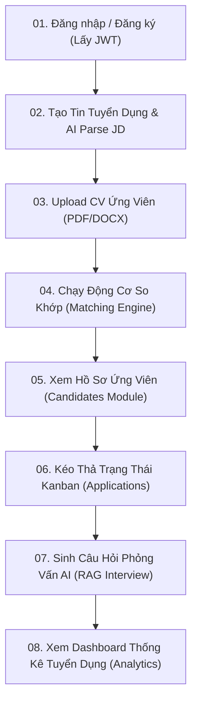

# 🚀 Hướng Dẫn Sử Dụng Swagger UI & Postman Collection v2.1

Tài liệu này cung cấp hướng dẫn toàn diện từ A đến Z để kiểm thử, tích hợp và tương tác với hệ thống API của **Smart HR & Candidate Screening System** thông qua giao diện trực quan **Swagger UI (OpenAPI 3.0)** và công cụ kiểm thử tự động **Postman Collection (v2.1)**.

---

## 📌 Mục Lục
1. [Tổng Quan Hạ Tầng API Documentation](#1-tổng-quan-hạ-tầng-api-documentation)
2. [Hướng Dẫn Sử Dụng Swagger UI](#2-hướng-dẫn-sử-dụng-swagger-ui)
3. [Hướng Dẫn Sử Dụng Postman Collection & Environment](#3-hướng-dẫn-sử-dụng-postman-collection--environment)
4. [Quy Trình Kiểm Thử End-to-End Mẫu Trên Postman](#4-quy-trình-kiểm-thử-end-to-end-mẫu-trên-postman)
5. [Cơ Chế Bắt Token Tự Động (Automated Token Capture)](#5-cơ-chế-bắt-token-tự-động-automated-token-capture)
6. [Lệnh CLI Xuất File & Chạy Automated Test Suite](#6-lệnh-cli-xuất-file--chạy-automated-test-suite)

---

## 1. Tổng Quan Hạ Tầng API Documentation

Hệ thống backend xây dựng trên nền tảng **NestJS v12 + Express** tích hợp trọn vẹn đặc tả **OpenAPI 3.0** (`@nestjs/swagger`) với đầy đủ metadata cho:
- **11 Controllers** nghiệp vụ cốt lõi.
- **36 Tuyến đường API (RESTful Endpoints)** hỗ trợ cả tiền tố hiện đại `/api/v1/*` và backward-compatible `/auth`, `/users`.
- **Cơ chế xác thực**: Chuẩn **JWT Bearer Token** (`Authorization: Bearer <token>`).
- **Phân loại Tags trực quan**:
  - `Authentication`: Đăng ký, đăng nhập, hồ sơ người dùng.
  - `Users`: Quản trị người dùng & phân quyền RBAC.
  - `Jobs`: Quản lý tin tuyển dụng & AI bóc tách tiêu chí JD.
  - `CV & Extraction`: Tải lên hồ sơ CV (PDF/DOCX), OCR & trích xuất thực thể.
  - `Candidate Screening & Matching`: Động cơ chấm điểm đa trụ cột & xếp hạng ứng viên.
  - `Candidates`: Hồ sơ 360° ứng viên, tìm kiếm đa tiêu chí & chuyển trạng thái.
  - `Applications & Kanban`: Quản lý phễu tuyển dụng, kéo thả Kanban [FR-CAND-03].
  - `AI Interview Generation`: Sinh câu hỏi phỏng vấn RAG theo ma trận 4 nhóm [FR-INT-01].
  - `Recruitment Analytics`: Báo cáo số liệu tuyển dụng, phân bố điểm & kỹ năng thiếu hụt [FR-REP-01].

---

## 2. Hướng Dẫn Sử Dụng Swagger UI

### 2.1. Khởi động Backend Server
Tại thư mục gốc dự án hoặc thư mục `backend/`:
```bash
cd backend
npm run start:dev
```
Backend sẽ khởi chạy tại cổng mặc định: `http://localhost:3000`.

### 2.2. Truy cập Giao Diện Swagger UI
Mở trình duyệt web bất kỳ và truy cập đường dẫn:
```
http://localhost:3000/api/docs
```
Để tải về tệp cấu hình OpenAPI JSON thô:
```
http://localhost:3000/api/docs-json
```
*(Tệp tĩnh tương đương cũng được xuất sẵn tại `docs/swagger/swagger.json`)*.

### 2.3. Hướng dẫn Xác Thực JWT (Authorize) trên Swagger UI
1. Nhấn vào nút **Authorize 🔓** màu xanh lá ở góc trên bên phải màn hình Swagger.
2. Một hộp thoại xuất hiện yêu cầu nhập **Value**.
3. Tiến hành gọi API `POST /api/v1/auth/login` (hoặc đăng ký bằng `POST /api/v1/auth/register`), sao chép chuỗi `accessToken` được trả về.
4. Dán trực tiếp chuỗi token vào ô **Value** (Swagger đã cấu hình `type: http, scheme: bearer`, bạn chỉ cần dán chuỗi token thô, không cần gõ thêm chữ `Bearer `).
5. Nhấn **Authorize** rồi nhấn **Close**. Biểu tượng khóa sẽ chuyển thành đã khóa 🔒. Giờ đây bạn có thể gọi tất cả các API được bảo vệ bằng JWT Guard!

---

## 3. Hướng Dẫn Sử Dụng Postman Collection & Environment

Các tệp Postman được lưu trữ tại thư mục `docs/postman/`:
1. `docs/postman/Smart_HR_APIs.postman_collection.json`: Bộ sưu tập 24+ request chia làm 9 thư mục chuẩn nghiệp vụ.
2. `docs/postman/Smart_HR_Environment.postman_environment.json`: Bộ biến môi trường dùng chung (`baseUrl`, `jwtToken`, `jobId`, `candidateId`, `applicationId`, v.v.).

### 3.1. Các Bước Import Vào Postman
1. Mở ứng dụng **Postman**.
2. Nhấn nút **Import** ở góc trên cùng bên trái.
3. Kéo và thả 2 tệp sau vào cửa sổ import:
   - `docs/postman/Smart_HR_APIs.postman_collection.json`
   - `docs/postman/Smart_HR_Environment.postman_environment.json`
4. Ở góc trên bên phải của Postman, mở menu chọn môi trường (Environment Dropdown) và chọn: **Smart HR Local Environment**.

---

## 4. Quy Trình Kiểm Thử End-to-End Mẫu Trên Postman

Bộ sưu tập được đánh số thứ tự từ `01` đến `09` để người kiểm thử có thể thực hiện một kịch bản tuyển dụng hoàn chỉnh:



### Chi Tiết Từng Bước Kiểm Thử:

1. **Bước 1 - Đăng nhập (`01. Authentication & Users -> Login Recruiter`)**:
   - Gửi yêu cầu với body có `email` và `password`.
   - Script tự động trích xuất `accessToken` và lưu vào biến `{{jwtToken}}`.

2. **Bước 2 - Tạo tin tuyển dụng (`03. Jobs Management -> Create Job Posting`)**:
   - Gửi `title`, `department`, `rawJdText`.
   - Hệ thống tự động bóc tách kỹ năng bắt buộc, số năm kinh nghiệm và sinh vector embedding.
   - Sao chép `_id` của Job vào biến môi trường `jobId`.

3. **Bước 3 - Nộp hồ sơ ứng tuyển (`06. Applications & Kanban Workflow -> Submit Application`)**:
   - Gửi đơn ứng tuyển kết nối `candidateId` và `jobId`.
   - Lưu `_id` nhận được vào biến môi trường `applicationId`.

4. **Bước 4 - Chấm điểm sàng lọc (`05. Candidate Screening & Matching -> Screen & Match Candidate with Job`)**:
   - Gửi `candidateId` và `jobId`.
   - Nhận về điểm số tổng hợp (Semantic, Skill, Experience, Education) và lời giải thích XAI.

5. **Bước 5 - Chuyển trạng thái Kanban (`06. Applications & Kanban Workflow -> Kanban Drag & Drop Status Transition`)**:
   - Gọi `PATCH /api/v1/applications/{{applicationId}}/status`.
   - Body:
     ```json
     {
       "status": "SHORTLISTED",
       "reason": "Ứng viên đạt 94% matching, kỹ năng NestJS vượt trội",
       "changedBy": "Trưởng phòng Tuyển dụng"
     }
     ```

6. **Bước 6 - Sinh câu hỏi phỏng vấn RAG (`07. AI Interview Question Generation -> Generate Interview Questions`)**:
   - Gọi `POST /api/v1/interviews/generate` với `applicationId`.
   - Nhận về bộ câu hỏi 4 nhóm (Làm rõ, Kỹ thuật sâu, Lỗ hổng kỹ năng, STAR) kèm bareme chấm điểm 3 mức.

7. **Bước 7 - Kiểm tra Dashboard Thống kê (`08. Recruitment Analytics & Dashboard -> Get Analytics Dashboard`)**:
   - Gọi `GET /api/v1/analytics/dashboard`.
   - Xem số liệu thời gian thực: Tổng hồ sơ, số lượng theo từng vòng phễu, phân bố điểm matching và Top 5 kỹ năng thiếu hụt.

---

## 5. Cơ Chế Bắt Token Tự Động (Automated Token Capture)

Trong Postman Collection, request `POST /api/v1/auth/login` được cài đặt sẵn đoạn mã **Postman Test Script**:

```javascript
// Tự động kiểm tra status code 200/201 và lưu trữ Bearer Token
pm.test("Status code is 200 or 201", function () {
    pm.expect(pm.response.code).to.be.oneOf([200, 201]);
});

var jsonData = pm.response.json();
var token = jsonData.accessToken || (jsonData.data && jsonData.data.accessToken);

if (token) {
    pm.environment.set("jwtToken", token);
    console.log("✅ Đã tự động cập nhật jwtToken vào Environment thành công!");
}
```

Nhờ cơ chế này, bạn chỉ cần bấm **Send** tại request Login một lần duy nhất, toàn bộ 23 request còn lại trong bộ sưu tập (sử dụng Header `Authorization: Bearer {{jwtToken}}`) sẽ tự động được cấp quyền truy cập mà không cần copy/paste thủ công.

---

## 6. Lệnh CLI Xuất File & Chạy Automated Test Suite

### 6.1. Xuất file đặc tả OpenAPI và Postman Collection
Nếu bạn có bất kỳ thay đổi nào trong mã nguồn DTO hoặc Controller:
```bash
# Xuất docs/swagger/swagger.json từ NestJS metadata
npm --prefix backend run swagger:export

# Chuyển đổi và xuất docs/postman/Smart_HR_APIs.postman_collection.json
npm --prefix backend run postman:export
```

### 6.2. Chạy Kiểm Thử Tự Động Swagger & Postman
Để kiểm tra tính toàn vẹn của tệp đặc tả và toàn bộ các endpoint:
```bash
npm --prefix backend run test:swagger
```
*Kết quả xác nhận: **56/56 PASS (100%)**.*

### 6.3. Chạy Toàn Bộ Test Suite Hệ Thống
```bash
# Kiểm thử Jobs Module
npm --prefix backend run test:jobs

# Kiểm thử Candidates Module
npm --prefix backend run test:candidates

# Kiểm thử Applications & Kanban Module
npm --prefix backend run test:applications

# Kiểm thử Analytics Dashboard Module
npm --prefix backend run test:analytics

# Kiểm thử Matching Engine
npm --prefix backend run test:matching

# Kiểm thử AI Interview Generation
npm --prefix backend run test:interview
```
*Tổng kết quả toàn hệ thống: **241/241 Test Cases Đạt 100%**.*
