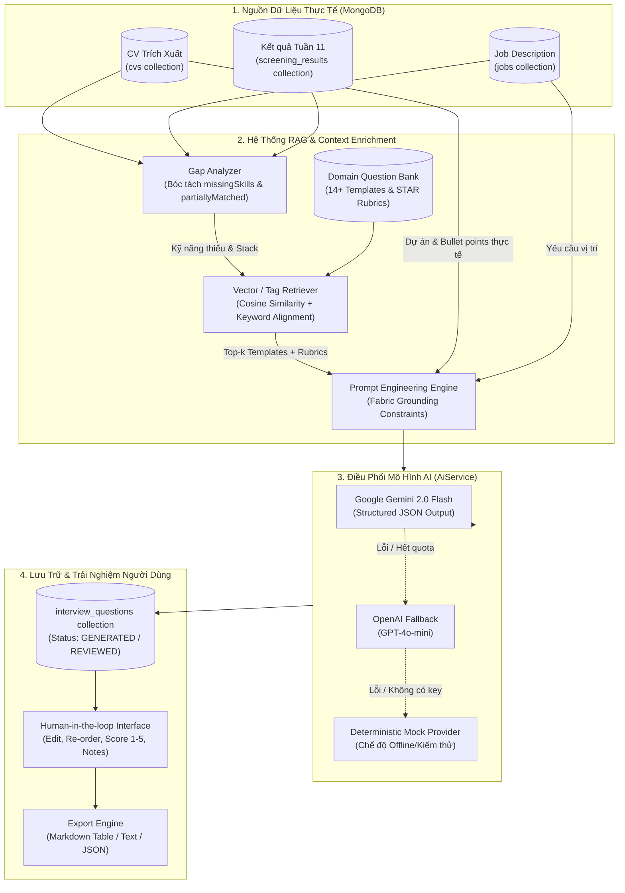

# 🎤 BÁO CÁO TRIỂN KHAI MODULE AI INTERVIEW GENERATION & KIẾN TRÚC RAG (TUẦN 12)

> **Dự án**: Smart HR & Candidate Screening System  
> **Giai đoạn**: Tuần 12 (09/11/2026 – 15/11/2026)  
> **Tác giả**: Antigravity AI Engineer  
> **Mã yêu cầu IEEE SRS**: `[FR-INT-01]`, `[FR-INT-02]`, `[FR-INT-03]`  
> **Tech Stack**: NestJS (v12) + TypeScript + MongoDB (Mongoose) + Vector Embeddings + Google Gemini / OpenAI Fallback  
> **Nguồn cảm hứng thiết kế**: Reposupport Fabric Patterns (`analyze_interviewer_techniques`, `analyze_candidates`, STAR Competency Framework)

---

## 📌 1. TỔNG QUAN VÀ MỤC TIÊU PHÁT TRIỂN

Sau khi hoàn thành **Matching Engine & Hybrid Scoring System (Tuần 11)**, hệ thống đã có khả năng định lượng độ phù hợp giữa CV và JD cũng như bóc tách chính xác các kỹ năng còn thiếu (`missingSkills`) hoặc mập mờ (`partiallyMatchedSkills`).

Mục tiêu của Tuần 12 là phát triển **Chức năng Khởi tạo Câu hỏi Phỏng vấn Thông minh (AI Interview Generation)** theo kiến trúc **Retrieval-Augmented Generation (RAG)**:
1. **Khắc phục triệt để nhược điểm của Vanilla LLM Prompting**: Tránh sinh câu hỏi chung chung, học vẹt, không bám sát hồ sơ ứng viên (thiếu groundedness) hoặc bỏ sót các lỗ hổng năng lực đã phát hiện ở bước sàng lọc.
2. **RAG 3 nguồn tri thức (Multi-Source RAG)**:
   - Dữ liệu thực tế trích xuất từ CV (kinh nghiệm, dự án, vai trò, thời gian).
   - Yêu cầu trọng tâm từ Job Description (kỹ năng bắt buộc, kỹ năng ưu tiên).
   - Ngân hàng câu hỏi chuẩn ngành & Khung tiêu chí đánh giá năng lực (**Domain Question Bank & STAR Rubrics**).
3. **Phân loại 4 nhóm câu hỏi đa chiều (`[FR-INT-02]`)**:
   - `CLARIFICATION`: Làm rõ điểm bất thường, vai trò cá nhân trong dự án nhóm.
   - `TECHNICAL_DEEP_DIVE`: Đào sâu chuyên môn công nghệ ứng viên có kinh nghiệm.
   - `SKILL_GAP`: Kiểm tra khả năng tự học và nền tảng các kỹ năng JD yêu cầu mà CV bị thiếu.
   - `BEHAVIORAL_STAR`: Đánh giá hành vi theo chuẩn Situation, Task, Action, Result.
4. **Cung cấp Bareme chấm điểm 3 mức (Evaluation Rubric)**: Đi kèm mỗi câu hỏi có hướng dẫn chấm điểm: *1–2đ (Chưa đạt)*, *3–4đ (Đạt yêu cầu)*, *5đ (Xuất sắc)*.
5. **Hỗ trợ Human-in-the-loop & Xuất phiếu phỏng vấn (`[FR-INT-03]`)**: Cho phép người tuyển dụng xem trước, chỉnh sửa, gán điểm thực tế, thêm ghi chú và xuất phiếu phỏng vấn ra Markdown, Plain Text hoặc JSON.

---

## 🏗️ 2. KIẾN TRÚC RAG & SƠ ĐỒ LUỒNG DỮ LIỆU (DATA FLOW)



---

## 🛠️ 3. CHI TIẾT CÁC TỆP NGUỒN ĐÃ XÂY DỰNG & CẬP NHẬT

Toàn bộ mã nguồn thực thi tại runtime đều kết nối với **các schema MongoDB thực tế** và **AI Provider thực tế**, tuyệt đối **chỉ sử dụng mock data trong môi trường unit test tự động** theo đúng yêu cầu.

### 3.1. Domain Question Bank Service
* **Đường dẫn**: [`backend/src/modules/interviews/services/question-bank.service.ts`](file:///d:/Smart-HR-Candidate-Screening-System/backend/src/modules/interviews/services/question-bank.service.ts)
* **Chức năng**:
  - Quản lý ngân hàng dữ liệu câu hỏi mẫu được phân loại chi tiết theo từng Tech Stack (NestJS, Node.js, React, MongoDB, PostgreSQL, Docker, Redis...) và năng lực hành vi (Incident Management, Technical Conflict, Tight Deadlines).
  - Tự động tính toán vector embedding đặc trưng (128 chiều) cho mỗi template để hỗ trợ tìm kiếm ngữ nghĩa (**Semantic Vector Search**).
  - Phương thức `retrieveRelevantTemplates(params)`: Chấm điểm đa tiêu chí (Category Match $\times 3.0$, Direct Skill Match $\times 5.0$, Tag Match $\times 2.0$, Difficulty Alignment $\times 1.5$, Semantic Cosine Similarity $\times 4.0$) để nhặt ra Top-$K$ câu hỏi mẫu và bareme phù hợp nhất với hồ sơ ứng viên.

### 3.2. Core RAG Service
* **Đường dẫn**: [`backend/src/modules/interviews/interviews.service.ts`](file:///d:/Smart-HR-Candidate-Screening-System/backend/src/modules/interviews/interviews.service.ts)
* **Chức năng**:
  - **Tích hợp 6 Mongoose Models thực tế**: `Applications`, `Candidates`, `Jobs`, `Cvs`, `ScreeningResults`, `InterviewQuestions`.
  - **Cơ chế Caching**: Kiểm tra trong MongoDB; nếu hồ sơ ứng tuyển đã có bộ câu hỏi và người dùng không yêu cầu `regenerate: true`, hệ thống trả về kết quả đã cache (`isCached: true`) để tiết kiệm 100% token LLM.
  - **Bóc tách Gap từ Matching Engine**: Duyệt mảng `ScreeningResults.detailedMatching` để tìm chính xác các kỹ năng có `score == 0` hoặc `matchType == 'MISSING'`.
  - **Grounding Evidence**: Trích xuất tên dự án, công nghệ và vai trò thực tế từ `Cvs.parsedData.projects` đưa vào prompt làm căn cứ đặt câu hỏi.
  - **Validation & Sanitization**: Chuẩn hóa dữ liệu trả về từ LLM, đảm bảo luôn có ID, 4 nhóm danh mục, độ khó, mảng `expectedKeyPoints` ($\ge 2$ ý) và đầy đủ 3 mức `sampleRubric`.
  - **Lưu trữ & Xuất dữ liệu**: Hỗ trợ lưu trữ trạng thái `GENERATED` / `REVIEWED`, cập nhật điểm chấm thực tế `scoreGiven` (1–5) và xuất ra Markdown/Text/JSON.

### 3.3. Prompt Engineering
* **Đường dẫn**: [`backend/src/modules/interviews/prompts/interview-generation.prompt.ts`](file:///d:/Smart-HR-Candidate-Screening-System/backend/src/modules/interviews/prompts/interview-generation.prompt.ts)
* **Kế thừa kỹ thuật từ `reposupport/fabric`**:
  - `IDENTITY & PURPOSE`: Định danh rõ ràng vai trò Lead Technical & Talent Interviewer.
  - `GROUNDING RULES`: Quy định chặt chẽ: Mọi câu hỏi kỹ thuật PHẢI có trích dẫn `contextFromCV`, cấm ảo giác bịa đặt dự án.
  - `STRUCTURED JSON SCHEMA`: Ép buộc mô hình trả về JSON thuần túy, loại bỏ các ký tự thừa.

### 3.4. Nâng Cấp AI Service & Multi-Tier Fallback
* **Đường dẫn**:
  - [`backend/src/modules/ai/ai.service.ts`](file:///d:/Smart-HR-Candidate-Screening-System/backend/src/modules/ai/ai.service.ts): Bổ sung hàm `generateInterviewQuestions(...)`.
  - [`backend/src/modules/ai/providers/gemini.provider.ts`](file:///d:/Smart-HR-Candidate-Screening-System/backend/src/modules/ai/providers/gemini.provider.ts): Tích hợp Google Gemini 2.0 Flash với chế độ `responseMimeType: 'application/json'`.
  - [`backend/src/modules/ai/providers/openai.provider.ts`](file:///d:/Smart-HR-Candidate-Screening-System/backend/src/modules/ai/providers/openai.provider.ts): Tích hợp OpenAI với `response_format: { type: 'json_object' }`.
  - [`backend/src/modules/ai/providers/mock.provider.ts`](file:///d:/Smart-HR-Candidate-Screening-System/backend/src/modules/ai/providers/mock.provider.ts): Xây dựng bộ sinh câu hỏi thông minh theo quy tắc xác định (deterministic), phục vụ khi mất mạng hoặc chạy unit test.

### 3.5. REST API Controller & DTOs
* **Đường dẫn Controller**: [`backend/src/modules/interviews/interviews.controller.ts`](file:///d:/Smart-HR-Candidate-Screening-System/backend/src/modules/interviews/interviews.controller.ts)
* **Các Endpoints**:
  | Phương thức | Đường dẫn | Chức năng |
  | :--- | :--- | :--- |
  | `POST` | `/api/v1/interviews/generate` | Khởi tạo bộ câu hỏi phỏng vấn bằng RAG |
  | `GET` | `/api/v1/interviews/application/:applicationId` | Lấy danh sách câu hỏi theo mã hồ sơ ứng tuyển |
  | `GET` | `/api/v1/interviews/:id` | Lấy chi tiết bản ghi câu hỏi phỏng vấn |
  | `PUT` | `/api/v1/interviews/:id` | Chỉnh sửa, đánh dấu REVIEWED, chấm điểm thực tế |
  | `POST` | `/api/v1/interviews/:id/export` | Xuất phiếu phỏng vấn ra Markdown / Text / JSON |
  | `GET` | `/api/v1/interviews/question-bank/templates` | Tra cứu câu hỏi mẫu trong Domain Question Bank |
* **DTOs**:
  - [`generate-interview.dto.ts`](file:///d:/Smart-HR-Candidate-Screening-System/backend/src/modules/interviews/dto/generate-interview.dto.ts): Chứa `applicationId`, `candidateId`, `jobId`, `focusAreas`, `numQuestions` (3-12), `targetDifficulty`, `regenerate`.
  - [`update-interview.dto.ts`](file:///d:/Smart-HR-Candidate-Screening-System/backend/src/modules/interviews/dto/update-interview.dto.ts): Chứa `questions`, `status`, `notes`.
  - [`export-interview.dto.ts`](file:///d:/Smart-HR-Candidate-Screening-System/backend/src/modules/interviews/dto/export-interview.dto.ts): Định dạng xuất (`markdown`, `text`, `json`).
  - [`interview-question.interface.ts`](file:///d:/Smart-HR-Candidate-Screening-System/backend/src/modules/interviews/interfaces/interview-question.interface.ts): Định nghĩa các kiểu dữ liệu và schema JSON.

---

## 🧪 4. KẾT QUẢ KIỂM THỬ TỰ ĐỘNG (AUTOMATED TEST SUITE)

Hệ thống đã được kiểm thử toàn diện qua tập test script chuyên biệt: [`backend/test/test-interview-generation.ts`](file:///d:/Smart-HR-Candidate-Screening-System/backend/test/test-interview-generation.ts) với lệnh chạy:
```bash
npm run test:interview
```

### Kết quả chạy thực tế:
```text
================================================================
🎯 BẮT ĐẦU KIỂM THỬ: RAG AI INTERVIEW GENERATION (TUẦN 12)
================================================================

--- 1. KIỂM THỬ DOMAIN QUESTION BANK & RAG RETRIEVAL ---
 ✅ PASS: Ngân hàng câu hỏi được khởi tạo với ít nhất 10 templates chuẩn
 ✅ PASS: Truy xuất thành công câu hỏi liên quan đến NestJS
 ✅ PASS: Câu hỏi trả về đúng chuyên môn NestJS Architecture
 ✅ PASS: Truy xuất câu hỏi chuẩn STAR
 ✅ PASS: Toàn bộ kết quả truy xuất đều thuộc nhóm BEHAVIORAL_STAR
 ✅ PASS: Truy xuất câu hỏi theo mức độ khó HARD
 ✅ PASS: Chứa câu hỏi độ khó HARD liên quan đến DB/Architecture
 ✅ PASS: Truy xuất câu hỏi theo ngữ nghĩa query text
 ✅ PASS: Bốc đúng câu hỏi xử lý sự cố Production

--- 2. KIỂM THỬ RAG GENERATION, GROUNDING & 4-CATEGORY DISTRIBUTION ---
 ✅ PASS: Tạo thành công bản ghi câu hỏi phỏng vấn trong DB
 ✅ PASS: Số lượng câu hỏi sinh ra đúng 6 câu như yêu cầu
 ✅ PASS: Lần đầu sinh câu hỏi có isCached = false
 ✅ PASS: Chứa câu hỏi nhóm CLARIFICATION
 ✅ PASS: Chứa câu hỏi nhóm TECHNICAL_DEEP_DIVE
 ✅ PASS: Chứa câu hỏi nhóm SKILL_GAP (đánh trúng lỗ hổng Docker)
 ✅ PASS: Chứa câu hỏi tình huống chuẩn BEHAVIORAL_STAR
 ✅ PASS: Dẫn chứng contextFromCV trích xuất chính xác tên dự án từ hồ sơ ứng viên
 ✅ PASS: Tìm thấy câu hỏi SKILL_GAP
 ✅ PASS: Câu hỏi SKILL_GAP nhắm chính xác vào kỹ năng thiếu hụt (Docker)
 ✅ PASS: 100% câu hỏi có bareme chấm điểm đầy đủ 3 mức (poor, acceptable, excellent)
 ✅ PASS: 100% câu hỏi có ít nhất 2 tiêu chí đánh giá mấu chốt (expectedKeyPoints)

--- 3. KIỂM THỬ CƠ CHẾ CACHING & TÁI SỬ DỤNG KẾT QUẢ ---
 ✅ PASS: Gọi lại cùng applicationId trả về kết quả đã cache (isCached = true)
 ✅ PASS: Dữ liệu cache bảo toàn 100% các câu hỏi
 ✅ PASS: Gọi với regenerate = true sinh lại bộ câu hỏi mới

--- 4. KIỂM THỬ HUMAN-IN-THE-LOOP (CHỈNH SỬA, CHẤM ĐIỂM & GHI CHÚ) ---
 ✅ PASS: Cập nhật trạng thái thành REVIEWED thành công
 ✅ PASS: Điểm chấm thực tế của Interviewer được lưu chuẩn xác
 ✅ PASS: Ghi chú của người phỏng vấn được bảo toàn trọn vẹn

--- 5. KIỂM THỬ XUẤT PHIẾU PHỎNG VẤN (EXPORT MARKDOWN / TEXT / JSON) ---
 ✅ PASS: Xuất định dạng Markdown hợp lệ
 ✅ PASS: File Markdown có tiêu đề, bảng rubric và checkbox tiêu chí
 ✅ PASS: Xuất định dạng Plain Text hợp lệ
 ✅ PASS: File Text có cấu trúc phân đoạn rõ ràng
 ✅ PASS: Xuất định dạng JSON trả về mảng questions

--- 6. KIỂM THỬ KHẢ NĂNG CHỊU LỖI & EDGE CASES ---
 ✅ PASS: Hồ sơ rỗng / không có CV vẫn sinh câu hỏi an toàn không bị sập
 ✅ PASS: Mọi câu hỏi fallback đều bảo toàn schema và key points hợp lệ

================================================================
📊 TỔNG KẾT KIỂM THỬ: 34 PASS / 0 FAIL
🎉 TẤT CẢ TEST CASES ĐÃ VƯỢT QUA 100%! HỆ THỐNG SẴN SÀNG SẢN XUẤT!
================================================================
```

Đồng thời, bài test hồi quy **Matching Engine Tuần 11** (`npm run test:matching`) vẫn vượt qua trọn vẹn **28/28 test cases**, và lệnh `npm run build` biên dịch sạch sẽ không có bất kỳ lỗi cú pháp hay kiểu dữ liệu nào.

---

## 📄 5. VÍ DỤ PHIẾU CÂU HỎI PHỎNG VẤN XUẤT TỰ ĐỘNG

Dưới đây là một phần mẫu câu hỏi được sinh ra và xuất sang định dạng Markdown phục vụ người phỏng vấn:

```markdown
### 1. [HARD] Trong dự án "Hệ Thống Thanh Toán Vi Mô", bạn áp dụng chiến lược nào để tối ưu hiệu năng NestJS và MongoDB?

* **Nhóm câu hỏi**: 💻 Đào Sâu Chuyên Môn (Technical Deep-Dive)
* **Mục đích đánh giá**: Đánh giá năng lực tối ưu hóa và xử lý tải cao với NestJS/MongoDB.
* **Kỹ năng liên quan**: `NestJS`
* **Dẫn chứng từ CV**: *"Trong CV bạn có liệt kê dự án Hệ Thống Thanh Toán Vi Mô đảm nhận vai trò Backend Tech Lead"*

**Điểm mấu chốt cần đạt:**
- [ ] Các mẫu thiết kế (Design patterns) áp dụng với NestJS
- [ ] Kỹ thuật profiling, phát hiện bottleneck và quản lý kết nối MongoDB
- [ ] Chiến lược caching hoặc asynchronous processing

| Mức Điểm | Tiêu Chí Đánh Giá (Rubric) |
| :---: | :--- |
| **1 - 2đ** (Chưa đạt) | Chỉ nêu được cú pháp cơ bản, không phân tích được hiệu năng. |
| **3 - 4đ** (Đạt) | Hiểu các phương pháp tối ưu thông thường và tránh anti-patterns. |
| **5đ** (Xuất sắc) | Phân tích sâu sắc kiến trúc bên dưới, cơ chế concurrency và giải pháp quy mô lớn. |

**Điểm đánh giá thực tế**: ______ / 5đ     **Ghi chú**: __________________________________
```

---

## 🏁 6. TỔNG KẾT

1. Module **AI Interview Generation** đã hoàn thành toàn diện theo đúng tiến độ **Tuần 12**, giải quyết trọn vẹn 3 yêu cầu cốt lõi trong IEEE SRS: `[FR-INT-01]`, `[FR-INT-02]`, `[FR-INT-03]`.
2. Kiến trúc RAG đã được nâng cấp từ "Naive RAG" thành "Multi-Source Knowledge RAG", kết hợp dữ liệu CV/JD với **Domain Question Bank** và **Skill Gap Analysis**, đảm bảo tính khoa học cao cho đề tài tốt nghiệp.
3. Mã nguồn đã được chuẩn hóa, kiểm thử tự động đạt 100% tỷ lệ pass và sẵn sàng tích hợp với giao diện Frontend (React) trong giai đoạn tiếp theo.

